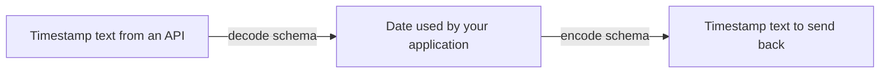

# `@okikio/codec`

An API sends a date as text, but your application wants a `Date` value for date operations. Later it must send text
back. A **codec** keeps those two conversion rules together so callers know how to enter and leave the application's
representation. It checks each direction through the schemas you supply.



Read left to right for the round trip in the demo. The arrows are value conversions, not network requests. This picture
omits invalid-input branches and does not promise that every codec preserves the original text spelling.

For shared terms such as `await` and `await using`, see
[the short glossary](../../docs/learn.md#read-the-small-amount-of-code-you-need).

## Run a complete example

```ts runnable
import * as codec from '@okikio/codec';
import { z } from 'zod';
const InstantCodec = codec.define({
	decode: z.string().datetime().transform((value) => new Date(value)),
	encode: z.date().transform((value) => value.toISOString()),
});
const instant = await codec.decode(InstantCodec, '2026-01-01T00:00:00.000Z');
console.log(await codec.encode(InstantCodec, instant));
```

Expected output:

```text output
2026-01-01T00:00:00.000Z
```

For these schemas, `decode()` returns `Promise<Date>` and `encode()` returns `Promise<string>`. Invalid input rejects
with structured schema issues. The resulting Date is a local application value; no transport, timer or resource is
opened, and the encoded string is the caller-owned wire representation.

The input is `2026-01-01T00:00:00.000Z`. Decoding produces a `Date`; encoding that date produces the printed timestamp.
Try a different valid timestamp to see the conversion use that value. A text value such as `not-a-date` rejects through
the decode schema instead of becoming an unchecked application date.

## Build on the example

- Pair a codec with [HTTP request](../http/request/README.md) parsing when an API field needs an application value. HTTP
  owns the request body; the codec owns that field's conversion.
- Use [Schema](../schema/README.md) directly when you only need to check incoming values. Add a codec when a stored or
  outgoing value also needs a defined reverse conversion.

Use a codec for an HTTP field, queue payload or stored result, then expose it through schema-compatible consumers. Both
directions validate their own output. Round-trip fidelity depends on your transformations: converting an offset
timestamp to Date intentionally normalizes its spelling. A codec does not serialize resources or make arbitrary objects
durable.

[Choose related utilities by outcome](../../docs/outcomes.md). The sections below explain the remaining contracts and
variations. Examples that introduce application-owned clients or schemas are composition sketches; supply those
dependencies before running them.

## Purpose

`@okikio/codec` defines explicit two-way data conversion with one Standard Schema for each direction.

A codec is useful when the runtime value and serialized value are different. Examples include dates, identifiers,
provider records, persistence formats, and wire representations.

The package deliberately uses separate decode and encode schemas. A single invertible schema is not assumed to describe
both directions safely.

## How it fits

`@okikio/schema` supplies the common Standard Schema validation operations. `@okikio/codec` adds bidirectional
composition on top of those operations.

Use `schema` when a value only needs validation or normalization. Use `codec` when callers must also convert the
validated value back to a different external form.

The codec utility does not own transport, persistence, HTTP, or provider behavior.

## Start here

A codec has one validator for decoding external data and another validator for encoding the application value back out.
Zod is convenient for authoring, but any Standard Schema V1 implementation can be used.

```ts
import * as codec from '@okikio/codec';
import { z } from 'zod';

const InstantCodec = codec.define({
	decode: z.string().datetime().transform((value) => new Date(value)),
	encode: z.date().transform((value) => value.toISOString()),
});

const instant = await codec.decode(InstantCodec, '2026-08-21T03:00:00.000Z');
const wire = await codec.encode(InstantCodec, instant);
```

The decode schema owns the external-to-application conversion. The encode schema independently owns the
application-to-external conversion.

## Larger composition

Object, optional, nullable, and array codecs preserve the same rule recursively:

```ts
const UserCodec = codec.object({
	createdAt: InstantCodec,
	deletedAt: codec.optional(codec.nullable(InstantCodec)),
	visits: codec.array(InstantCodec),
});

const user = await codec.decode(UserCodec, stored);
const encoded = await codec.encode(UserCodec, user);
```

Invalid nested input reports its complete property/index path. The utility does not mutate the external input or
application value.

## Progressive usage

Read [complete compositions](../../docs/composition.md) for a bounded CSV import, allowed-page discovery and a
resource-backed operation. Each example names its result and owner. Use [the outcome guide](../../docs/outcomes.md) to
choose additional mechanisms when the application needs them.

## Convenience and the manual equivalent

| Convenience                                   | Manual equivalent                                                                                                                    | Concrete value                                          |
| --------------------------------------------- | ------------------------------------------------------------------------------------------------------------------------------------ | ------------------------------------------------------- |
| `codec.object()`                              | validate every property with its decode schema, prefix issue paths, build the application object, then reverse the process on encode | one bidirectional object contract                       |
| `codec.optional()` / `nullable()` / `array()` | branch around the inner codec and repeat decode/encode validation for each container case                                            | composable wrappers without duplicating schema plumbing |

`@okikio/codec` is a convenience layer, not a hidden runtime. You can reproduce its core mechanics by calling a Standard
Schema validator before and after your own encode/decode functions.

The utility packages those two directions into one immutable contract and keeps validation behavior consistent.

## Validation helper

`assert()` is the strict runtime guard for a codec definition. Use it at an untyped integration seam before storing or
composing a caller-supplied codec. Ordinary typed application code normally calls `decode()` or `encode()` directly.

## Source guide

Start with this README, then use the source in this order when you need more detail:

1. `mod.ts` shows the supported runtime operations and the composition shape.
2. `types.ts`, when present, shows the public value and behavior contracts.
3. `*.test.ts` files show edge cases, cancellation, invalid input, and lifecycle behavior as executable examples.
4. Read internal implementation files only when you need the exact state transition or performance-sensitive loop.

The README is the primary user documentation. It intentionally stays close to the public source instead of maintaining a
separate hand-written API reference.
