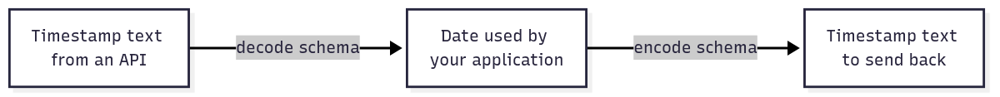

# `@okikio/codec`

An API sends a date as text, but your application wants a `Date` value for date operations. Later it must send text
back. A **codec** keeps those two conversion rules together so callers know how to enter and leave the application's
representation. It checks each direction through the schemas you supply.



[Editable diagram source](diagram.mmd). Read left to right for the round trip in the demo. The arrows are value
conversions, not network requests. This picture omits invalid-input branches and does not promise that every codec
preserves the original text spelling.

The examples explain the common conversion path. The [full API reference](API.md) includes every composition helper.

## Run a complete example

```ts runnable
import * as codec from '@okikio/codec';
import { z } from 'zod';
const InstantCodec = codec.define({
	decode: z.string().datetime().transform((value) => new Date(value)),
	encode: z.date().transform((value) => value.toISOString()),
});
const instant = await codec.decode(InstantCodec, '2026-01-01T00:00:00.000Z');
console.log(await codec.encode(InstantCodec, instant));
```

Expected output:

```text output
2026-01-01T00:00:00.000Z
```

For these schemas, `decode()` returns `Promise<Date>` and `encode()` returns `Promise<string>`. Invalid input rejects
with structured schema issues. The resulting Date is a local application value; no transport, timer or resource is
opened, and the encoded string is the caller-owned wire representation.

The input is `2026-01-01T00:00:00.000Z`. Decoding produces a `Date`; encoding that date produces the printed timestamp.
Try a different valid timestamp to see the conversion use that value. A text value such as `not-a-date` rejects through
the decode schema instead of becoming an unchecked application date.

## Put a converted date into an ordinary API response

The codec gives you a `Date`, so normal JavaScript date methods work. Encode that value when returning JSON. This
example uses a local `Response`; it opens no listener and sends no request.

```ts runnable=response-date.ts
import { decode, define, encode } from '@okikio/codec';
import { z } from 'zod';

const InstantCodec = define({
	decode: z.string().datetime().transform((text) => new Date(text)),
	encode: z.date().transform((date) => date.toISOString()),
});
const joined = await decode(InstantCodec, '2026-01-01T00:00:00.000Z');
const response = Response.json({ joined: await encode(InstantCodec, joined), year: joined.getUTCFullYear() });
console.log(await response.text());
```

```text output
{"joined":"2026-01-01T00:00:00.000Z","year":2026}
```

The important contract is two validators, not a special kind of application object:

| Part                               | Contract for this example                             | Why it is separate                                                                        |
| ---------------------------------- | ----------------------------------------------------- | ----------------------------------------------------------------------------------------- |
| `InstantCodec.decode`              | Standard Schema: timestamp text → `Date`              | Checks and converts incoming data.                                                        |
| `InstantCodec.encode`              | Standard Schema: `Date` → timestamp text              | Checks the value that is about to leave the application.                                  |
| `decode()` / `encode()`            | `Promise<Date>` / `Promise<string>`                   | Both await validation; reported issues reject with `SchemaValidationError`.               |
| `object({ joined: InstantCodec })` | Object → object with each declared property converted | Child issue paths are prefixed with the property name. Undeclared properties are omitted. |

Under the hood, `define()` checks that both schemas implement Standard Schema V1 and freezes the outer definition.
`decode()` calls the decode schema's validator; `encode()` calls the encode schema's validator. Object and array
composition repeat that process for children and collect issues with their paths. Output containers from that
composition are frozen; this does not make every returned payload deeply immutable.

Two directions are deliberate: turning text into a date loses the original timezone spelling. An encoder cannot recover
that spelling just by reversing the decoder. Keep raw text separately if that evidence matters.

## Build on the example

- Pair a codec with [HTTP request](../http/request/README.md) parsing when an API field needs an application value. HTTP
  owns the request body; the codec owns that field's conversion.
- Use [Schema](../schema/README.md) directly when you only need to check incoming values. Add a codec when a stored or
  outgoing value also needs a defined reverse conversion.

## How it fits

`@okikio/schema` supplies the common Standard Schema validation operations. `@okikio/codec` adds bidirectional
composition on top of those operations.

Use `schema` when a value only needs validation or normalization. Use `codec` when callers must also convert the
validated value back to a different external form.

The codec utility does not own transport, persistence, HTTP, or provider behavior.

## Convert a complete stored user record

Object, optional, nullable and array codecs apply the same two directions to larger values. A missing optional field
stays `undefined`; an explicitly nullable field can stay `null`. This stored user has a creation date, no deletion date
and one visit.

```ts runnable=stored-user.ts
import { array, decode, define, encode, nullable, object, optional } from '@okikio/codec';
import { z } from 'zod';

const InstantCodec = define({
	decode: z.string().datetime().transform((text) => new Date(text)),
	encode: z.date().transform((date) => date.toISOString()),
});
const UserCodec = object({
	createdAt: InstantCodec,
	deletedAt: optional(nullable(InstantCodec)),
	visits: array(InstantCodec),
});
const user = await decode(UserCodec, {
	createdAt: '2026-01-01T00:00:00.000Z',
	deletedAt: null,
	visits: ['2026-01-02T00:00:00.000Z'],
});
console.log(user.createdAt.getUTCFullYear(), user.deletedAt);
console.log(JSON.stringify(await encode(UserCodec, user)));
```

```text output
2026 null
{"createdAt":"2026-01-01T00:00:00.000Z","deletedAt":null,"visits":["2026-01-02T00:00:00.000Z"]}
```

Invalid nested input reports its property/index path, such as `['visits', 0]`. The utility creates converted containers
without mutating the external input. The generated outer objects are frozen; nested `Date` values retain normal Date
behavior and ownership.

## Progressive usage

Read [complete compositions](../../docs/composition.md) for a bounded CSV import, allowed-page discovery and a
resource-backed operation. Each example names its result and owner. Use [the outcome guide](../../docs/outcomes.md) to
choose additional mechanisms when the application needs them.

## Convenience and the manual equivalent

| Convenience                                   | Manual equivalent                                                                                                                    | Concrete value                                          |
| --------------------------------------------- | ------------------------------------------------------------------------------------------------------------------------------------ | ------------------------------------------------------- |
| `codec.object()`                              | validate every property with its decode schema, prefix issue paths, build the application object, then reverse the process on encode | one bidirectional object contract                       |
| `codec.optional()` / `nullable()` / `array()` | branch around the inner codec and repeat decode/encode validation for each container case                                            | composable wrappers without duplicating schema plumbing |

`@okikio/codec` is a convenience layer, not a hidden runtime. You can reproduce its core mechanics by calling a Standard
Schema validator before and after your own encode/decode functions.

The utility packages those two directions into one immutable contract and keeps validation behavior consistent.

## Validation helper

`assert()` is the strict runtime guard for a codec definition. Use it at an untyped integration seam before storing or
composing a caller-supplied codec. Ordinary typed application code normally calls `decode()` or `encode()` directly.

## Source guide

Start with this README, then use the source in this order when you need more detail:

1. `mod.ts` shows the supported runtime operations and the composition shape.
2. `types.ts`, when present, shows the public value and behavior contracts.
3. `*.test.ts` files show edge cases, cancellation, invalid input, and lifecycle behavior as executable examples.
4. Read internal implementation files only when you need the exact state transition or performance-sensitive loop.

The [generated API reference](API.md) lists every public function and type. These examples teach the common paths and
the design decisions behind those contracts.
