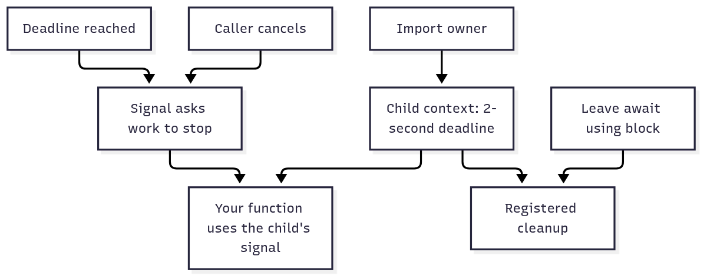

# `@okikio/context`

Give a download a deadline, pass its stop signal to `fetch`, and release its timer when the download finishes. Your code
still calls `fetch`, awaits a `Response`, and returns text. You can use this package without activities, resources,
tasks, or workflows.

A **context** is an object carried alongside that work: an ID, an `AbortSignal`, a clock, and an optional deadline. An
**owned context** also has cleanup methods. It is supporting state for your function, not the function's answer.

## Download text with a two-second budget

Loading a profile needs a name and a city. The caller allows two seconds for the whole operation; each helper also caps
its own download at one second. The helper receives the caller's context, so it cannot restart or extend that overall
budget. This complete example uses real `fetch`; `data:` URLs keep it offline. HTTPS URLs require network permission.

```ts runnable=download-text.ts
import '@okikio/duration/polyfill';
import '@okikio/dispose/polyfill';
import * as context from '@okikio/context';

async function downloadText(parent: context.Context, url: string): Promise<string> {
	await using download = context.timeout(parent, { seconds: 1 });
	const response = await fetch(url, { signal: download.signal });
	if (!response.ok) throw new Error(`Download failed: HTTP ${response.status}`);
	return await response.text();
}

await using request = context.create({
	id: 'profile-screen',
	deadline: Temporal.Now.instant().add({ seconds: 2 }),
});
const name = await downloadText(request, 'data:text/plain,Ada');
const city = await downloadText(request, 'data:text/plain,Toronto');
console.log(`${name} lives in ${city}`);
```

```text output
Ada lives in Toronto
```

There are two different results here. `context.timeout()` returns `download` **immediately**. `fetch()` returns a
`Promise<Response>`. `response.text()` reads the body and returns a `Promise<string>`. The budget remains active during
both the request and body read because both are inside the block.

`await using` means “when this block ends, await this object's cleanup,” including when a call throws. Here it releases
the child's deadline wait and parent listener. The caller closes the parent. Finishing early does not wait out the two
seconds. The setup imports install Temporal and disposal APIs only if the host lacks them; ordinary context imports
install no globals. Replace `Ada` with `Grace` in the first URL: the output becomes `Grace lives in Toronto`.

An HTTP error is handled by the explicit `response.ok` check; a network error or abort rejects the Fetch promise.
Context does not convert every provider's errors into a new result format.

## What `timeout()` builds underneath

The public signature returns an owner, not a Promise for work:

```ts
timeout(parent: Context, duration: Temporal.DurationLike | string): Owned
```

These are selected fields from the real contracts. Optional tracing fields and less-used operations are omitted:

- **`Context` carries the operation.** `id: string` names it; `signal: AbortSignal` asks it to stop; `clock: Clock`
  supplies time; `deadline?: Temporal.Instant` is the optional latest allowed instant.
- **`Clock` supplies time and waiting.** `now(): Temporal.Instant` reads the time.
  `sleep(milliseconds, signal?): Promise<void>` waits using that same time source.
- **`Owned` adds cleanup.** `defer(fn)` registers a callback, `use(value)` registers a disposable value, and
  `adopt(value, disposer)` registers a value with its close function. `[Symbol.asyncDispose]()` starts awaited disposal;
  `closed: Promise<void>` resolves after cleanup and the deadline wait finish.

Read the normal path left to right. The lower branch explains expiry; cleanup belongs to the caller in either case.

```text
timeout(request, { seconds: 2 })
    compute deadline -> create child -> return child immediately
                              |
                              +-> child.signal -> fetch -> read body -> return text
                              |
                              +-> clock sleep -> deadline reached -> abort child.signal

function exits, successfully or with an error
    -> dispose child -> unlink parent + stop deadline wait + run registered cleanup
```

The simplified construction is:

1. Read `parent.clock.now()` and add the requested duration.
2. Choose the earlier of that instant and the parent's deadline. A child cannot extend its parent's budget.
3. Create a new `AbortController` and `AsyncDisposableStack`, inheriting the parent's ID and clock.
4. Link parent cancellation to the child and start a cancellable wait through the inherited clock.
5. When the deadline is observed, abort the child's signal with `ContextDeadlineExceededError`.
6. On disposal, unlink the parent, abort unfinished child work, run registered cleanup in reverse registration order,
   and join the deadline wait before resolving `closed`.

Long deadlines use bounded clock waits and recheck the absolute deadline. The diagram omits those timer slices and
tracing. It does not imply that JavaScript can be forcibly interrupted or that accepted writes are rolled back.

The design keeps the signal passed to `fetch`, the observed deadline, and the cleanup owner together. Separate timers
make it easy for a nested helper to start a fresh budget after its caller's budget is almost exhausted, or leave a timer
alive after success. Deadline inheritance prevents the first mistake; disposal prevents the second.

For one isolated `fetch` that only needs a stop signal, `AbortSignal.timeout(2000)` may be sufficient. Context becomes
useful when calls share identity, a remaining budget, cancellation, or cleanup. The cost is an owner you must close,
plus listener and timer state. Expiry aborts the signal; it does not dispose registered resources by itself.

## Use familiar `try/finally` instead of `await using`

The cleanup syntax can look unfamiliar even when the work is ordinary JavaScript. This complete fragment of the profile
load prints its name and explicitly awaits both owners' disposal:

```ts runnable=download-finally.ts
import '@okikio/duration/polyfill';
import '@okikio/dispose/polyfill';
import * as context from '@okikio/context';

const request = context.create({ id: 'profile-screen', deadline: Temporal.Now.instant().add({ seconds: 2 }) });
try {
	const download = context.timeout(request, { seconds: 2 });
	try {
		const response = await fetch('data:text/plain,Ada', { signal: download.signal });
		if (!response.ok) throw new Error(`Download failed: HTTP ${response.status}`);
		console.log(await response.text());
	} finally {
		await download[Symbol.asyncDispose]();
	}
} finally {
	await request[Symbol.asyncDispose]();
}
```

```text output
Ada
```

`await using` expresses this responsibility more briefly and uses the language's combined-error rules when work and
cleanup both fail. Hand-written `finally` needs its own combined-error policy if retaining both errors matters.

## Share cancellation across two downloads

If a screen already owns a controller, pass its signal into the parent. Both downloads use the same child budget;
`Promise.all` starts the familiar parallel calls. Context does not start or parallelize them.

```ts runnable=two-downloads.ts
import '@okikio/duration/polyfill';
import '@okikio/dispose/polyfill';
import * as context from '@okikio/context';

const screen = new AbortController();
await using request = context.create({ id: 'profile-screen', signal: screen.signal });
await using downloads = context.timeout(request, { seconds: 2 });
async function read(url: string): Promise<string> {
	const response = await fetch(url, { signal: downloads.signal });
	if (!response.ok) throw new Error(`Download failed: HTTP ${response.status}`);
	return await response.text();
}
screen.abort(new Error('The screen was closed.'));
try {
	await Promise.all([read('data:text/plain,Ada'), read('data:text/plain,Toronto')]);
} catch (error) {
	if (error !== screen.signal.reason) throw error;
	console.log('Profile load cancelled');
}
```

```text output
Profile load cancelled
```

The screen closes before its reads start, so both Fetch calls receive an already-aborted child signal. This proves that
cancellation stops new requests, rather than just printing a flag after completed work. In a UI, the same
`screen.abort()` call belongs in its close action. This offline case does not simulate cancellation during an active
network transfer. Disposing a child never aborts its parent. `Promise.all` does not cancel its other input when one
fails; use the bounded concurrency package when you need its sibling-cancellation and joining contract.

## Observe expiry without relying on network timing

`TestClock` moves logical time directly. This exercises the actual deadline check without a slow server or sleep:

```ts runnable=logical-time.ts
import '@okikio/duration/polyfill';
import '@okikio/dispose/polyfill';
import * as context from '@okikio/context';

const clock = new context.TestClock();
await using request = context.create({ id: 'download', clock, deadline: clock.now().add({ seconds: 1 }) });
await using download = context.timeout(request, { seconds: 2 });
clock.advance({ seconds: 1 });
await Promise.resolve();
try {
	await fetch('data:text/plain,Too%20late', { signal: download.signal });
} catch (error) {
	console.log(error instanceof context.ContextDeadlineExceededError);
}
```

```text output
true
```

The parent allows one second; the helper requests two. Advancing one second releases the inherited deadline wait,
showing that the helper cannot extend its caller's budget. The next microtask lets that wait abort the signal before
Fetch starts; Fetch then rejects with the deadline reason. No active network request or machine-time sleep is involved.
`check()` reads the deadline and signal and throws when work must stop. Use it between synchronous chunks.
`wait(ctx,
duration)` checks before and after sleeping through the context's clock. `delay(milliseconds)` is a plain
pause; `remaining(ctx)` reads the budget without starting a timer. None returns your download's answer.

## Add a field without creating another lifetime

A helper may need the user's language alongside its signal. `view()` adds a typed field while sharing the original
cancellation and cleanup responsibility:

```ts runnable=language-view.ts
import '@okikio/duration/polyfill';
import '@okikio/dispose/polyfill';
import * as context from '@okikio/context';

await using request = context.create({ id: 'greeting' });
const localized = context.view(request, { language: 'fr' as const });
function greeting(ctx: context.Context & { readonly language: 'fr' | 'en' }, name: string): string {
	context.check(ctx);
	return ctx.language === 'fr' ? `Bonjour ${name}` : `Hello ${name}`;
}
console.log(greeting(localized, 'Ada'));
```

```text output
Bonjour Ada
```

The helper reads the added language and checks cancellation through the same context. Its return type is
`Base & Readonly<Extension>`: existing fields plus the new fields. The implementation copies and freezes the view,
rejects replacement of existing properties, and records its relationship to the original owner. It creates no
controller, timer, or cleanup stack. Other packages call similar additions a **scope** when they add permissions or
resource access. There is no `context.scope()` export: `child()` creates a lifetime; `view()` adds fields.

## Register cleanup and choose the next capability

Use `defer(() => closeTemporaryFile())` for a supplied cleanup callback, `use(disposable)` for an already disposable
object, or `adopt(value, disposer)` when a value needs a supplied close function. Cancellation requests a stop; disposal
runs cleanup. The application decides which owner closes each resource.

| You need                                                  | Next step                                                                                                                  |
| --------------------------------------------------------- | -------------------------------------------------------------------------------------------------------------------------- |
| Several downloads with limits and joined sibling failures | Pass the context signal into [Concurrency](../concurrency/README.md).                                                      |
| Pause, resume, cancel, and await one live import          | [Task](../task/README.md) returns a control handle and result promise.                                                     |
| Send identity and deadline through a message              | `snapshot()` produces IDs and timestamps; `restore()` creates a new local owner. Signals and resources are not serialized. |
| Resume named work using recorded completions              | [Workflow](../workflow/README.md) owns instruction history; context alone has no restart record.                           |

The illustrated ownership view shows the same parent/child split. Read the branches as responsibilities of the child,
not additional work launched by `timeout()`:



Its [editable source](diagram.mmd) omits timer implementation details. The [generated contracts](API.md) list every
option and field. To trace these calls, read [timeout/child/create](mod.ts), [Context/Owned/Clock](types.ts), and
[the deadline cases](mod.test.ts).
