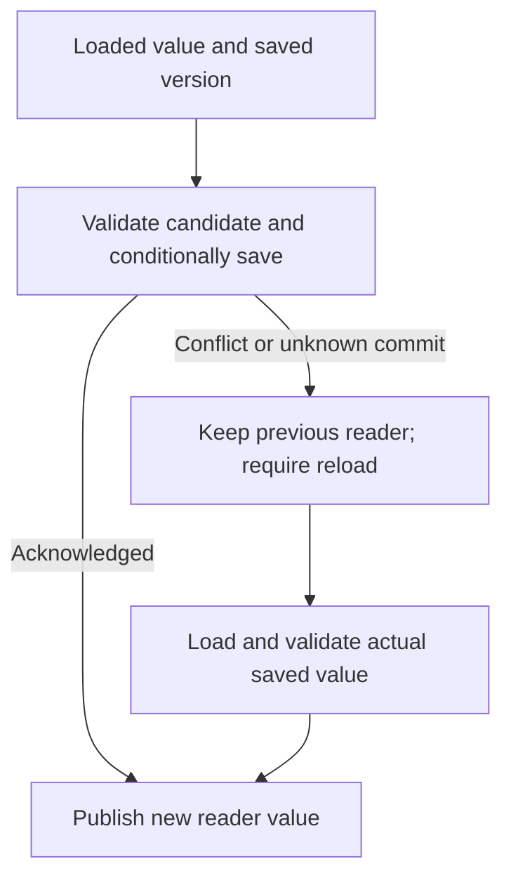

# Context

A download has two waits: one for the response and another for its body. If the caller leaves or runs out of time,
both waits should stop, and anything the download opened should still close. A Context carries the cancellation
signal, deadline, clock and cleanup for related work. Your function still returns the downloaded text.

For Deno, Node, and Bun execution, see [run a portable example](../../docs/05-runtime.md#run-a-portable-example-in-your-own-project). Host-specific adapters keep their native runtime requirements.

An owned context also releases resources registered with `use`, `adopt`, and `defer`. Pass a context to work that should
borrow that lifetime. Create a child when the work needs an independently closable lifetime.

An `AbortSignal` is a notification that work should stop. It only affects operations that read it. A **deadline** is the
latest allowed time; reaching it aborts the signal. **Cleanup** is the separate work of closing a reader, timer or client.
The code that creates the context owns that cleanup and must await it before treating the operation as finished.

## Download with a budget

The child allows two elapsed seconds for both the request and the body read. The `data:` URL supplies real offline
input. Context uses the owned local Temporal and disposal implementations when needed; importing it changes no globals.

From a checkout of this experimental workspace, run `mise trust`, `mise install`, then `mise run prepare -- --kind deps` at the repository root. Save the following program as `download-text.ts` and run `mise exec -- deno run download-text.ts`. These commands use the workspace export maps; they do not assume a published registry version.

```ts runnable=download-text.ts
import * as context from '@okikio/context';
import { sec } from '@okikio/duration';

await using request = context.create({ id: 'profile' });
// The child gets the shorter deadline; disposing it will not cancel the parent request.
await using download = context.timeout(request, sec(2));
// Passing the signal lets the I/O observe cancellation. Creating a context alone cannot stop fetch.
const response = await fetch('data:text/plain,Ada', { signal: download.signal });
if (!response.ok) throw new Error(`Download failed: HTTP ${response.status}`);
const name = await response.text();
console.log(name);
```

```text output
Ada
```

The `id` labels this operation in snapshots and diagnostics. It is not a globally registered owner or an access token.
Reuse an existing request or job ID when you have one. Otherwise choose a useful local label, as this example does.
The default clock is real time; no clock, registry or global polyfill setup is needed for ordinary work.

`timeout()` returns the child immediately. Two events can happen after that, and each has a different job:

| Event | What the download observes | What happens to cleanup |
| --- | --- | --- |
| The deadline arrives while the download is active | The child's signal asks the download to stop. Pass that signal to the I/O so it can respond. | The signal alone does not run the cleanup stack. |
| Execution leaves the `await using` scope | The child ends and its timer is cancelled. The parent request remains open. | The scope waits for the child's registered cleanup. |

Both rules matter on the slow path: the deadline gives a blocked read a way to stop, and leaving the scope gives its
owner a way to join cleanup before returning.

## Choose the operation you need

| Job                               | API                                                      | Lifetime                                                                            |
| --------------------------------- | -------------------------------------------------------- | ----------------------------------------------------------------------------------- |
| Own a request or job              | `create({ id, signal?, clock?, deadline? })`             | Caller disposes the returned owner.                                                 |
| Give nested work a shorter budget | `timeout(parent, sec(2))` or `deadline(parent, instant)` | Child cannot extend its parent's deadline.                                          |
| Attach a typed capability         | `view(ctx, { progress: reader })`                        | Borrows the source lifetime and preserves its existing fields.                      |
| Wait within a budget              | `wait(ctx, min(2))`                                      | Uses the supplied clock and cancellation; long waits use timer slices.              |
| Check remaining time              | `remaining(ctx)`                                         | Returns the exact duration, including nanoseconds. No deadline returns `undefined`. |
| Carry identity across a queue     | `snapshot(ctx)` and `restore(snapshot)`                  | The receiver creates a new local owner and signal.                                  |
| Publish local state               | `createState(value)` or `state.create(value)`            | Cell owns writes and completion; reader borrows observation.                        |
| Publish saved state               | `await state.open({ store, contract, value, initial? })` | Owner saves before publication and joins active I/O when disposed.                  |
| Observe an EventTarget            | `fromEvents(ctx, target, type)` or `events.from(...)`    | Each subscriber owns one listener and borrows the target.                           |

For focused imports, use `@okikio/context/state` and `@okikio/context/events`. Their functions and types are identical
to the root families. Native event targets retain native event types; structural mocks do not require DOM constructors.
Ordinary imports install no globals or timers.

## Publish progress without sharing mutation

The owner keeps the cell. A renderer receives only its `reader`; it can read the latest value or subscribe through the
owned Observables package. The subscription follows the screen signal, so leaving the screen stops that observation
without stopping the work.

Save this complete variation as `observe-state.ts` and run `mise exec -- deno run observe-state.ts` after the same checkout setup.

```ts runnable=observe-state.ts
import * as context from '@okikio/context';

using progress = context.createState({ completed: 0, total: 4 });
const screen = new AbortController();
using subscription = progress.reader.changes.subscribe({
	next: ({ value }) => console.log(`${value.completed}/${value.total}`),
	error: (error) => console.error(error),
}, { signal: screen.signal });
progress.set({ completed: 1, total: 4 });
screen.abort();
progress.set({ completed: 2, total: 4 });
```

```text output
1/4
```

`reader.get()` reads the current value. `reader.changes` emits future changes and completes when the cell closes; it
does not replay old changes. `reader.subscribe(callback, { immediate: true })` also supports an initial callback.
Payloads remain borrowed values. Replace them through `set` or `update`; mutation inside an existing value cannot create
a revision. Use the existing `@okikio/observables` operators when projecting or filtering changes.

Attach this reader with `view(owner, { progress: progress.reader })` when related functions need it. Keep the mutation
cell with its real owner. A local cell retains state in that owner alone. Choose `state.open` when a value must be saved
and reopened through an explicit storage adapter. Queue claims and workflow history continue to use their own stores.

## Save progress and reopen it

A stored cell exposes the same reader, while `set`, `update`, and `reload` return Promises. Register it with the
operation that owns its work. That operation's disposal stops new writes, completes observations, and awaits any active
save. The backing store remains borrowed and keeps its saved value.

Save this complete variation as `reopen-state.ts` and run `mise exec -- deno run reopen-state.ts` after the same checkout setup.

```ts runnable=reopen-state.ts
import * as context from '@okikio/context';
import * as stores from '@okikio/storage/state';
import * as schema from '@okikio/schema';

const store = stores.memory();
const value = schema.object({ completed: schema.number({ integer: true, minimum: 0 }) });
{
	await using operation = context.create({ id: 'catalog' });
	const progress = operation.use(
		await context.state.open({
			store,
			contract: 'catalog.progress.v1',
			value,
			initial: () => ({ completed: 0 }),
			signal: operation.signal,
		}),
	);
	const display = context.view(operation, { progress: progress.reader });
	await progress.update((current) => ({ completed: current.completed + 1 }));
	console.log(display.progress.get().completed);
}
await using reopened = await context.state.open({ store, contract: 'catalog.progress.v1', value });
console.log(reopened.reader.get().completed);
```

```text output
1
1
```

The memory adapter retains one encoded snapshot in the reused store object. It does not survive process restart. The Web
Storage and PostgreSQL adapters select a durable host key explicitly; their concurrency and retention rules are
documented in [Storage state](../storage/state/README.md). A failed write never appears as a successful local update.
Conflicts and uncertain commits require explicit reconciliation with `reload` before another mutation.

That save-before-display order matters when a database accepts a write but the connection drops before returning its
answer. The reader keeps its previously accepted value until the owner reconciles the saved record:



The arrows show publication order, not an automatic retry. `cell.version` identifies a saved envelope; compare it only
for equality. `reader.revision` counts local publications for observers and starts again at zero on a new owner. A new
notification revision therefore does not prove a particular database write succeeded.

## Observe a host event within a lifetime

This example subscribes to a borrowed EventTarget. The same function accepts a native element, Worker, socket, or typed
mock that implements the listener contract.

Save this complete variation as `observe-events.ts` and run `mise exec -- deno run observe-events.ts` after the same checkout setup.

```ts runnable=observe-events.ts
import * as context from '@okikio/context';

const screen = new AbortController();
const target = new EventTarget();
const updates = context.fromEvents({ signal: screen.signal }, target, 'update');
using subscription = updates.subscribe({ next: (event) => console.log(event.type) });
target.dispatchEvent(new Event('update'));
screen.abort();
target.dispatchEvent(new Event('update'));
```

```text output
update
```

The Observable attaches a listener when subscribed. Unsubscription removes that listener; context cancellation removes
it and completes the observation. `once` also removes it before completion, including for a mock that emits while
registering. Observing a socket does not acquire ownership of the socket itself.

Read the [usage guide](../../docs/context/01-guide.md) for ownership, exact time, observer failures, transport, and
cancellation rules, and the [stored-state guide](../../docs/context/03-stored-state.md) for commits, codecs, and
restart. Source contracts are in [types.ts](./types.ts), [state.ts](./state.ts), and [events.ts](./events.ts).

## Choose the owner for each operation

A request, an editor and an import can each use Context for cancellation and cleanup. These are separate lifetimes,
not stages that transfer one live owner. A saved draft can outlive its request; reopening that data creates a new local
view, not a continuation of the old request's cancellation signal or cleanup stack.

Pass a borrowed context into ordinary functions. Create a child for independently closable work. Add Storage only for
saved state and Task only when pause/resume control is required.

Cancellation requests cooperation. It does not roll back a write or prove cleanup completed; await the owner disposal
and the operation result separately.

## Choose an entry point

Use the table to find a focused import for the job you need. Contract links open the exact public source, including its
options and types.

| Import                   | Use it to                                                                        | Exact contract          |
| ------------------------ | -------------------------------------------------------------------------------- | ----------------------- |
| `@okikio/context`        | Use the package entry shown in the complete examples above.                      | [Contract](./mod.ts)    |
| `@okikio/context/testing` | Advance a logical clock within explicit step and microtask budgets. | [Contract](./testing.ts) |
| `@okikio/context/types`  | Import public types for this capability; this entry does not start work.         | [Contract](./types.ts)  |
| `@okikio/context/state`  | Own local or stored state and lend read-only observations.                       | [Contract](./state.ts)  |
| `@okikio/context/events` | Observe a borrowed event target and remove listeners when the subscription ends. | [Contract](./events.ts) |

## Derive a percentage from the same progress

Derived readers retain write authority with their source owner. Dispose the projection when the view closes; it owns its
upstream subscriptions, and closing the borrowed source alone does not dispose the projection.

Save this example as `display-projection.ts` and run `mise exec -- deno run display-projection.ts` after the checkout setup.

```ts runnable=display-projection.ts
import * as state from '@okikio/context/state';

using progress = state.create({ completed: 0, total: 10 });

// The display can read and subscribe to the percentage. Only the progress owner can write.
using percent = state.select(progress.reader, ({ completed, total }) => completed / total);
using display = percent.subscribe(({ value }) => console.log(value));

progress.set({ completed: 5, total: 10 });
```

```text output
0.5
```

`combine([readerA, readerB], project)` observes current values when either source changes. Separate source updates can
produce intermediate combinations; this is not a transaction across cells. Equality follows normal cell options. Initial
selector failure throws before subscribing. If a later reader rejects subscription, the projection releases any earlier
subscriptions it acquired; an error in that release remains visible alongside the registration error. Later selector
or equality failure keeps the last accepted value and is available on `error`; `onError` is isolated. The projection has
no `set` or `update` method. Its payloads remain borrowed.

## Advance a test clock within a finite budget

For deterministic simulations, `@okikio/context/testing` provides `pending(clock)` and
`advanceUntilIdle(clock, { maximumSteps, maximumMicrotasks })`. Both budgets are explicit. The latter advances to the
next sleep target and allows the chosen number of microtask turns between steps. It throws when sleepers remain after
the step budget. Clock-idle means no sleepers were visible after those turns; it does not imply native I/O or arbitrary
application promise chains have completed. Keep and join the application work separately, and cancel it when a
simulation hits its budget.

## Reopen progress after its saved shape changes

The saved progress record originally contains only `completed`. A newer application also needs `total` to derive its percentage. The migration below converts that same record directly and saves the new representation before lending a reader. The explicit `total: 4` is this application's known import size, not a value inferred by Storage.

Save this as `migrate-progress.ts` and run `mise exec -- deno run migrate-progress.ts` after the same setup.

```ts runnable=migrate-progress.ts
import * as schema from '@okikio/schema';
import * as state from '@okikio/context/state';
import * as stores from '@okikio/storage/state';

const store = stores.memory();

// Write the old representation so the conversion starts from actual saved data.
const LegacySchema = schema.object({ completed: schema.number({ integer: true, minimum: 0 }) });
{
	await using old = await state.open({
		store,
		contract: 'catalog.progress.v1',
		value: LegacySchema,
		initial: () => ({ completed: 1 }),
	});
}

// Describe one direct conversion; the new total comes from this application's known import size.
const CurrentSchema = schema.object({
	completed: schema.number({ integer: true, minimum: 0 }),
	total: schema.number({ integer: true, minimum: 1 }),
});
const convert = state.migration('catalog.progress.v1', LegacySchema, ({ completed }) => ({ completed, total: 4 }));

// Opening validates and saves the converted representation before returning a reader.
await using progress = await state.open({
	store,
	contract: 'catalog.progress.v2',
	value: CurrentSchema,
	migrations: [convert],
});

// A projection copies the percentage for display; progress remains the only writer.
using percent = state.select(progress.reader, ({ completed, total }) => completed / total);
console.log(percent.get());
await progress.update((current) => ({ ...current, completed: 2 }));
console.log(percent.get());
```

```text output
0.25
0.5
```

The source owner still controls writes. The projection subscribes to that reader and owns only its subscription. Disposing it does not close the stored cell. This is an in-process composition example; the following race and uncertain-commit rules come from the stored-cell contract, not from this successful run.

The migration validates the old payload through its schema or codec, converts it once, then validates/encodes/decodes
the current representation. It conditionally saves against the exact loaded version before exposing a reader or
replacing its value during `reload`. No match, duplicate old contracts or invalid conversion reject. There is no
inferred version order or automatic migration chain.

Two concurrent conversions can run, but only one conditional save may win in an atomic store. The loser gets
`ConflictError`; conversion is not automatically replayed. Keep conversion free of external effects because an explicit
reopen or reload after a conflict may run it again. Web Storage retains its documented single-writer restriction.
Migration does not grant it cross-tab atomicity.

A lost acknowledgement produces `CommitError` with the candidate version and unknown outcome. Inspect or reopen/reload
the store to reconcile it; do not repeat an external effect or arbitrary updater. A reload conflict or uncertain commit
sets `needsReload`, preserving the last accepted reader value until reconciliation. The envelope version and application
contract are independent from the reader's local notification revision. Existing stores remain borrowed and usable after
a cell closes.

## Measure readers, clocks and progress

The focused benchmarks measure 1–10,000 projections, clock sleepers and observer delivery. The benchmark compares
against manual reader/cell composition; callback versus Observable delivery. Snapshot migration through Storage remains
a root workflow.

From the repository root, run the package's tests and untimed benchmark checks before collecting timings:

```sh
deno task --cwd=packages/context test
deno task --cwd=packages/context bench:check
deno task --cwd=packages/context bench
```

These commands use package-owned fixtures and development dependencies. The
[benchmark protocol](../../docs/benchmarks/01-running.md#choose-a-comparison-that-answers-the-question) explains fair
comparisons, raw report collection and the limits of local measurements.
