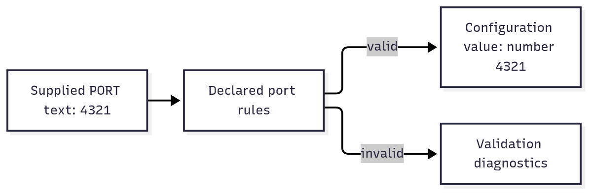

# `@okikio/env`

Your service reads its port from configuration. The value arrives as text, but the listener needs a number, and an
invalid value should be caught before the service starts. `env` keeps the allowed fields, defaults and secret labels in
one definition, then parses the source you explicitly choose.



[Editable diagram source](diagram.mmd). The diagram shows startup configuration checking. The valid branch returns
values for your application to use; it does not open a listener. It omits merging several sources and handling secrets.

The [full API reference](API.md) includes field metadata, source and definition contracts.

## Run a complete example

```ts runnable
import * as env from '@okikio/env/zod';
import { z } from 'zod';
const Service = env.define({
	PORT: z.coerce.number().int().min(1).max(65535).default(8787).describe('TCP port used by the service.'),
});
const values = Service.parseSync(env.record({ PORT: '4321' }));
console.log('Listen on port', values.PORT);
```

Expected output:

```text output
Listen on port 4321
```

`parseSync()` returns the inferred configuration object immediately: here `{ PORT: number }` with PORT `4321`. Invalid
fields throw validation diagnostics before host startup. The record source reads only supplied values, so this example
needs no environment permission and opens no listener.

The demo supplies `{ PORT: '4321' }` without reading your machine's environment. Parsing turns the text into a number
you can pass to a listener. Try an empty record to use the declared default `8787`. A port outside the declared range
fails validation.

## Apply a test override to normal startup configuration

A source is just an object with `get(name)`. Use supplied records first so precedence is visible without access to the
machine's environment. The resulting configuration is a normal object you can pass to existing code.

```ts runnable=startup-config.ts
import { define, merge, record } from '@okikio/env/zod';
import { z } from 'zod';

const Service = define({
	HOST: z.string().default('localhost').describe('Address on which the service listens.'),
	PORT: z.coerce.number().int().min(1).max(65535).default(8787).describe('Port on which the service listens.'),
});
const source = merge(record({ HOST: '127.0.0.1', PORT: '8787' }), record({ PORT: '4321' }));
const config = Service.parseSync(source);
console.log(`http://${config.HOST}:${config.PORT}`);
```

```text output
http://127.0.0.1:4321
```

| Part                | Contract                                                                  | Responsibility                                                                                      |
| ------------------- | ------------------------------------------------------------------------- | --------------------------------------------------------------------------------------------------- |
| Source              | `get(key: string): string \| undefined`                                   | Supplies raw text; an absent value can use a default.                                               |
| `record(values)`    | String/undefined map → source snapshot                                    | Captures your supplied values without reading ambient state.                                        |
| `merge(...sources)` | Sources → source                                                          | Reads from last to first; `undefined` falls through, while an empty string overrides.               |
| Definition          | `parse(source): Promise<typed values>`; `parseSync(source): typed values` | Runs declared validators. Invalid fields throw `EnvironmentError`; async validators need `parse()`. |

Under the hood, the definition retains its named fields and metadata. Parsing asks the selected source for each field,
passes the raw value to that field's validator and collects issues before returning values. The record source snapshots
into a `Map`, so names such as `__proto__` remain ordinary keys.

The split is deliberate: a reusable library can describe its settings without reading your environment at import time.
The executable decides when to parse and which overrides apply. Mark credentials with `secret()` for redacted package
diagnostics; your code still receives the actual credential and must control where it is logged.

## Build on the example

- Parse the listener configuration before starting a [Server](../server/README.md). The executable chooses the source
  and startup time; reusable packages can export definitions without reading ambient state.
- Combine [Resource](../resource/README.md) requirements with environment definitions when a database or API client
  needs credentials. Mark secret fields explicitly and let the provider own its live connection.

## How it fits

Concrete packages define the environment fields they need. An executable host selects raw sources and parses those
definitions during startup. Importing a definition never reads ambient process state.

Metadata can produce an operator's configuration checklist. `secret()` keeps the credential value out of that generated
template, so the same definitions used for startup checks can also produce safe deployment instructions:

```ts
import * as env from '@okikio/env/zod';
import { z } from 'zod';

const ServiceEnvironment = env.define({
	PORT: z.coerce.number().int().positive().default(8787).describe('TCP port used by the service.').meta({
		title: 'HTTP port',
		description: 'Port used by the service listener.',
		examples: ['8787'],
	}),
	DATABASE_URL: env.secret(
		z.string().min(1).describe('PostgreSQL connection string.'),
	),
});

console.log(env.example(ServiceEnvironment));
```

The definition is import-safe. Creating it does not read ambient state, connect to a provider, or configure a process.
The service entrypoint owns the source and decides when startup validation occurs.

Field collections are ordinary records. Use an object literal or a null-prototype record with own enumerable string
properties. `env.environment()` snapshots that record into a frozen null-prototype object so keys such as `__proto__`
and `constructor` stay ordinary environment keys. It rejects class instances, hidden properties, accessors, and symbol
keys rather than silently dropping data that the TypeScript field type claimed was present.

## Public vocabulary

Import the package as a namespace so the verbs stay short without becoming ambiguous:

```text
env.define(...)       create a definition
env.environment(...)  equivalent concise authoring form
env.compose(...)      combine definitions through canonical field identity

env.env               lazy Deno/Node ambient source
env.record(...)       capture deterministic raw values
env.merge(...)        combine sparse sources by precedence
env.select(...)       read a bounded raw record without defining schemas
env.isSource(...)     detect an existing pull-based environment source

env.variable(...)     classify an ordinary host variable
env.secret(...)       classify protected secret material

env.manifest(...)     project deployment metadata
env.example(...)      generate a safe .env.example
env.requirement(...)  explain why a resource selects canonical fields
env.requirementReport(...) project selected requirements without exposing secret values
```

`compose` combines definitions. `merge` combines sources. The different verbs make the two halves visible at the call
site.

`isSource()` is mainly for adapters that accept either an existing source or a raw record. `requirementReport()` is
useful at deployment and startup checks when an operator needs to see which canonical keys are required and why without
printing the corresponding secret values.

## Author metadata with your validator

### Zod

Bare Zod schemas become ordinary variables. The adapter reads metadata through Zod 4's public `.meta()` and
`.describe()` APIs:

```ts
import * as env from '@okikio/env/zod';
import { z } from 'zod';

const ServiceEnvironment = env.define({
	LOG_LEVEL: z.enum(['debug', 'info', 'warning', 'error']).default('info').meta({
		title: 'Log level',
		description: 'Minimum diagnostic severity emitted by the service.',
		examples: ['info'],
	}),
});
console.log(ServiceEnvironment.parseSync({}).LOG_LEVEL); // info
```

Secret classification remains explicit because secrecy is a deployment rule, not a validation property:

```ts
import * as env from '@okikio/env/zod';
import { z } from 'zod';

const ServiceEnvironment = env.define({
	API_TOKEN: env.secret(
		z.string().min(1).describe('Token used to call the provider API.'),
	),
});
console.log(env.example(ServiceEnvironment)); // API_TOKEN=<secret>, with its description
```

### Valibot

```ts
import * as env from '@okikio/env/valibot';
import * as v from 'valibot';

const PortSchema = v.pipe(
	v.string(),
	v.title('HTTP port'),
	v.description('Port used by the service listener.'),
	v.examples(['8787']),
);

const ServiceEnvironment = env.define({ PORT: PortSchema });
console.log(ServiceEnvironment.parseSync({ PORT: '8787' }).PORT); // '8787': this schema keeps text
```

The adapter uses Valibot's public `getTitle`, `getDescription`, `getMetadata`, and `getExamples` functions. The original
Valibot schema remains the runtime validator and the source of inferred output types.

### Generic Standard Schema

Standard Schema defines validation interoperability but does not define a shared metadata protocol. Generic callers
therefore provide environment metadata explicitly:

```ts
import * as env from '@okikio/env/standard';
import { z } from 'zod';

const PortSchema = z.coerce.number().int().min(1).max(65535);
const ServiceEnvironment = env.define({
	PORT: env.variable(PortSchema, {
		description: 'Port used by the service listener.',
		example: '8787',
	}),
});
console.log(ServiceEnvironment.parseSync({ PORT: '8787' }).PORT); // 8787, a number
```

The generic entrypoint never inspects private Zod or Valibot properties.

## Metadata ownership and precedence

Schema metadata should describe the value itself:

```text
title
description
examples
deprecated
```

Environment metadata describes the deployment binding:

```text
variable or secret classification
documentation URL
deployment availability
replacement key
```

Explicit metadata passed to `env.variable()` or `env.secret()` overrides schema metadata. This lets one reusable schema
carry a general description while a service gives the binding a more specific operational meaning.

Secrets never project examples, including examples attached to the schema.

## Raw-source ownership

`@okikio/env` consumes raw environment records. It does not discover `.env` files, read a filesystem, or choose which
runtime source has precedence. That decision belongs to the executable host.

At the executable root, pass `env.env` to read only the declared keys from the runtime. You can also supply
`process.env` in Node or `Deno.env.toObject()` in Deno when an existing host already owns a complete raw snapshot.

A browser-like host can pass deployment bindings. A test can pass a literal record. If a CLI chooses to parse dotenv
syntax, the parser remains CLI/runtime composition and its result is still just `Record<string, string | undefined>`.

## Source-only usage

Not every value needs an environment definition. A deployment adapter may need only a few opaque strings:

```ts
import * as env from '@okikio/env';

const values = env.select(
	env.merge({ RELEASE_ID: 'stable', REGION: 'us-east' }, { RELEASE_ID: 'preview' }),
	['RELEASE_ID', 'REGION'],
);
console.log(JSON.stringify(values)); // {"RELEASE_ID":"preview","REGION":"us-east"}
```

This path has no Zod or Valibot dependency.

## Canonical field identity

Composition permits the same field object to arrive through several imported definitions:

```ts
import * as env from '@okikio/env/zod';
import { z } from 'zod';

const DatabaseUrl = env.secret(
	z.string().min(1).describe('PostgreSQL connection string.'),
);

const DatabaseEnvironment = env.define({ DATABASE_URL: DatabaseUrl });
const WorkerEnvironment = env.define({ DATABASE_URL: DatabaseUrl });

const HostEnvironment = env.compose(DatabaseEnvironment, WorkerEnvironment);
console.log(env.manifest(HostEnvironment).secrets.map((field) => field.key)); // ['DATABASE_URL'], once
```

Independently declaring another field under `DATABASE_URL` is rejected. Silently choosing one declaration would lose
validation or deployment metadata.

Bare Zod and Valibot schemas are canonicalized by schema-object identity, so reusing the same schema object in several
definitions composes safely.

## Runtime behavior

- `env.env` is lazy and performs no read during import.
- Deno reads remain per-key so hosts can grant narrow environment permissions.
- Node access reads ambient `process.env` without static `node:` imports in browser-compatible graphs.
- `env.record()` snapshots values through `Map`, so prototype-shaped external keys remain ordinary data.
- `env.merge()` is sparse: `undefined` falls through to a lower-precedence source.
- Definitions collect all schema issues before throwing `EnvironmentError`; its message lists each field while `.issues`
  preserves structured failures.
- `parseSync()` rejects schemas that validate asynchronously and directs callers to `parse()`.

## Progressive usage

Read [complete compositions](../../docs/composition.md) for a bounded CSV import, allowed-page discovery and a
resource-backed operation. Each example names its result and owner. Use [the outcome guide](../../docs/outcomes.md) to
choose additional mechanisms when the application needs them.

## Convenience and the manual equivalent

| Convenience                          | Manual equivalent                                                                       | Concrete value                                                                  |
| ------------------------------------ | --------------------------------------------------------------------------------------- | ------------------------------------------------------------------------------- |
| `env.environment()`                  | validate field definitions, snapshot the field map, parse raw strings and prefix issues | one schema-derived environment contract                                         |
| `env.merge()` / `env.select()`       | copy raw source records in precedence order or pick exact keys manually                 | source acquisition stays outside the utility while composition is deterministic |
| `definition.parse()` / `parseSync()` | resolve the definition and throw one structured report for missing/invalid fields       | typed startup failure instead of scattered `Deno.env.get()` checks              |

`@okikio/env` is a convenience layer, not a hidden runtime. You can reproduce its core mechanics by passing a
`Record<string, string | undefined>` into Zod, Valibot, or another Standard Schema.

The utility adds canonical field identity, source composition, secret classification, manifests, examples, and
requirement metadata. It deliberately does not discover files or load dotenv documents.

## Source guide

Start with this README, then use the source in this order when you need more detail:

1. `mod.ts` shows the supported runtime operations and the composition shape.
2. `types.ts`, when present, shows the public value and behavior contracts.
3. `*.test.ts` files show edge cases, cancellation, invalid input, and lifecycle behavior as executable examples.
4. Read internal implementation files only when you need the exact state transition or performance-sensitive loop.

The [generated API reference](API.md) lists every public function and type. These examples teach the common paths and
the design decisions behind those contracts.
