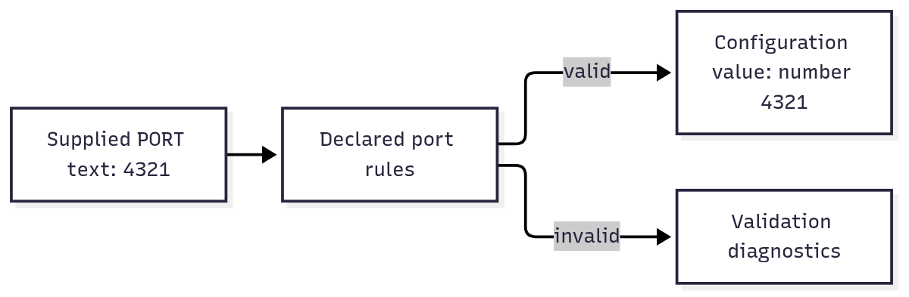

# `@okikio/env`

Your service reads its port from configuration. The value arrives as text, but the listener needs a number, and an
invalid value should be caught before the service starts. `env` keeps the allowed fields, defaults and secret labels in
one definition, then parses the source you explicitly choose.

For Deno, Node, and Bun execution, see [run a portable example](../../docs/05-runtime.md#run-a-portable-example-in-your-own-project). Host-specific adapters keep their native runtime requirements.



[Editable diagram source](./diagram.mmd). The diagram shows startup configuration checking. The valid branch returns
values for your application to use; it does not open a listener. It omits merging several sources and handling secrets.

The [public source contracts](./mod.ts) includes field metadata, source and definition contracts.

An environment variable is a named value supplied when a program starts, usually as text. A **source** answers where a
value comes from, such as a supplied object or the host environment. A **definition** says which values are allowed.
Separating them lets a test supply `PORT` without changing the machine, while production uses the same validation rule.
Parsing configuration does not start the configured service.

## Convert port text into a checked startup value

Supply port text explicitly and parse it before service startup. The definition owns the conversion and allowed range;
the application retains the choice of configuration source and when to open its listener.

From a checkout of this experimental workspace, run `mise trust`, `mise install`, then `mise run prepare -- --kind deps` at the repository root. Save the following program as `example.ts` and run `mise exec -- deno run example.ts`. These commands use the workspace export maps; they do not assume a published registry version.

```ts runnable
import * as env from '@okikio/env';
import * as schema from '@okikio/schema';
// Define validation once. Parsing reads only the explicit source supplied below.
const Service = env.define({
	PORT: env.variable(
		schema.defaults(schema.coerce.number({ integer: true, minimum: 1, maximum: 65535 }), () => 8787),
		{ description: 'TCP port used by the service.' },
	),
});
// The source contains text; the schema converts and checks it before application use.
const values = Service.parseSync(env.record({ PORT: '4321' }));
console.log('Listen on port', values.PORT);
```

Expected output:

```text output
Listen on port 4321
```

`parseSync()` returns the inferred configuration object immediately: here `{ PORT: number }` with PORT `4321`. Invalid
fields throw validation diagnostics before host startup. The record source reads only supplied values, so this example
needs no environment permission and opens no listener.

The demo supplies `{ PORT: '4321' }` without reading your machine's environment. Parsing turns the text into a number
you can pass to a listener. Try an empty record to use the declared default `8787`. A port outside the declared range
fails validation.

## Apply a test override to normal startup configuration

A source is just an object with `get(name)`. Use supplied records first so precedence is visible without access to the
machine's environment. The resulting configuration is a normal object you can pass to existing code.

Save this complete variation as `startup-config.ts` and run `mise exec -- deno run startup-config.ts` after the same checkout setup.

```ts runnable=startup-config.ts
import { define, merge, record, variable } from '@okikio/env';
import * as schema from '@okikio/schema';

const Service = define({
	HOST: variable(schema.defaults(schema.string(), () => 'localhost'), {
		description: 'Address on which the service listens.',
	}),
	PORT: variable(
		schema.defaults(schema.coerce.number({ integer: true, minimum: 1, maximum: 65535 }), () => 8787),
		{ description: 'Port on which the service listens.' },
	),
});
const source = merge(record({ HOST: '127.0.0.1', PORT: '8787' }), record({ PORT: '4321' }));
const config = Service.parseSync(source);
console.log(`http://${config.HOST}:${config.PORT}`);
```

```text output
http://127.0.0.1:4321
```

| Part                | Contract                                                                  | Responsibility                                                                                      |
| ------------------- | ------------------------------------------------------------------------- | --------------------------------------------------------------------------------------------------- |
| Source              | `get(key: string): string \| undefined`                                   | Supplies raw text; an absent value can use a default.                                               |
| `record(values)`    | String/undefined map → source snapshot                                    | Captures your supplied values without reading ambient state.                                        |
| `merge(...sources)` | Sources → source                                                          | Reads from last to first; `undefined` falls through, while an empty string overrides.               |
| Definition          | `parse(source): Promise<typed values>`; `parseSync(source): typed values` | Runs declared validators. Invalid fields throw `EnvironmentError`; async validators need `parse()`. |

Under the hood, the definition retains its named fields and metadata. Parsing asks the selected source for each field,
passes the raw value to that field's validator and collects issues before returning values. The record source snapshots
into a `Map`, so names such as `__proto__` remain ordinary keys.

The split is deliberate: a reusable library can describe its settings without reading your environment at import time.
The executable decides when to parse and which overrides apply. Mark credentials with `secret()` for redacted package
diagnostics; your code still receives the actual credential and must control where it is logged.

## Check settings before starting a server or client

- Parse the listener configuration before starting a [Server](../server/README.md). The executable chooses the source
  and startup time; reusable packages can export definitions without reading ambient state.
- Combine [Resource](../capability/resource/README.md) requirements with environment definitions when a database or API
  client needs credentials. Mark secret fields explicitly and let the provider own its live connection.

## Validate settings before starting clients

A service port, a worker concurrency limit, and a CLI credential all start as external text. Declare their validation
and choose the source at startup.

Use the Standard Schema entry when validator interoperability matters; choose a validator-specific adapter only when its
authoring behavior is needed.

Validate before opening clients or listeners. Mark secrets through the environment contract and keep actual credential
values out of documentation, telemetry, and committed fixtures.

## Choose an entry point

Use the table to find a focused import for the job you need. Contract links open the exact public source, including its
options and types.

| Import                 | Use it to                                                                | Exact contract            |
| ---------------------- | ------------------------------------------------------------------------ | ------------------------- |
| `@okikio/env/resolve` | Resolve explicit named sources and inspect key-only provenance. | [Contract](./resolve.ts) |
| `@okikio/env`          | Use the package entry shown in the complete examples above.              | [Contract](./mod.ts)      |
| `@okikio/env/standard` | Define and read environment fields using Standard Schema validators.     | [Contract](./standard.ts) |
| `@okikio/env/valibot`  | Use the Valibot-specific environment authoring adapter.                  | [Contract](./valibot.ts)  |
| `@okikio/env/zod`      | Use the Zod-specific environment authoring adapter.                      | [Contract](./zod.ts)      |
| `@okikio/env/types`    | Import public types for this capability; this entry does not start work. | [Contract](./types.ts)    |

## Resolve once and retain key-only provenance

Supply explicit named records so both the selected port and its origin can be inspected without reading your machine's environment. This standalone variation continues the same port definition. The limits bound keys and sources that resolution may inspect; they do not make a foreign validator interruptible.

Save this complete variation as `port-provenance.ts` and run `mise exec -- deno run port-provenance.ts` after the same checkout setup.

```ts runnable=port-provenance.ts
import * as env from '@okikio/env';
import * as schema from '@okikio/schema';
import { inspect, resolve } from '@okikio/env/resolve';
// Define validation once. Parsing reads only the explicit source supplied below.
const Service = env.define({
	PORT: env.variable(schema.coerce.number({ integer: true, minimum: 1, maximum: 65535 }), {
		description: 'TCP port used by the service.',
	}),
});
const sources = [
	{ name: 'deployment', source: { PORT: '8787' } },
	{ name: 'test', source: { PORT: '4321', PORRT: '9000' } },
];
const limits = { maximumKeys: 4, maximumSources: 2 };
const resolved = await resolve(Service, sources, limits);
console.log(resolved.values.PORT, resolved.provenance[0]?.source);
const report = await inspect(Service, sources, { ...limits, unknownKeys: 'reject' });
console.log(report.valid, JSON.stringify(report.unknown));
```

```text output
4321 test
false ["PORRT"]
```

The later source wins for `PORT`; the misspelled extra key is visible without printing its value. `resolve` validates declared settings, while `inspect` can additionally reject unknown source keys. Correct `PORRT` before starting a listener. Neither function opens that listener. Keep credentials out of application logs even though provenance itself contains no values.

Import `resolve` and `inspect` from `@okikio/env/resolve`. Supply named sources in lowest-to-highest precedence order
and explicit `{ maximumKeys, maximumSources }`. Each declared key is read once per source. Undefined allows a lower
source to win; blank strings remain concrete inputs for the validator's existing blank/default policy. Resolved values
may contain secrets; provenance contains only keys, source names/indexes, shadowed indexes and deprecation metadata.
Source names must be safe labels.

A missing raw value is marked `selected: 'schema'`; the utility does not guess whether an opaque schema applied a
default or coercion. A read failure throws `EnvironmentSourceError` with key/source index and no possibly secret-bearing
cause. It is distinct from missing configuration.

`inspect(..., { maximumKeys, maximumSources, unknownKeys: 'report' | 'reject' })` returns validation categories and
key-only diagnostics without values or vendor messages. Get-only sources need explicit `keys` inventories for complete
unknown-key detection. Report mode marks incomplete inventory; reject mode refuses an incomplete inventory. Existing
Zod/Valibot/Standard Schema definitions retain their normal parsing owner.

## Measure parsing and source resolution

The focused benchmarks measure typed field parsing and validated two-source provenance. The benchmark compares against
direct Zod parsing. Direct parsing omits source diagnostics and provenance.

From the repository root, run the package's tests and untimed benchmark checks before collecting timings:

```sh
deno task --cwd=packages/env test
deno task --cwd=packages/env bench:check
deno task --cwd=packages/env bench
```

These commands use package-owned fixtures and development dependencies. The
[benchmark protocol](../../docs/benchmarks/01-running.md#choose-a-comparison-that-answers-the-question) explains fair
comparisons, raw report collection and the limits of local measurements.

## Read further

The [Env guide](https://github.com/okikio/utils/blob/main/docs/env.md) explains the model, manual alternatives, and
composition.
