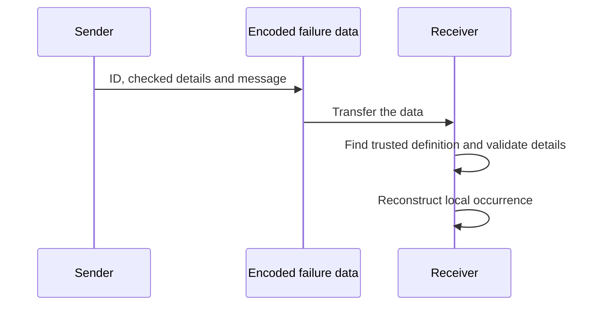

# `@okikio/failure`

An asset lookup can legitimately find no asset. Callers need to recognize “missing asset” even if its explanatory
sentence changes or the answer arrives from another process. `failure` defines that expected reason with a stable ID and
checked details, then creates individual occurrences of it.



The demo encodes and decodes locally to show these steps. The transfer is something your application supplies; this
package performs no network or storage I/O. Local JavaScript causes do not cross the encoded boundary.

For shared terms such as `await` and `await using`, see
[the short glossary](../../docs/learn.md#read-the-small-amount-of-code-you-need).

## Run a complete example

```ts runnable
import * as failure from '@okikio/failure';
import { z } from 'zod';
const Missing = failure.define({
	id: 'asset.missing',
	description: 'The requested asset does not exist.',
	data: z.object({ id: z.string() }),
});
const occurrence = await failure.create(Missing, { data: { id: 'asset-1' } });
const wire = await failure.encode(occurrence);
const restored = await failure.decode(wire, [Missing]);
console.log(restored.definition === Missing, restored.data.id);
```

Expected output:

```text output
true asset-1
```

The demo creates a missing-asset occurrence for `asset-1`, then reconstructs it using the trusted `Missing` definition.
The output means the reconstructed occurrence uses that exact definition and keeps the asset ID. Change the asset ID in
the input to change the retained details. An unknown failure ID cannot invent a new trusted definition at decode.

## Build on the example

- Wrap an expected occurrence in [Result](../result/README.md) so a caller handles success and missing asset explicitly.
  Result chooses the branch; Failure gives the reason its stable meaning.
- Present that reason through a declared [HTTP problem](../http/problem/README.md) at an API boundary. Keep internal
  causes and secrets out of public responses and encoded failure data.

Use failures for expected domain outcomes such as missing input or a declined request. Encode at a transport boundary
and decode against trusted definitions on the receiving side. Unknown identities reject instead of manufacturing
authority from input. Unexpected exceptions belong to fault diagnostics; HTTP presentation belongs to problem
definitions. Do not put secrets in durable failure data.

[Choose related utilities by outcome](../../docs/outcomes.md). The sections below explain the remaining contracts and
variations. Examples that introduce application-owned clients or schemas are composition sketches; supply those
dependencies before running them.

## Purpose

`@okikio/failure` defines expected reasons that an operation cannot complete as intended.

A failure definition has a stable ID, a description, and a Standard Schema for its durable data. A runtime occurrence
keeps the exact definition, validated data, a message, and an optional in-process cause.

Definitions and occurrences freeze their own outer objects, but validated failure `data` is owned by its
schema/producer. The utility does not recursively freeze arbitrary schema output. `encode()` revalidates that data
before transport instead of treating outer `Object.freeze()` as a durability guarantee.

## Start here

```ts
import * as failure from '@okikio/failure';
import { z } from 'zod';

const MissingFile = failure.define({
	id: 'file.missing',
	description: 'The requested file does not exist.',
	data: z.object({ path: z.string() }),
});

const occurrence = await failure.create(MissingFile, {
	data: { path: '/tmp/input.csv' },
});

const encoded = await failure.encode(occurrence);
```

Only `id`, validated durable data, and the message cross the encoded seam. The local JavaScript `cause` is intentionally
not serialized.

## Encode and reconstruct a durable occurrence

```ts
const Failures = failure.catalog('imports', { InvalidFile });
const occurrence = await failure.create(InvalidFile, {
	data: { reason: 'missing-header' },
});

const encoded = await failure.encode(occurrence);
const restored = await failure.decode(encoded, Failures);
```

Encoding deliberately omits process-local causes. Decoding resolves the stable failure ID through a trusted catalog and
validates the durable data again.

## How it fits

Failure is not the same concept as `result` or an HTTP problem.

- `@okikio/result` is a success-or-failure container.
- `@okikio/failure` gives expected failures stable identity and durable data.
- `@okikio/http/problem` describes an RFC 9457 HTTP representation.

A queue or Worker can encode a failure occurrence and decode it through a trusted failure catalog. An HTTP service can
map the same failure to a declared HTTP problem without adding HTTP fields to the failure definition.

## Durable data

`failure.encode()` validates the data again before serialization. The encoded form contains only the stable failure ID,
durable data, and message.

The JavaScript `cause` stays local. Provider errors, sockets, request objects, and other non-durable values must not
enter the encoded form.

`decode()` also treats the encoded envelope as data, not behavior. The envelope must be a plain object or null-prototype
record with own enumerable data properties. Accessor-backed fields are rejected without invoking their getters. The
nested `data` value is then validated by the trusted failure definition's Standard Schema.

## Progressive usage

Read [complete compositions](../../docs/composition.md) for a bounded CSV import, allowed-page discovery and a
resource-backed operation. Each example names its result and owner. Use [the outcome guide](../../docs/outcomes.md) to
choose additional mechanisms when the application needs them.

## Convenience and the manual equivalent

| Convenience                              | Manual equivalent                                                                                                                      | Concrete value                                               |
| ---------------------------------------- | -------------------------------------------------------------------------------------------------------------------------------------- | ------------------------------------------------------------ |
| `failure.define()` + occurrence creation | freeze failure identity, validate structured data, and retain nominal package-created occurrence identity                              | declared failures stay distinguishable from arbitrary errors |
| `encode()` / `decode()`                  | copy stable id/message/data into a cloneable envelope, validate descriptors, then resolve the current definition before reconstruction | safe durable transport without serializing Error instances   |
| `failure.match()`                        | write repeated ID checks and casts for every declared failure branch                                                                   | exhaustive typed failure handling                            |

`@okikio/failure` is a convenience layer, not a hidden runtime. You can reproduce its core mechanics with a tagged
immutable record plus a map from IDs to definitions.

The utility adds schema validation, trusted catalog decoding, matching, and stable encoded failure transport.

## Composition and decoding helpers

- `failure.catalog()`, `select()`, and `compose()` build exact imported failure universes.
- `isOccurrence()` checks that an unknown `Error` was actually created by this module instance; a lookalike object with
  `definition` and `data` fields is not accepted.
- `isEncoded()` checks the inert durable envelope shape without invoking accessor-backed fields. Use it at generic
  transport seams that do not yet have the trusted catalog required for `decode()`.
- `match()` dispatches one occurrence to handlers keyed by exact failure definitions.
- `UnknownFailureDefinitionError` reports durable encoded failure data whose ID is not in the trusted definition set.

## Source guide

Start with this README, then use the source in this order when you need more detail:

1. `mod.ts` shows the supported runtime operations and the composition shape.
2. `types.ts`, when present, shows the public value and behavior contracts.
3. `*.test.ts` files show edge cases, cancellation, invalid input, and lifecycle behavior as executable examples.
4. Read internal implementation files only when you need the exact state transition or performance-sensitive loop.

The README is the primary user documentation. It intentionally stays close to the public source instead of maintaining a
separate hand-written API reference.
