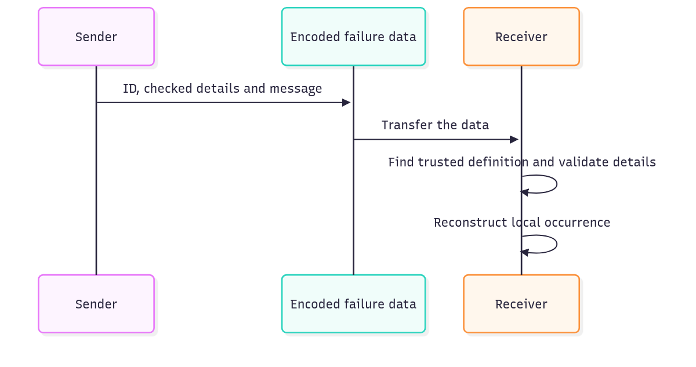

# `@okikio/failure`

An asset lookup can legitimately find no asset. Callers need to recognize “missing asset” even if its explanatory
sentence changes or the answer arrives from another process. `failure` defines that expected reason with a stable ID and
checked details, then creates individual occurrences of it.



[Editable diagram source](diagram.mmd). The demo encodes and decodes locally to show these steps. The transfer is
something your application supplies; this package performs no network or storage I/O. Local JavaScript causes do not
cross the encoded boundary.

## Keep a missing asset recognizable across a boundary

```ts runnable
import * as failure from '@okikio/failure';
import { z } from 'zod';
const Missing = failure.define({
	id: 'asset.missing',
	description: 'The requested asset does not exist.',
	data: z.object({ id: z.string() }),
});
const occurrence = await failure.create(Missing, { data: { id: 'asset-1' } });
const wire = await failure.encode(occurrence);
const restored = await failure.decode(wire, [Missing]);
console.log(restored.definition === Missing, restored.data.id);
```

Expected output:

```text output
true asset-1
```

The demo creates a missing-asset occurrence for `asset-1`, then reconstructs it using the trusted `Missing` definition.
The output means the reconstructed occurrence uses that exact definition and keeps the asset ID. Change the asset ID in
the input to change the retained details. An unknown failure ID cannot invent a new trusted definition at decode.

The local value is an `Error` with useful structured fields, so ordinary `throw` and `catch` still work. Its compact
contract is `Occurrence<typeof Missing>`: `definition` is the exact `Missing` object, `data` is the schema's
`{ id: string }` output, and `message` is explanatory text. The optional `cause` stays in the current process.

Encoding changes the shape to an inert record:

```text
{ id: "asset.missing", data: { id: "asset-1" }, message: "The requested asset does not exist." }
```

`create()` validates data and constructs the local Error. `encode()` validates its current data again before copying the
ID, message, and data. `decode()` checks the envelope, finds the ID in definitions you supplied, then validates against
that definition before constructing a new Error. This preserves a recognizable reason without trying to send a live
Error instance, stack, or provider client to another runtime.

## Catch a missing file using its definition

This file lookup uses an in-memory Map so it can run anywhere. The branch is the same one you can use around a real file
index or database: handle the expected missing-file reason and rethrow unexpected exceptions.

```ts runnable=missing-file.ts
import * as failure from '@okikio/failure';
import { z } from 'zod';
const Missing = failure.define({
	id: 'file.missing',
	description: 'The requested file does not exist.',
	data: z.object({ path: z.string() }),
});
const files = new Map<string, string>([['photo.txt', 'saved']]);
async function read(path: string): Promise<string> {
	const text = files.get(path);
	if (text === undefined) throw await failure.create(Missing, { data: { path } });
	return text;
}
try {
	console.log(await read('missing.txt'));
} catch (error) {
	if (!failure.is(error, Missing)) throw error;
	console.log(`Choose another file: ${error.data.path}`);
}
```

```text output
Choose another file: missing.txt
```

The decision uses the exact definition, not a substring in the error message. You can revise the explanation without
breaking the caller's branch. A definition describes an expected outcome; choosing whether to retry or which HTTP status
to send remains the caller's decision.

## Present the same reason at an application boundary

- Wrap an expected occurrence in [Result](../result/README.md) so a caller handles success and missing asset explicitly.
  Result chooses the branch; Failure gives the reason its stable meaning.
- Present that reason through a declared [HTTP problem](../http/problem/README.md) at an API boundary. Keep internal
  causes and secrets out of public responses and encoded failure data.

Do not put secrets in encoded failure data. Unexpected exceptions belong to fault diagnostics; declared failures
describe expected domain outcomes.

Definitions and occurrences freeze their own outer objects, but validated failure `data` is owned by its
schema/producer. The utility does not recursively freeze arbitrary schema output. `encode()` revalidates that data
before transport instead of treating outer `Object.freeze()` as a durability guarantee.

A queue or Worker can encode a failure occurrence and decode it through a trusted failure catalog. An HTTP service can
map the same failure to a declared HTTP problem without adding HTTP fields to the failure definition.

## Durable data

Provider errors, sockets, request objects, and other non-durable values must not enter the encoded form.

`decode()` also treats the encoded envelope as data, not behavior. The envelope must be a plain object or null-prototype
record with own enumerable data properties. Accessor-backed fields are rejected without invoking their getters. The
nested `data` value is then validated by the trusted failure definition's Standard Schema.

## Convenience and the manual equivalent

| Convenience                              | Manual equivalent                                                                                                                      | Concrete value                                               |
| ---------------------------------------- | -------------------------------------------------------------------------------------------------------------------------------------- | ------------------------------------------------------------ |
| `failure.define()` + occurrence creation | freeze failure identity, validate structured data, and retain nominal package-created occurrence identity                              | declared failures stay distinguishable from arbitrary errors |
| `encode()` / `decode()`                  | copy stable id/message/data into a cloneable envelope, validate descriptors, then resolve the current definition before reconstruction | safe durable transport without serializing Error instances   |
| `failure.match()`                        | write repeated ID checks and casts for every declared failure branch                                                                   | dispatch by stable failure ID                                |

`@okikio/failure` is a convenience layer, not a hidden runtime. You can reproduce its core mechanics with a tagged
immutable record plus a map from IDs to definitions.

The utility adds schema validation, trusted catalog decoding, matching, and stable encoded failure transport.

## Composition and decoding helpers

- `failure.catalog()`, `select()`, and `compose()` build exact imported failure universes.
- `isOccurrence()` checks that an unknown `Error` was actually created by this module instance; a lookalike object with
  `definition` and `data` fields is not accepted.
- `isEncoded()` checks the inert durable envelope shape without invoking accessor-backed fields. Use it at generic
  transport seams that do not yet have the trusted catalog required for `decode()`.
- `match()` dispatches one occurrence to handlers keyed by stable failure IDs.
- `UnknownFailureDefinitionError` reports durable encoded failure data whose ID is not in the trusted definition set.

## Source guide

Start with this README, then use the source in this order when you need more detail:

1. `mod.ts` shows the supported runtime operations and the composition shape.
2. `types.ts`, when present, shows the public value and behavior contracts.
3. `*.test.ts` files show edge cases, cancellation, invalid input, and lifecycle behavior as executable examples.
4. Read internal implementation files only when you need the exact state transition or performance-sensitive loop.

Read the [generated API reference](API.md) for the complete exported contracts and field descriptions.
