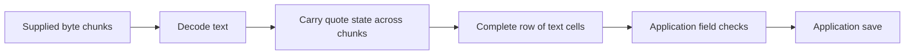

# `@okikio/format/csv`

A customer exports contacts from a spreadsheet. One note says “hello, world,” so a simple split on commas turns one cell
into two. `csv` reads the file's quoting and row structure, keeps cells as text, and gives you column names you can use
to look up those cells. This is a file reader, not an automatic contact importer.

| Source content           | Parsed view in the demo                                |
| ------------------------ | ------------------------------------------------------ |
| Header `Company,Email,Note`       | Column keys `company`, `email`, `note`                          |
| Row `"Ada, Inc.",ada@example.com,"hello, world"` | Three cells; quoted commas stay inside Company and Note                    |
| Quotes around the note   | CSV framing; the quotes are not part of the cell value |

The table shows one small text file. It omits encoding, header discovery, source diagnostics and streaming limits, which
matter for larger or less predictable files.

The [public source contracts](./mod.ts) lists parsing options, row shapes and diagnostic codes.

## Read a quoted contact record

Parse a quoted company name and its email column from a local document. The comma belongs to the company name, so record
framing must happen before the application selects fields or validates contact rules.

These examples use the current experimental source checkout, not an assumed registry release. From the `utils`
repository root, review `mise.toml`, run `mise trust`, then `mise install` and `mise run prepare -- --kind deps`.
Save the following module as `example.ts` and run `mise exec -- deno run example.ts`.
[Checkout prerequisites](../../../README.md#work-on-the-repository) explain installing Mise.

```ts runnable=example.ts
import * as csv from '@okikio/format/csv';

const source = 'Company,Email,Note\n"Ada, Inc.",ada@example.com,"hello, world"\n';
const options = { headerRow: 1 };
const document = csv.parse(source, options);
// Select by the parsed header key so a changed column order does not select the wrong field.
const email = document.columns.find((column) => column.key === 'email');
if (email === undefined) throw new Error('The contact file needs an Email column.');
console.log(document.columns.map((column) => column.key).join(','));
console.log(document.rows[0]?.values[email.index]);
```

Expected output:

```text output
company,email,note
ada@example.com
```

`parse()` returns `CsvDocument` immediately. Here its rows contain strings and its columns expose normalized keys; it
collects the supplied text in memory and owns no reader to dispose. For streaming input, see
[the complete bounded import](../../../docs/03-composition.md#import-rows-with-bounded-work).

The demo chooses the first row as the header. Its output shows normalized column keys, then the email found by that
key. The Company and Note commas remain inside their quoted cells. Try putting a newline inside the quoted note to keep two lines in one cell. Parsing
leaves the content as text; it does not decide what a contact record must contain.

## Read a contact by column name

Once CSV quoting is handled, the rest is ordinary array and object code. Use the normalized column key to find a cell
instead of assuming every export keeps email at one fixed position. The next export reorders the same three fields;
the lookup still selects the email, while a fixed second-column index would now select the note.

```ts runnable=contact-preview.ts
import { parse } from '@okikio/format/csv';

// This export moved Email to the first column. Header lookup still finds it.
const source = 'Email,Note,Company\nada@example.com,"hello, world","Ada, Inc."\n';
const document = parse(source, { headerRow: 1 });
const emailColumn = document.columns.find((column) => column.key === 'email');
if (emailColumn === undefined) throw new Error('The contact file needs an Email column.');
const addresses = document.rows.map((row) => row.values[emailColumn.index] ?? '');
console.log(JSON.stringify(addresses));
```

```text output
["ada@example.com"]
```

| Value or call                 | Contract                                           | What it proves                                                                                         |
| ----------------------------- | -------------------------------------------------- | ------------------------------------------------------------------------------------------------------ |
| `CsvColumn`                   | `{ index, name, key, normalizedName, rawHeader? }` | Where the field is and how its header was interpreted. `index` is zero-based.                          |
| `CsvRow`                      | `{ row, values: readonly string[], diagnostics }`  | Cell text and its one-based logical source record. Quoted newlines stay inside a cell.                 |
| `parse(text, options?)`       | String → `CsvDocument` immediately                 | Bounded structural parsing. Unrecoverable input throws `CsvParseError` with a machine-readable `code`. |
| `parseStream(body, options?)` | Byte stream → `Promise<CsvStreamDocument>`         | Metadata plus one-shot async rows. Dispose the document to release its reader.                         |

Under the hood, the parser separates three decisions:

1. Byte entrypoints choose an encoding, then dialect detection or your explicit option chooses the delimiter.
2. A record scanner carries quote state. A comma or newline inside quotes belongs to the current cell, not the next row.
3. Header selection assigns unique lookup keys; data records retain strings and attach recoverable diagnostics.

Keeping structure separate from meaning preserves phone numbers, leading zeroes and formula-like text instead of
guessing their types. Your importer still validates email addresses and decides whether warnings should stop the import.
The contact preview above materializes the small source; use streamed rows for large input.

A **stream** makes the next piece available as it is read instead of first collecting the whole file. A source chunk is
only a delivery fragment: it may split a quoted cell or a line ending. The parser carries that unfinished record into the
next chunk. Its row consumer sees logical records, not arbitrary network fragments.

Read this flow from left to right. Byte decoding, CSV quoting and application validation answer different questions;
one successful step does not prove that the next step will accept the value.



The diagram omits discovery and errors. A malformed CSV record can stop parsing; a valid record can still contain an
invalid email address. “Streaming” also does not mean unlimited input: choose byte and row limits, and do not collect
all returned rows if the goal is bounded memory.

## Own a streaming import

Pass `signal` to `parseStream()` so cancellation can interrupt initial format discovery as well as later row reads. An
already aborted signal prevents reader acquisition. Specify both `delimiter` and `encoding` when the format is known;
discovery then reads only enough to identify a possible byte-order mark before finding the requested headers. The byte
limit is checked before retaining a discovery chunk that already proves the input is too large.

Use `await using document = await parseStream(...)` or call `document[Symbol.asyncDispose]()` when done. Disposal
releases owned reader locks promptly and requests source cancellation. The source cancellation hook can take longer;
`document.cleanup` preserves its eventual outcome. Supply `onCleanup(completion)` when that outcome must remain
available even if discovery fails before returning a document. The Promise resolves to the shared
`@okikio/streams/reader` cleanup result, including `{ status: 'failed', error }` for a late cleanup failure.

Collecting and streaming parsers use the same row construction and diagnostics. Row width, unsafe cell content, and
column identity therefore have one interpretation across both entrypoints.

## Carry rows into a bounded import

- Use [Schema](../../schema/README.md) to validate each imported row's business meaning after CSV has read its text. A
  successfully parsed file can still contain an invalid email address or missing required field.
- Use [Concurrency](../../scheduler/concurrency/README.md) for bounded per-row work in a large import. The
  [complete import walkthrough](../../../docs/03-composition.md#import-rows-with-bounded-work) shows the reader,
  validation and work ownership together.

## Choose adjacent capabilities

The application owns header mappings, validation, and persistence. Use Streams for transport and Concurrency when row
enrichment needs bounded asynchronous work.

The [package choice map](../README.md#choose-an-entry-point) lists the other public entries and when to use them.

## Read further

The [numbered guide](https://github.com/okikio/utils/blob/main/docs/csv.md) explains the model, manual alternatives, and
composition.
