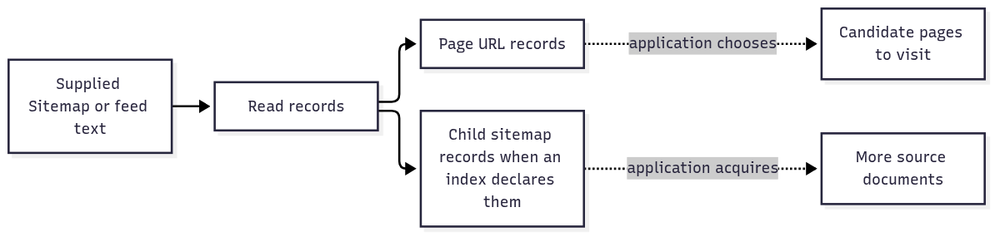

# `@okikio/format/sitemap`

A website provides a list of pages for discovery, sometimes as Sitemap XML, sometimes as a feed or a plain URL list.
`sitemap` reads those supplied documents into page or child-source records. It saves a collector from writing a
different URL extractor for each supported format; it does not download the listed pages.

In a Sitemap XML document, tags describe the structure: `<url>` groups one page entry and `<loc>` contains its address.
A `<sitemapindex>` instead lists other sitemap documents. The `xmlns` text identifies which XML vocabulary the tags use;
it does not ask the parser to download that address. This is why a URL-shaped string in the document is not enough to
decide whether it names a page, another source or only the vocabulary.



[Editable diagram source](./diagram.mmd). The first demo contains only one page record. Child records describe other
sources rather than fetching them. Dotted arrows are decisions and I/O your application must provide; this view omits
format errors and streaming limits.

The [public source contracts](./mod.ts) includes source formats, streaming options and record metadata.

## Read page locations from a sitemap

Read a single page location from a supplied sitemap document. Source URL, content type, and text are explicit inputs;
the parser extracts records without fetching a website on import.

These examples use the current experimental source checkout, not an assumed registry release. From the `utils`
repository root, review `mise.toml`, run `mise trust`, then `mise install` and `mise run prepare -- --kind deps`.
Save the following module as `example.ts` and run `mise exec -- deno run example.ts`.
[Checkout prerequisites](../../../README.md#work-on-the-repository) explain installing Mise.

```ts runnable
import * as sitemap from '@okikio/format/sitemap';

const text = `
<urlset xmlns="http://www.sitemaps.org/schemas/sitemap/0.9">
  <url>
    <loc>https://example.com/guide</loc>
  </url>
</urlset>`;
// Supply local source text explicitly. Parsing these locations does not fetch pages or crawl the site.
const source = { url: 'https://example.com/sitemap.xml', contentType: 'application/xml', text };
// locations() reads supplied XML. It does not fetch the page named by loc.
console.log(JSON.stringify(sitemap.locations(source)));
```

Expected output:

```text output
["https://example.com/guide"]
```

The input is a complete XML document containing the guide URL. `locations()` returns that one address, which the demo
prints as an array. Add another `<url><loc>...</loc></url>` entry to list a second page. A listed URL is a discovery
candidate, not proof that the page exists or should be crawled.

## Decide whether a record is a page or another source

The same parser handles a page list and an index of other sitemap files. Check `kind` before deciding what work to
schedule. The example only prints decisions; it performs no recursive downloads.
Save it as `index-decisions.ts` and run `mise exec -- deno run index-decisions.ts` from the same checkout.

```ts runnable=index-decisions.ts
import { locations, parse } from '@okikio/format/sitemap';

const source = {
	url: 'https://example.com/sitemap.xml',
	contentType: 'application/xml',
	text: `
<sitemapindex xmlns="http://www.sitemaps.org/schemas/sitemap/0.9">
  <sitemap>
    <loc>https://example.com/pages.xml</loc>
  </sitemap>
</sitemapindex>`,
};
// locations() keeps the child address too; only parse() retains its source/page distinction.
console.log(JSON.stringify(locations(source)));
for (const record of parse(source)) {
	if (record.kind === 'sitemap') console.log(`Read another source: ${record.loc}`);
	else console.log(`Consider a page: ${record.loc}`);
}
```

```text output
["https://example.com/pages.xml"]
Read another source: https://example.com/pages.xml
```

| Call or value                       | Contract                                                                                        | Meaning                                                                                  |
| ----------------------------------- | ----------------------------------------------------------------------------------------------- | ---------------------------------------------------------------------------------------- |
| Complete input                      | `{ text, url, contentType?, policy? }`                                                          | Supplied source content and metadata; `url` helps identify the source format.            |
| `SitemapRecord`                     | `{ kind: 'url' \| 'sitemap', loc, format, alternates, lastModified? }`, with more page metadata | A page candidate or child source, not a completed download.                              |
| `parse(input)` / `locations(input)` | Readonly record array / readonly URL array                                                      | Complete in-memory parsing. Unsupported or failed XML parsing can return an empty array. |
| `parseStream(input)`                | Byte stream + awaited `onRecord` → `Promise<{ byteLength, capped, format?, problems }>`         | Reports streaming observations and byte capping; owns and releases the stream reader.    |

Under the hood, source metadata and a prefix choose text versus XML. XML parsing uses namespace-aware records to
distinguish Sitemap, RSS and Atom content, then one reducer projects their fields into `SitemapRecord`. Complete-source
parsing removes duplicate records. The streaming path awaits your sink after each record so a slow consumer can apply
backpressure.

One record shape lets discovery code reuse scheduling logic across formats. Use `parseStream()` when diagnostics or
bounded incremental input matter: an empty result from convenience `parse()` alone cannot prove that the source was
valid and empty. Your application owns nested-source limits, fetch policy and admission of discovered pages.

## Retain complete-input failure evidence

Use `inspect(input, { maximumCodeUnits, maximumRecords, maximumUrlLength, maximumProblems })` when empty results must be
explained. The result includes `records`, detected `format`, `problems` and `capped`. All limits are required finite
non-negative integers. String lengths count UTF-16 code units. The input-length guard runs before XML tree construction;
inspection is a complete-input operation. Use `parseStream` for incremental input.

A valid `<urlset/>` has no records and no problems. Malformed XML produces `malformed_xml`; a policy limit sets
`capped`. Duplicate kind/location pairs merge within the retained record bound. `maximumProblems: 0` suppresses messages
and sets `capped` when evidence is discarded. Unexpected defects throw. The older `parse`/`locations` operations
preserve their permissive array results.

`maximumProblems` limits how many comments and XML syntax or namespace problems the stream reports. The default is
128; use a nonnegative safe integer. If the reader drops any of that information, it sets `capped` and keeps sending
records. Set `maxBytes` to limit how much input it can read.

The stream sends locations in source order, including repeats, and waits for each callback to finish. It does not
remember which locations it sent. Your callback decides whether to keep them. In contrast, `inspect` merges duplicates
among the records it keeps, up to `maximumRecords`. It checks the input size before the Standard Library builds an
XML tree in memory. A small record limit therefore does not make that tree small. The duplicate-heavy 10,000-record tests exercise these
different contracts; the benchmark reports timing and source identity, not a peak-memory guarantee.

## Choose complete text or incremental input

Use the first example when the application already holds a small complete document. `locations()` returns every parsed
location, including child sitemap addresses, and discards each record's kind. Use `parse()` and check `record.kind` when
pages and child sources need different actions. For unknown-size downloads, skip whole-text collection and use the
[complete streaming discovery program](../../../docs/packages/21-sitemap.md#use-with-other-utilities). That program
supplies the byte stream, byte cap, awaited record sink, abort owner and cleanup receipt. Start with one supplied source;
add recursive index fetching only after choosing depth, visited-source and total download budgets. A parser cap cannot
bound your entire crawl. [Retain complete-input failure evidence](#retain-complete-input-failure-evidence) explains how to
distinguish a valid empty source from a rejected one.

## Release a source when parsing stops

`parseStream()` validates `maxBytes` and checks an already aborted `signal` before acquiring the source reader. The
signal covers the first format-discovery read as well as the parse loop. A read failure, abort, byte cap, or normal
completion releases the reader lock. Abort interrupts a stalled read without waiting for a source cancellation hook that
may depend on another tee branch.

Pass `onCleanup(completion)` to retain the source's eventual cleanup outcome, including failures that arrive after the
parse call settles. This uses `@okikio/streams/reader`'s always-resolving `CleanupOutcome` Promise. Parse metadata
remains plain data; the source owner decides when to await cleanup. Continue passing cancellation to any fetch or other
producer that supplied the bytes.

## Follow index records without losing source ownership

- Supply Sitemap addresses and acquire their sources in your application. Apply application crawl policy to discovered
  page candidates. The [complete streaming example](../../../docs/packages/21-sitemap.md#use-with-other-utilities) uses
  supplied bytes.
- Pair streamed discovery with a [Context](../../context/README.md) signal and an awaited `onRecord` sink. A slow sink
  can make the parser wait rather than forcing your application to retain every record at once.

## Choose adjacent capabilities

The application supplies source bytes and decides which URLs may be fetched. Parsing an index does not recursively crawl
it.

The [package choice map](../README.md#choose-an-entry-point) lists the other public entries and when to use them.

## Read further

The [numbered guide](https://github.com/okikio/utils/blob/main/docs/packages/21-sitemap.md) explains the model, manual
alternatives, and composition.
