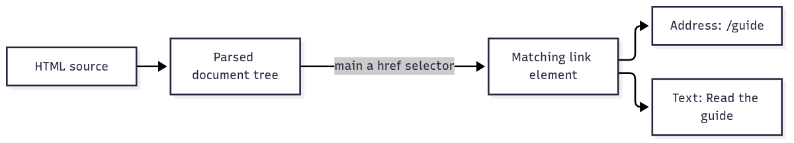

# `@okikio/html`

You have the source of a help page and want its guide link and visible source text. `html` turns the markup into a
searchable tree, then lets you select an element and read its attributes or text. You can answer source-document
questions without starting a browser.



[Editable diagram source](diagram.mmd). The branches are two facts from the same link in the demo. A selector is a
pattern for choosing elements. This diagram omits malformed-markup repair and does not show scripts, layout or
browser-rendered content.

The [full API reference](API.md) describes traversal helpers, tree types and source locations.

## Run a complete example

```ts runnable
import * as html from '@okikio/html';
const page = html.parse('<main><a href="/guide">Read the guide</a></main>');
const link = html.selectOne(page.document, 'main a[href]');
console.log(link === null ? 'missing' : html.attribute(link, 'href'));
console.log(link === null ? 'missing' : html.text(link));
```

Expected output:

```text output
/guide
Read the guide
```

The demo supplies a page fragment with one link. The selector finds it, then the two output lines show its address and
text. Remove the link from the input to take the demo's `missing` branch. A relative address such as `/guide` still
needs the page's base URL before it can become an absolute download target.

## Make a link report with ordinary array methods

The selected nodes are useful evidence, but your report can be plain data. This keeps parser objects local and produces
an array that can be JSON-encoded or sent to another thread.

```ts runnable=link-report.ts
import { attribute, parse, selectAll, text } from '@okikio/html';

const pageUrl = 'https://example.com/help/';
const page = parse('<main><a href="../guide">Read <strong>the guide</strong></a><a href="/pricing">Pricing</a></main>');
const links = selectAll(page.document, 'main a[href]').map((link) => ({
	label: text(link).trim(),
	url: new URL(attribute(link, 'href') ?? '', pageUrl).href,
}));
console.log(JSON.stringify(links));
```

```text output
[{"label":"Read the guide","url":"https://example.com/guide"},{"label":"Pricing","url":"https://example.com/pricing"}]
```

| Call or value                             | Contract                                      | What to expect                                                                                                    |
| ----------------------------------------- | --------------------------------------------- | ----------------------------------------------------------------------------------------------------------------- |
| `parse(source)`                           | String → `{ document, problems }` immediately | A parsed tree and non-fatal parser observations, not a browser document.                                          |
| `selectOne(root, selector)`               | Node + CSS selector → `HtmlElement \| null`   | Check for a missing element before reading it. Invalid selector syntax can throw.                                 |
| `selectAll(root, selector)`               | Node + CSS selector → readonly element array  | Ordinary array methods can project the result into your data.                                                     |
| `attribute(element, name)` / `text(node)` | String or `null` / string                     | An empty attribute is `''`; a missing one is `null`. Text follows source-tree descendants, not screen visibility. |

One level deeper: parse5 applies HTML parsing and repair rules, using an adapter that creates the tree shape css-select
expects. Selectors and text helpers inspect that same tree; they do not parse the markup again. Source locations are
retained for diagnostics, although nodes inserted by repair can lack a location.

This design centralizes the parser/selector agreement. It lets you inspect imperfect markup without starting a browser,
but scripts are not run and hidden elements still contribute source text. Use browser automation when the answer depends
on layout or code executed by the page.

## Build on the example

- Extract inline stylesheet text and pass it to [CSS](../css/README.md) to find referenced images and fonts. The
  runnable composition below uses both parsers on supplied source.
- Check discovered page URLs with [Robots](../robots/README.md) before a crawler schedules work. Your application still
  fetches pages and decides how to handle unavailable policy files.

## The ordinary problem

Combining parse5, its htmlparser2 tree adapter, css-select and DOMUtils requires each caller to choose matching tree
representations and remember their attribute storage. This package makes that agreement once. The lower-level libraries
still own parsing and selectors; the useful addition is one document model and consistent traversal operations.

## Use the utility

```ts
import * as html from '@okikio/html';

const parsed = html.parse(`
  <main>
    <a class="cta" href="/pricing"> Pricing <strong>now</strong> </a>
  </main>
`);

const link = html.selectOne(parsed.document, 'main > a.cta[href]');
if (link) {
	console.log(html.attribute(link, 'href')); // /pricing
	console.log(html.text(link).trim()); // Pricing now
	console.log(html.tagName(link)); // a
	console.log(html.location(link)); // parse5 source coordinates
}

console.log(parsed.problems); // non-fatal HTML parse problems
```

The parser follows HTML correction rules. The returned tree therefore describes parsed HTML structure, which can differ
from a naive text/tree interpretation of malformed markup.

## Use with other utilities

Extract a stylesheet from HTML and pass its source to `@okikio/css`:

```ts runnable=stylesheet-resources.ts
import * as css from '@okikio/css';
import * as html from '@okikio/html';

const page = html.parse('<style>@import "theme.css"; .hero { background: url("hero.webp"); }</style>');
const style = html.selectOne(page.document, 'style');

if (style) {
	const stylesheet = css.parse(html.text(style));
	console.log(JSON.stringify(css.resources(stylesheet).map((item) => item.url)));
}
```

Expected output:

```text output
["theme.css","hero.webp"]
```

`html.parse()` returns a parsed document immediately; `css.parse()` returns a parsed stylesheet immediately. The final
value is a `string[]` projection of URL references. Neither parser fetches or owns a stream. Kaiju Crawl uses this
separation when extracting HTML and CSS resource evidence.

Or feed discovered Sitemap declarations from page metadata into a discovery layer that also uses `@okikio/robots` and
`@okikio/sitemap`. Each parser owns one syntax; the discovery package owns which sources to fetch and trust.

## Convenience and the manual equivalent

| Convenience            | Manual equivalent                                           | Utility-owned invariant             |
| ---------------------- | ----------------------------------------------------------- | ----------------------------------- |
| `html.parse()`         | configure parse5 tree adapter and collect parse diagnostics | one runtime-neutral parsed document |
| selector helpers       | call css-select with the correct adapter tree shape         | consistent selector behavior        |
| attribute/tree helpers | depend on htmlparser2 internal fields in every caller       | small stable traversal surface      |

The package does not fetch pages or execute JavaScript. It only answers questions about the HTML source supplied by the
caller.

## Source guide

1. `mod.ts` contains the complete parser/traversal adapter.
2. `mod.test.ts` covers HTML correction rules, selectors, source locations, and non-fatal parse problems.
