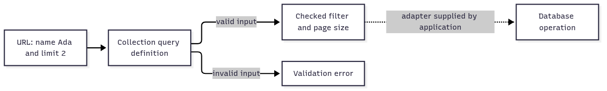

# `@okikio/query`

A directory page asks for people named Ada and wants only two results. The API needs to understand that request before
its database adapter runs it. `query` declares which fields, comparisons and page sizes callers may request, then
returns checked query data. A **query definition** is the allowed search language for one collection.



[Editable diagram source](diagram.mmd). The demo stops at checked data and its URL round trip. The dotted arrow needs a
compatible adapter; parsing a filter does not execute it or make a database support that comparison. This view omits
sorting and complex filter groups.

For shared terms such as `await` and `await using`, see
[the short glossary](../../docs/learn.md#read-the-small-amount-of-code-you-need).

For the exact functions, types and field explanations, read the [generated contract reference](API.md).

## Run a complete example

The explicit polyfill imports let this example run when the host lacks Temporal or disposal globals. An existing native
implementation is preserved.

```ts runnable
import '@okikio/duration/polyfill';
import '@okikio/dispose/polyfill';
import * as query from '@okikio/query';
import { z } from 'zod';
const Search = query.define({
	fields: { id: query.field(z.string(), { sortable: true }), name: query.field(z.string()) },
	filters: { name: [query.eq, query.in] },
	order: [query.asc('id', { tiebreaker: true })],
	pagination: query.offset({ defaultLimit: 20 }),
});
const value = await Search.parse(new URLSearchParams('filter[name]=Ada&limit=2'));
console.log(value.filters[0]?.field, value.pagination.limit);
console.log((await Search.parse(Search.encode(value))).filters[0]?.value);
```

Expected output:

```text output
name 2
Ada
```

The demo declares `name` filtering and a default page size of 20. The supplied URL overrides that limit to 2; the first
line prints the selected field and page size. The second line shows `Ada` survived encoding and parsing again. Remove
`limit=2` to use the default. Requesting an undeclared filter is a validation failure, not extra database authority.

## Build on the example

- Parse a collection URL at a [Server endpoint](../server/endpoint/README.md) boundary, then pass the checked query to
  the application's declared database adapter. Keep adapter capability checks alongside that translation.
- Use [Schema](../schema/README.md) contracts for field meanings, then use Query for collection-level search grammar. A
  field's valid values and the operations a client may request on it are separate rules.

Start with flat filters, enable bounded all/any/not groups when the provider supports them, and encode values for
lossless URL round trips. The tagged wire codec preserves commas, empty text, bigint, dates and negative zero.
normalize() produces canonical query data; it does not run a query. Adapters must explicitly declare capabilities and
fail closed for unsupported groups. Preserve opaque cursors with a trusted codec rather than interpreting arbitrary
client strings.

[Choose related utilities by outcome](../../docs/outcomes.md). The sections below explain the remaining contracts and
variations. Examples that introduce application-owned clients or schemas are composition sketches; supply those
dependencies before running them.

## Before and after: express alternatives without losing literal values

A flat filter list could only mean conjunction. Splitting list operands on commas also lost literal commas and empty
members. Enable Boolean capabilities deliberately and use the tagged codec for values that need it:

```ts runnable
import * as query from '@okikio/query';
import { z } from 'zod';
const Search = query.define({
	fields: { id: query.field(z.string(), { sortable: true }), name: query.field(z.string()) },
	filters: { name: [query.eq, query.in] },
	expressions: ['all', 'any', 'not'],
	order: [query.asc('id', { tiebreaker: true })],
	pagination: query.offset(),
});
const first = await Search.parse({ filter: { $any: [{ name: 'Ada' }, { name: 'Lin' }] } });
const second = await Search.parse({ filter: { $any: [{ name: 'Lin' }, { name: 'Ada' }] } });
console.log(Search.stringify(first) === Search.stringify(second));
const literal = await Search.parse({ filter: { name: { in: ['a,b', '', '雪'] } } });
console.log(JSON.stringify((await Search.parse(Search.encode(literal))).filters[0]?.value));
```

Expected output:

```text output
true
["a,b","","雪"]
```

The provider must declare support for the same expressions; parsing ANY does not make a conjunction-only database
adapter support it. The `.filters` compatibility view throws for ANY/NOT trees so callers cannot silently omit a
condition. Use `filter` for the full tree, `inspect()` for authored structure, and `normalize()` or `stringify()` when
equivalent queries should share identity. The ordinary `wireSchema()` method remains available beside Standard JSON
Schema projection.

| Input budget                      | Default |
| --------------------------------- | ------: |
| Filter leaves                     |      20 |
| Client sorts                      |       5 |
| Selected fields                   |     100 |
| Values per filter                 |     100 |
| String/bigint length              |    4096 |
| Parameters including repeats      |     200 |
| Expression depth including leaves |       8 |
| Siblings in a Boolean group       |     100 |

## Purpose

`@okikio/query` defines storage-neutral collection queries for filters, sorting, sparse fieldsets, and bounded
pagination. It validates and normalizes public query input but does not execute a database query.

## How it fits

HTTP request parsing can produce a normalized query value from this package. A concrete database adapter then translates
the value into Drizzle, ClickHouse, SPARQL, or another native query language and rejects unsupported semantics.

Storage-neutral public collection-query definitions for filtering, sorting, sparse fieldsets, bounded pagination,
validation, encoding, documentation, and provider capability checks.

The package does not execute database queries, construct HTTP responses, or implement cursor cryptography.
Drizzle/PostgreSQL, ClickHouse, SPARQL, and Supabase adapters translate the normalized query value into their native
query language and must declare which semantics they can honor.

## Start here

```ts
import * as query from '@okikio/query';

export const WidgetQuery = query.define({
	fields: {
		id: query.field(IdSchema, { sortable: true }),
		name: query.field(NameSchema, { sortable: true }),
		score: query.field(ScoreSchema, { sortable: true }),
		deletedAt: query.field(InstantSchema),
		internalNote: query.field(NoteSchema, { selectable: false }),
	},
	filters: {
		name: [query.eq, query.icontains, query.in],
		score: [query.gte, query.between],
		deletedAt: [query.isNull, query.isNotNull],
	},
	order: [query.desc('id', { tiebreaker: true })],
	pagination: query.pagination({
		default: 'cursor',
		cursor: query.cursor({ defaultLimit: 25, maximumLimit: 100 }),
		offset: query.offset({ defaultLimit: 20, maximumLimit: 100 }),
	}),
	fieldsets: {
		widgets: ['id', 'name', 'score'],
		owners: ['id', 'name'],
	},
	defaultFields: ['id', 'name', 'score'],
});
```

Cursor support requires exactly one stable tiebreaker so keyset traversal stays deterministic.

## Documented URL syntax

```http
GET /widgets?
  filter[score][gte]=50&
  filter[deletedAt]=null&
  sort=score:desc,id:asc&
  fields=id,name,score&
  cursor=opaque&
  limit=50
```

JSON:API sparse fieldsets are preserved rather than flattened:

```http
GET /widgets?fields[widgets]=id,name&fields[owners]=id,name
```

Offset endpoints may accept either:

```http
GET /widgets?offset=40&limit=20
GET /widgets?page=3&per_page=20
```

Cursor, page, and offset modes cannot be mixed in one request. Unknown fields, disallowed operators, invalid null
semantics, duplicate sorts, excessive values, and unsupported pagination fail closed with structured issues.

## Provider adapters

```ts
const compatibility = WidgetQuery.validateAdapter({
	operators: ['eq', 'gte', 'between', 'isNull'],
	pagination: ['offset'],
	fieldSelection: ['simple'],
	maximumSorts: 3,
});
```

Adapters reject unsupported operators or pagination strategies instead of silently changing their meaning. Tenant,
authorization, and row-level-security predicates remain server-owned and are not represented by client filters.

An adapter's `maximumSorts` counts the complete normalized order. The definition's limit counts client-selected sorts.
For example, a request that selects `name:asc` may append the stable `id` field for cursor traversal, so the adapter
must support two sorts even when the definition permits only one client-selected sort. Requirements count distinct
eligible fields; a query with only `id` needs capacity for one sort.

`WidgetQuery.encode(value)` recreates canonical bracket filters, colon sorts, sparse fieldsets, and the selected
pagination form for link generation and round-trip tests.

## Request and adapter flow

```ts
const ListImports = endpoint.get({
	id: 'imports.list',
	path: '/imports',
	query: ListImportsQuery,
	responses: [ImportPage],
	resources: [SelectImports],
});

const ListImportsHandler = endpoint.handler(ListImports, async (context) => {
	const selectImports = await context.resources.get(SelectImports);

	const page = await selectImports.execute({
		query: context.input.query,
		base: {
			organizationId: context.organization.id,
		},
		execution: context.execution,
	});

	return response.create(ImportPage, page);
});
```

The service runtime parses raw `URLSearchParams` and validates them through the query definition before the handler
runs. The handler receives a normalized query value, not raw strings.

A provider package compiles the public definition once:

```ts
const SelectImports = postgres.collection(ListImportsQuery, {
	from: imports,
	columns: {
		id: imports.id,
		filename: imports.filename,
		status: imports.status,
		createdAt: imports.createdAt,
	},
	base: {
		organizationId: imports.organizationId,
	},
});
```

The adapter owns parameterized Drizzle expressions, keyset seek predicates, count strategy, and cursor codec use.
ClickHouse and SPARQL adapters map the same normalized public contract into their native semantics and reject
unsupported combinations at adapter compilation.

## Progressive usage

Read [complete compositions](../../docs/composition.md) for a bounded CSV import, allowed-page discovery and a
resource-backed operation. Each example names its result and owner. Use [the outcome guide](../../docs/outcomes.md) to
choose additional mechanisms when the application needs them.

## Convenience and the manual equivalent

| Convenience         | Manual equivalent                                                                                                               | Concrete value                                              |
| ------------------- | ------------------------------------------------------------------------------------------------------------------------------- | ----------------------------------------------------------- |
| `query.define()`    | snapshot field/filter/order/pagination records, validate operators, defaults, aliases, and tiebreakers yourself                 | one storage-neutral query contract                          |
| `query.safeParse()` | descriptor-validate the raw record, parse every filter/order/page field, normalize values, and collect prefixed issues manually | untrusted query input becomes one normalized shape          |
| `query.encode()`    | serialize only deterministic scalar wire values and preserve repeated filters/order explicitly                                  | round-trippable transport without arbitrary object coercion |

`@okikio/query` is a convenience layer, not a hidden runtime. You can reproduce its core mechanics with URLSearchParams
plus your own filter/sort AST, validator calls, pagination rules, and cursor encoding.

The utility keeps query meaning storage-neutral so Postgres, ClickHouse, SPARQL, or another adapter can compile the same
normalized request.

## Operators, projection, and validation

The query vocabulary intentionally exposes operators as small named values. In addition to the operators shown above,
the public set includes `ne`, `gt`, `lt`, `lte`, `contains`, `startsWith`, `endsWith`, `inArray`, `notInArray`, and the
aliases `nin`/related selected operators supported by the definition.

Tooling and adapters also use:

- `document()` for deterministic query-definition metadata.
- `paginationParameters()` for the transport-neutral pagination parameter schema.
- `requirements()` for backend capability requirements implied by a definition.
- `QueryValidationError` when raw user query input cannot be normalized into the declared contract.

## Source guide

Start with this README, then use the source in this order when you need more detail:

1. `mod.ts` shows the supported runtime operations and the composition shape.
2. `types.ts`, when present, shows the public value and behavior contracts.
3. `*.test.ts` files show edge cases, cancellation, invalid input, and lifecycle behavior as executable examples.
4. Read internal implementation files only when you need the exact state transition or performance-sensitive loop.

The README is the primary user documentation. It intentionally stays close to the public source instead of maintaining a
separate hand-written API reference.

## Validation shape versus wire shape

A `QueryDefinition` is a Standard Schema validator for the normalized query value. Its `wireSchema()` method has a
different job: it describes the bracketed HTTP query-string representation used by endpoint/OpenAPI documentation.

The two shapes are intentionally different. For example, `filter[name][contains]=kai` is an HTTP query-string
representation, while a database adapter consumes the normalized `QueryValue`. Endpoint documentation uses
`wireSchema()` so OpenAPI describes the HTTP input rather than the normalized JavaScript value.
