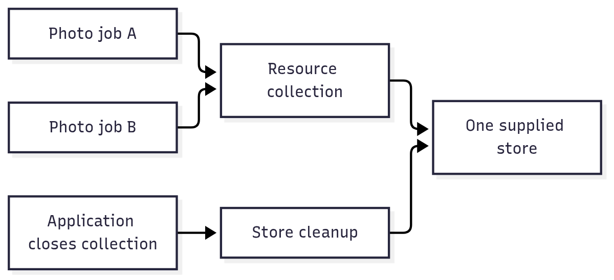

# `@okikio/resource`

Share something a job needs without making every function open and close its own copy. For example, ten photo jobs can
borrow one application-owned storage client instead of opening ten connections. A resource describes that dependency; a
resource collection creates the supplied implementation when it is first needed and owns its cleanup.

This package does not choose a storage vendor or provide a database. It connects your supplied clients to the jobs that
declare their use, and makes their lifetimes explicit. Access requirements are checked when a caller borrows a resource.

## Follow one shared dependency

Read the arrows as requests to borrow the same store. The collection opens it lazily, shares the admitted creation, and
closes the owned store when the collection ends. The two jobs do not close their borrowed copy themselves.



[Editable diagram source](diagram.mmd). The picture shows one resource inside one collection. Another collection can own
a separate instance. It omits dependency ordering and access checks, which are explained below. The collection is not a
cross-machine connection pool.

## Supply a storage client to an operation

The explicit polyfill imports let this example run when the host lacks Temporal or disposal globals. An existing native
implementation is preserved.

```ts runnable
import '@okikio/duration/polyfill';
import '@okikio/dispose/polyfill';
import * as context from '@okikio/context';
import * as resource from '@okikio/resource';
const Store = resource.define<{ read(id: string): string }>()({ id: 'store', description: 'Read one stored value.' });
const StoreLive = resource.implement(Store, { create: () => ({ read: (id) => `value:${id}` }) });
await using ctx = context.create({ id: 'store-owner' });
await using stores = resource.create(resource.implementations(StoreLive), { ctx, host: {} });
const store = await stores.get(ctx, Store);
console.log(store.read('asset-1'));
```

Expected output:

```text output
value:asset-1
```

`create()` returns a `ResourceCollection` immediately without opening the store. `get()` returns a Promise of the
borrowed `{ read(id: string): string }` value, creating it lazily. The collection owns created values and releases them
at disposal. The caller gets the string `value:asset-1` and must not dispose a borrowed provider independently.

The mini-demo starts with the ID `asset-1`. `Store` describes the operation a caller can use, and `StoreLive` supplies a
tiny implementation that returns `value:` followed by that ID. `stores.get()` obtains that implementation; `read()`
produces the printed string. No external file or database is read. Replace the supplied implementation when the same
call needs to use real storage.

The curried call `resource.define<Value>()({ id, description })` separates the TypeScript value type from the runtime
metadata. The first parentheses tell the compiler what a consumer will receive. The second create a definition; they do
not connect to storage. `implement()` binds that exact definition to a factory, and `create()` owns the factories' live
values. The [contract reference](API.md) gives the full generic signatures; the local model is:

```text
ResourceDefinition<Value>       names the dependency and the value callers may use
ResourceImplementation         { definition, create(arguments) }
ResourceCollection             { get(ctx, definition): Promise<Value>, has(definition) }
```

On the first `get()`, the collection checks the borrower's direct use requirements, resolves dependencies, and calls the
factory. Concurrent borrowers of the same definition share the pending creation. A later `get()` rechecks its caller's
requirements before returning the retained value. Factories can register cleanup through their supplied `ctx.defer()`,
`ctx.adopt()`, or `ctx.use()`; returned disposable values are adopted when not already registered. This makes the
collection the cleanup owner while a consumer only borrows the client. A borrowed Context supplies the consumer's
cancellation and identity; `await using stores` closes the collection when its block ends.

## Save a value once and read it from another operation

The next example uses a real in-memory Map. Two borrowers receive the same Map, and the factory runs once. Leaving the
collection's block clears it through the registered cleanup, making the ownership visible in the final line.

```ts runnable=shared-store.ts
import '@okikio/duration/polyfill';
import '@okikio/dispose/polyfill';
import * as context from '@okikio/context';
import * as resource from '@okikio/resource';
const Store = resource.define<Map<string, string>>()({ id: 'notes', description: 'Share saved notes.' });
let opened = 0;
const retained = new Map<string, string>();
const StoreLive = resource.implement(Store, {
	create({ ctx }) {
		opened++;
		ctx.defer(() => retained.clear());
		return retained;
	},
});
await using owner = context.create({ id: 'note-owner' });
{
	await using stores = resource.create(resource.implementations(StoreLive), { ctx: owner, host: {} });
	const writer = await stores.get(owner, Store);
	writer.set('note-1', 'Remember the photo');
	const reader = await stores.get(owner, Store);
	console.log(reader.get('note-1'));
	console.log(writer === reader, opened);
}
console.log(retained.size);
```

```text output
Remember the photo
true 1
0
```

The Map is shared within this collection. A different collection has a different lifetime; whether its factory creates a
different Map is application policy. The example closes in-memory state only. A database factory should register its
actual client-close operation and leave persistent records according to the database's own contract.

| Situation                                       | Combine                                                                | Useful outcome                                                                                      |
| ----------------------------------------------- | ---------------------------------------------------------------------- | --------------------------------------------------------------------------------------------------- |
| Several photo jobs need the same storage client | Resource + [activity](../activity/README.md)                           | Each job declares its dependency; the collection owns the live client.                              |
| A local import owns a temporary client          | Resource + [task](../task/README.md) + [context](../context/README.md) | The task borrows the client and its owner releases it after work ends.                              |
| Different users share one client                | Resource + [permission](../permission/README.md)                       | Check each actor's permitted use, rather than treating the first borrow as permission for everyone. |

See [the complete manifest-saving demo](../../docs/composition.md#share-a-resource-with-a-finite-operation) for a task
that writes and reads a real in-memory value through a resource. Choose [pool](../pool/README.md) when work needs
exclusive leases from a limited set of instances rather than shared access to one value.

## Build on the example

Add dependency declarations when one resource needs another, validate implementation coverage before startup, and scope
access to the exact resources an activity may use. Collections own created values; callers borrow them and must not
close them individually. Acquisition requirements apply at creation, while actor-specific use requirements are checked
on public borrowing. Remote work must reconstruct its local resources rather than serialize live clients.

## Declare a dependency and its access requirements

A resource can declare dependencies, environment requirements, failures, health metadata, and generic requirements. The
following sketch assumes application-owned `StorageClient`, `MediaClient`, and permission definitions. The complete Map
example above needs none of those dependencies.

```ts
import * as resource from '@okikio/resource';

const Storage = resource.define<StorageClient>()({
	id: 'storage',
	requirements: [permission.require(FileWrite)],
});

const Media = resource.define<MediaClient>()({
	id: 'media',
	dependencies: { storage: Storage },
});
```

`resource.reachable(Media)` returns the statically reachable requirement set from the full dependency graph. Reachable
metadata is descriptive and can bind runtime views; it is not automatically active admission work.

Definition requirements are checked on every public borrow. A concrete implementation can declare separate
`requirements` that are checked once while that implementation is acquired. This prevents a shared cached resource from
reusing one actor's authorization result for another actor.

## Acquisition

A resource implementation receives only its declared dependencies, selected environment values, the host value, and an
owned creation context.

```ts
const StorageLive = resource.implement(Storage, {
	requirements: [entitlement.require(StorageProvider)],
	async create({ ctx, environment }) {
		const client = ctx.use(await openClient(environment.URL));
		ctx.defer(() => flushDiagnostics());
		return client;
	},
});
```

The creation context uses standard explicit-resource-management semantics:

- `ctx.use(value)` owns a `Disposable` or `AsyncDisposable` value.
- `ctx.adopt(value, dispose)` owns an arbitrary value through explicit cleanup.
- `ctx.defer(dispose)` registers cleanup without an associated value.

Each acquisition has its own `AsyncDisposableStack`. If creation fails, that stack is disposed immediately. If creation
succeeds, the collection owns the completed resource scope.

```text
ResourceCollection
  |
  +-- Storage resource scope
  |     +-- provider client
  |     `-- resource cleanup
  |
  `-- Media resource scope
        +-- borrows Storage
        `-- owns Media-only helpers
```

Dependencies are borrowed. A dependent resource never adopts a dependency that is already owned by the collection. This
prevents double disposal.

A returned disposable value is automatically owned by its resource scope when the implementation has not already
registered that exact value. `return ctx.use(client)` and `return client` are therefore both safe: an exact `use()` or
`adopt()` registration is not duplicated by return-value ownership.

## ResourceCollection lifetime

Acquisition is lazy and memoized. Concurrent `get()` calls for one exact definition share one in-flight creation.
Missing implementations, duplicate implementations, stable-ID conflicts, and dependency cycles fail explicitly.

```ts
await using resources = resource.create(
	resource.implementations(StorageLive, MediaLive),
	{ host, ctx },
);

const media = await resources.get(ctx, Media);
```

`resource.implementations()` deduplicates the same implementation object. Its result therefore preserves the
implementation **types** but does not promise that its `implementations` array has the same tuple length as the
arguments. Manually, this is the same rule as pushing each implementation into an array only the first time its object
identity is seen.

Awaited collection disposal closes acquired resource scopes in reverse acquisition order and joins in-flight
acquisitions, so a value that finishes creation late cannot escape ownership. Context cancellation alone requests a
stop; it does not await acquisitions or dispose the collection. The caller still owns its awaited disposal.

`@okikio/resource` does not implement databases, browsers, payment systems, or permission engines. Concrete packages
implement definitions and hosts decide how generic requirements are interpreted.

## Convenience and the manual equivalent

| Convenience                         | Manual equivalent                                                                                                               | Concrete value                                         |
| ----------------------------------- | ------------------------------------------------------------------------------------------------------------------------------- | ------------------------------------------------------ |
| `resource.define()` + `implement()` | declare identity/dependencies, separately bind create/dispose behavior, and validate that implementation matches the definition | definition and live provider stay separate             |
| `resource.create()`                 | topologically acquire dependencies, cache values, fence cycles/missing implementations, and unwind partial failures manually    | one owned resource graph                               |
| `implementations()`                 | deduplicate implementation objects while preserving the implementation union yourself                                           | runtime set semantics no longer lie about tuple length |

`@okikio/resource` is a convenience layer, not a hidden runtime. You can reproduce its core mechanics with a dependency
graph, a cache, and one AsyncDisposableStack per acquired value.

The utility adds deterministic dependency selection, cycle checks, scoped requirements, borrowed dependencies, and
reverse-order cleanup.

## Catalogs, projections, and expected errors

Resource definition sets use the same import-safe composition model as the other definition utilities:

- `catalog()`, `select()`, and `compose()` build exact resource definition sets.
- `validate()` checks a definition/implementation composition before runtime use.
- `manifest()` projects the dependency/environment shape a host must satisfy.
- `document()` produces deterministic JSON-safe resource metadata.

The main structural errors are `DefinitionConflictError`, `ImplementationConflictError`, `MissingImplementationError`,
`DependencyCycleError`, and `CollectionDisposedError`. Each identifies a different ownership/configuration failure; none
is silently repaired.

## Source guide

Start with this README, then use the source in this order when you need more detail:

1. `mod.ts` shows the supported runtime operations and the composition shape.
2. `types.ts`, when present, shows the public value and behavior contracts.
3. `*.test.ts` files show edge cases, cancellation, invalid input, and lifecycle behavior as executable examples.
4. Read internal implementation files only when you need the exact state transition or performance-sensitive loop.

Read the [generated API reference](API.md) for the complete exported contracts and field descriptions.
