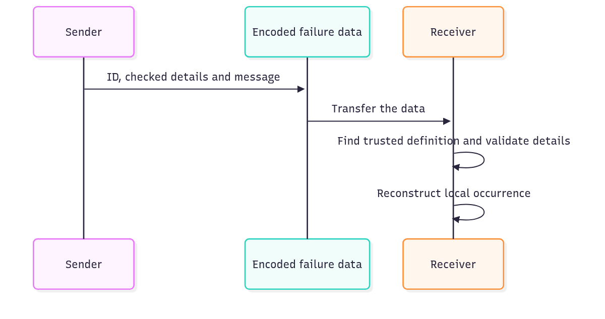

# `@okikio/result/failure`

An asset lookup can legitimately find no asset. Callers need to recognize “missing asset” even if its explanatory
sentence changes or the answer arrives from another process. `failure` defines that expected reason with a stable ID and
checked details, then creates individual occurrences of it.



[Editable diagram source](./diagram.mmd). The demo encodes and decodes locally to show these steps. The transfer is
something your application supplies; this package performs no network or storage I/O. Local JavaScript causes do not
enter the encoded representation.

## Keep a missing asset recognizable across a process transfer

An asset lookup reports a known missing ID. Encode that occurrence as transferable data, then decode it against the
receiver's trusted definition list. The restored value keeps both the recognized definition and the asset ID.

From a checkout of this experimental workspace, run `mise trust`, `mise install`, then `mise run prepare -- --kind deps` at the repository root. Save the following program as `example.ts` and run `mise exec -- deno run example.ts`. These commands use the workspace export maps; they do not assume a published registry version.

```ts runnable
import * as failure from '@okikio/result/failure';
import * as schema from '@okikio/schema';
const Missing = failure.define({
	id: 'asset.missing',
	description: 'The requested asset does not exist.',
	data: schema.object({ id: schema.string() }),
});
const occurrence = await failure.create(Missing, { data: { id: 'asset-1' } });
const wire = await failure.encode(occurrence);
// Decode against trusted definitions. The wire ID alone must not manufacture a failure declaration.
const restored = await failure.decode(wire, [Missing]);
console.log(restored.definition === Missing, restored.data.id);
```

Expected output:

```text output
true asset-1
```

The demo creates a missing-asset occurrence for `asset-1`, then reconstructs it using the trusted `Missing` definition.
The output means the reconstructed occurrence uses that exact definition and keeps the asset ID. Change the asset ID in
the input to change the retained details. An unknown failure ID cannot invent a new trusted definition at decode.

The local value is an `Error` with useful structured fields, so ordinary `throw` and `catch` still work. Its compact
contract is `Occurrence<typeof Missing>`: `definition` is the exact `Missing` object, `data` is the schema's
`{ id: string }` output, and `message` is explanatory text. The optional `cause` stays in the current process.

Encoding changes the shape to an inert record:

```text
{ id: "asset.missing", data: { id: "asset-1" }, message: "The requested asset does not exist." }
```

`create()` validates data and constructs the local Error. `encode()` follows the explicit codec encoder or an owned
identity validator before copying the ID, message, and data. A transformation without an encoder rejects instead of
interpreting an output as input. `decode()` checks the envelope, finds the ID in definitions you supplied, then
validates against that definition before constructing a new Error. This preserves a recognizable reason without trying
to send a live Error instance, stack, or provider client to another runtime.

## Results, expected failures and diagnostics

Use Result when a call can return success or failure as data. If a missing asset is an expected outcome, define it
with Failure and put the actual failure in the result. If the call throws something unexpected, use Fault to prepare
a report within size limits. Your code decides which failures it expects and when a retry is safe.

For transformed data, supply a codec as `data`. `create()` decodes incoming data once, `encode()` uses the reverse
direction, and `decode()` resolves the ID through trusted definitions before validating the wire value. Native identity
schemas work directly. External identity validators require `codec.identity(schema)` as an explicit declaration. Local
causes are never encoded.

## Upgrade a saved failure without guessing its schema

A breaking payload change uses a new failure ID. Keep the historical definition
until the application has migrated or expired every record that uses it. The
`failure/migrate` entry checks the old payload, calls your conversion, checks the
new payload, then returns an encoded replacement. It does not write storage.

```ts
import { migrate } from '@okikio/result/failure/migrate';
import * as failure from '@okikio/result/failure';
import * as schema from '@okikio/schema';

const Previous = failure.define({
	id: 'asset.missing.v1',
	description: 'The asset is missing.',
	data: schema.object({ path: schema.string() }),
});

const Current = failure.define({
	id: 'asset.missing.v2',
	description: 'The asset is missing.',
	data: schema.object({ id: schema.string() }),
});

const saved = { id: Previous.id, data: { path: 'asset-1' }, message: 'Archived asset is missing.' };

// Both definitions are trusted application code; the saved ID cannot select an arbitrary converter.
const replacement = await migrate(saved, {
	from: Previous,
	to: Current,
	convert: ({ path }) => ({ id: path }),
});

// The application now writes replacement in its own transaction or compare-and-swap.
console.log(replacement.id, replacement.data);
```

The saved explanation remains intact. A local cause is not transferred. Unknown
IDs, invalid historical data, conversion errors, and invalid replacement data
reject before a replacement is returned. Converters should be pure so a storage
retry does not repeat external effects. Apply a second explicit transition when
several historical versions must be upgraded; there is no global migration registry
or automatic fallback during ordinary `decode()`.

## Choose adjacent capabilities

Use Failure for a stable expected rejection that callers can encode and recognize. Result carries success or failure as
data; Fault projects unexpected exceptions without inventing a domain failure definition.

The [package choice map](../README.md#choose-an-entry-point) lists the other public entries and when to use them.

## Read further

The [numbered guide](https://github.com/okikio/utils/blob/main/docs/packages/08-failure.md) explains the model, manual
alternatives, and composition.
