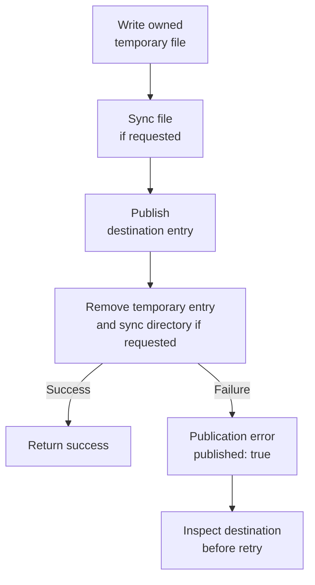

# Runtime

A **runtime** is the program that executes your JavaScript: Deno, Node, Bun, or a browser. They share many Web APIs,
but starting a worker or subprocess uses different host facilities. An **adapter** translates one of those facilities
into the same Utils operation, so the work inside the worker can keep the same request and reply contract.

For example, a photo resize can run in a Node thread on a server or a browser Worker in a web page. The application
chooses where it runs and owns stopping it. Importing an adapter only makes its functions available; calling its launch
operation is what starts another execution context.

For Deno, Node, and Bun execution, see [run a portable example](../../docs/05-runtime.md#run-a-portable-example-in-your-own-project). Host-specific adapters keep their native runtime requirements.

| Host    | Entry points                                                                                                                       |
| ------- | ---------------------------------------------------------------------------------------------------------------------------------- |
| Node    | `@okikio/runtime/node/worker`, `@okikio/runtime/node/process`                                                                      |
| Deno    | `@okikio/runtime/deno`, `/deno/worker`, `/deno/process`, plus permission, signal, file, port, proxy, readiness and health subpaths |
| Bun     | `@okikio/runtime/bun/worker`                                                                                                       |
| Browser | `@okikio/runtime/browser/worker`                                                                                                   |

If you only need to describe a host in TypeScript, import `Host` from the root. To start a real worker or subprocess,
select its adapter above. The root does not inspect globals, import a native adapter or start a process. Node threads
use `node:worker_threads`. Browser and Bun worker adapters accept their host's Worker capabilities. Deno adapters stay
available through JSR/source exports and are omitted from the npm projection, where Deno globals are unavailable.

Adapters preserve the shared Worker protocol's input, output, progress and reverse-request types. Resource ownership
remains explicit: cancellation joins cleanup and a host that cannot cooperate is retired before reuse. See the
[Deno host guide](./deno/README.md) and [Worker guide](../worker/README.md) for lifetime semantics.

Choose the highest layer that solves your task. To send a checked message, start with
[Worker's complete two-file example](../worker/thread/README.md). Add a Runtime adapter when your selected host needs
one, such as Node's `worker_threads`. Use the permission, port, signal and health modules independently when an
executable needs those host facilities. You do not need to assemble every Runtime subpath before using Worker.

## Prepare a browser contract without starting a Worker

Prepare an echo protocol and a checked reply without opening a browser Worker. The response is an ordinary value; the
empty transfer list shows that this reply transfers no separately owned buffers.

These examples use the current experimental source checkout, not an assumed registry release. From the `utils`
repository root, review `mise.toml`, run `mise trust`, then `mise install` and `mise run prepare -- --kind deps`.
Save the following module as `example.ts` and run `mise exec -- deno run example.ts`.
[Checkout prerequisites](../../README.md#work-on-the-repository) explain installing Mise.

```ts runnable
import { protocol, reply } from '@okikio/runtime/browser/worker';
import * as schema from '@okikio/schema';
import { read } from '@okikio/schema/codec';
// Describe the data crossing the worker boundary without starting a worker.
const Echo = protocol({ request: schema.string(), response: schema.string() });
// Validate the response first, then package it with its explicit transfer list.
const outgoing = reply(await read(Echo.response, 'ready'));
console.log(outgoing.response);
console.log(outgoing.transfer.length);
```

```text output
ready
0
```

A browser application passes its actual Worker and this contract to `open()`. The example demonstrates import-safe
contract preparation and the explicit transfer envelope; it creates no fake host.

## Move from a contract to an actual host

The echo example above deliberately stops before launch. To observe a real native boundary, follow the
[Deno two-file child](./deno/README.md#launch-a-real-child-with-the-chosen-grants): the parent launches Deno, waits for
exit, and prints a denied file read from the child. For a bidirectional protocol rather than a one-shot command, use the
[complete Worker thread program](../worker/thread/README.md). It supplies both host and worker entry modules, sends a
checked request, and joins disposal. Choose the adapter for the host you will actually deploy; a successful contract-only
example does not test thread startup, browser transfer, subprocess capture, or host cancellation.

## Borrow a Node parent port

`@okikio/runtime/node/worker.scope(port)` owns its message listeners and borrows the selected MessagePort. A synchronous
Dispose stack records each removal before registration can fail, releases both listeners even if one removal throws, and
makes repeated disposal harmless. Setup and release failures retain standard SuppressedError ordering. Disposing the
scope leaves the port open for its application's owner. `serve()` retains this bridge until the Worker server's actual
cleanup completes.

## Supply a native Node thread to an activity provider

`@okikio/runtime/node/worker.create(module, options)` returns the shared protocol's raw Worker surface. Pass it as the
factory when an Activity provider must own native threads. Unlike `open()`, it does not open a second typed protocol
client around the host. Importing the factory starts no thread; calling it starts one.

```ts
import * as native from '@okikio/runtime/node/worker';
// Inside activityWorker.create({ ..., create }):
const create = (module: URL, selected: { name?: string }) =>
	native.create(module, { name: selected.name, resourceLimits: { maxOldGenerationSizeMb: 256 } });
```

The provider owns termination; the adapter joins native exit and removes its bridge listeners. Node's options control
thread environment, arguments and runtime limits. They do not define placement, resource leases or a per-request memory
quota. A multi-thread provider remains one registered executor. Use its `hosts()` references and
`placement.host(executor, hostReference)` when an activity must return to one particular thread in that pool.
The [physical-host guide](../../docs/workflows/19-hosts.md) shows selection, retirement and recovery limits.

## Select the host that supplies the capability

A browser Worker and a Node thread can execute the same Worker protocol through different host adapters. A subprocess
has a distinct launch and termination contract.

Import the adapter for the actual host, then pass it to Worker or an Activity engine. Portable domain code should not
discover globals or choose a deployment.

Contract construction does not launch a host. Deno-specific entries are source/JSR capabilities and are intentionally
absent from the npm projection.

## Choose an entry point

Use the table to find a focused import for the job you need. Contract links open the exact public source, including its
options and types.

| Import                             | Use it to                                                                | Exact contract                    |
| ---------------------------------- | ------------------------------------------------------------------------ | --------------------------------- |
| `@okikio/runtime/deno`             | Select Deno host operations explicitly.                                  | [Contract](./deno/mod.ts)         |
| `@okikio/runtime/deno/permissions` | Build and check Deno permission requests.                                | [Contract](./deno/permissions.ts) |
| `@okikio/runtime/deno/types`       | Import public types for this capability; this entry does not start work. | [Contract](./deno/types.ts)       |
| `@okikio/runtime/deno/signals`     | Own process-signal subscriptions and their removal.                      | [Contract](./deno/signals.ts)     |
| `@okikio/runtime/deno/file`        | Use Deno file host capabilities.                                         | [Contract](./deno/file.ts)        |
| `@okikio/runtime/deno/port`        | Select Deno port capabilities.                                           | [Contract](./deno/port.ts)        |
| `@okikio/runtime/deno/proxy`       | Use Deno proxy host integration.                                         | [Contract](./deno/proxy.ts)       |
| `@okikio/runtime/deno/readiness`   | Expose host readiness independently of application startup.              | [Contract](./deno/readiness.ts)   |
| `@okikio/runtime/deno/health`      | Expose Deno host health observations.                                    | [Contract](./deno/health.ts)      |
| `@okikio/runtime/deno/process`     | Supply the Deno subprocess adapter to Worker.                            | [Contract](./deno/process.ts)     |
| `@okikio/runtime/node/process`     | Supply the Node subprocess adapter to Worker.                            | [Contract](./node/process.ts)     |
| `@okikio/runtime/deno/worker`      | Supply the Deno Web Worker adapter.                                      | [Contract](./deno/worker.ts)      |
| `@okikio/runtime`                  | Use the package entry shown in the complete examples above.              | [Contract](./mod.ts)              |
| `@okikio/runtime/node/worker`      | Supply the Node worker_threads adapter.                                  | [Contract](./node/worker.ts)      |
| `@okikio/runtime/bun/worker`       | Supply the Bun Worker adapter.                                           | [Contract](./bun/worker.ts)       |
| `@okikio/runtime/browser/worker`   | Supply the browser Worker adapter.                                       | [Contract](./browser/worker.ts)   |
| `@okikio/runtime/inspect`          | Inspect host API availability without acquiring resources.               | [Contract](./inspect.ts)          |
| `@okikio/runtime/deno/inspect`     | Query exact Deno permission descriptors without requesting grants.       | [Contract](./deno/inspect.ts)     |

## Inspect host evidence without acquisition

```ts
import { inspect } from '@okikio/runtime/inspect';
const evidence = inspect();
console.log(evidence.host, evidence.adapters.worker, evidence.permissions);
```

This focused portable entry reads runtime identity and Web API availability. It creates no Worker, process, file,
listener or timer. `adapters` describes this package's tested entry points, while `features` describes visible Web
API constructors. For example, Node's Worker adapter can exist without a global Worker constructor. The root remains
type-only. An unfamiliar embedding reports `unknown`; replaceable host globals are diagnostic evidence, never
authentication.

Deno callers can query explicit permission scopes without requesting grants:

```ts
import { inspect } from '@okikio/runtime/deno/inspect';
const evidence = await inspect([{ name: 'read', path: '/srv/input' }], { maximumQueries: 1 });
console.log(evidence.permissions[0]?.state);
```

States distinguish `granted`, `denied`, `prompt` and an unavailable descriptor. The report retains only input positions
and states, excluding private paths and hosts. An unscoped query asks about the whole capability and can differ from a
scoped grant. Inspection does not guarantee any subsequent operation succeeds.

## Keep a Deno port reservation bound

```ts
import { reserve } from '@okikio/runtime/deno/port';
using reservation = reserve();
console.log(reservation.address.port);
// A server that accepts this listener can use reservation.listener.accept().
```

The reservation owns closure of the bound listener. Repeated disposal is harmless; accepted connections belong to their
accepting caller and need separate disposal. Use the actual listener to avoid a discovery/rebind race. An unrelated
child cannot bind this occupied port: give the child port zero and wait for its explicit ready address instead. Existing
`get()` still closes its temporary listener before returning a number and therefore cannot promise the number remains
available.

## Measure inspection without acquisition

The focused benchmarks measure 1 and 1,000 frozen host-evidence snapshots. The benchmark compares against primitive
feature checks only. Primitive checks omit the report. Real ports and host permissions remain root diagnostics.

From the repository root, run the package's tests and untimed benchmark checks before collecting timings:

```sh
deno task --cwd=packages/runtime test
deno task --cwd=packages/runtime bench:check
deno task --cwd=packages/runtime bench
```

These commands use package-owned fixtures and development dependencies. The
[benchmark protocol](../../docs/benchmarks/01-running.md#choose-a-comparison-that-answers-the-question) explains fair
comparisons, raw report collection and the limits of local measurements.

## Select file publication and synchronization

`@okikio/runtime/deno/file` retains `write(path, contents, options)`. Omitted options preserve replacement without
synchronization. `overwrite: 'create'` publishes with an exclusive hard link, rejecting existing entries without a
check/rename race; `'replace'` renames over the destination entry. Replacing a symlink replaces its entry and does not
write through it. Parent directories must be trusted; this API does not enforce containment against parent symlinks.

`durability: 'file'` requests file synchronization before publication. `'directory'` additionally synchronizes the
parent after publication and removal of the temporary entry. Unsupported host operations fail; there is no silent
fallback. `FilePublicationError.published` is true when final synchronization or cleanup fails after the destination was
published. Inspect the destination before retrying. Cancellation is checked before publication; cancellation racing a
publication syscall cannot roll it back. Keep input bytes stable until settled.

The two option groups answer different questions: may this write replace a name, and what must be synchronized?

| Option | Effect |
| --- | --- |
| `overwrite: 'replace'` (default) | Rename the complete new file over the destination entry |
| `overwrite: 'create'` | Link the complete new file only if the destination does not exist |
| `durability: 'none'` (default) | Publish without requesting filesystem synchronization |
| `durability: 'file'` | Synchronize the new file before publishing its name |
| `durability: 'directory'` | Synchronize the new file, publish it, remove the temporary entry, then synchronize the parent directory |



Before publication, a failure leaves the previous destination in place and cleanup removes the owned temporary entry.
After publication, a synchronization failure can reject even though readers can already see the new contents. Treating
that rejection as “nothing happened” can overwrite a successful write. Inspecting the destination is therefore a
recovery step, not merely an error message.

Temporary files use exclusive creation and mode 0600 subject to umask. Replacement does not preserve old ownership or
modes. Normal failures remove only an owned temporary entry; process death can leave one for application recovery. Local
process-kill tests demonstrate complete old/new visibility at instrumented boundaries, not power-loss durability.
Filesystem, operating-system and hardware guarantees remain external. No Node-specific file adapter is inferred from
this Deno-owned implementation.
