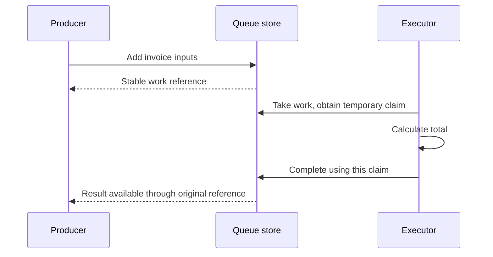

# `@okikio/scheduler/queue`

A thumbnail request needs to wait until a converter is free. If a converter stops halfway through, another one should be
able to try that request without letting the old converter overwrite a newer result. `@okikio/scheduler/queue` gives
each piece of work a stable reference and each attempt a temporary claim, then accepts completion only from the live
claim.

A **claim** is permission to work on one queued item until its lease expires. **Fenced completion** means an old claim
cannot publish over the current owner. The included `memory()` store keeps all of this in the current process;
restarting the process loses it.

For a PostgreSQL queue that survives worker process loss, use `@okikio/storage/queue/postgres`. It implements this same
Queue contract. The separate [workflow adapter](../../../docs/workflows/01-basics.md) owns its own workflow queue; it
does not require a second queue beside it.

```text
Add work -> queued -> claim by worker-a -> complete with live claim -> result
                         |
                         +-> claim expires -> recover / claim again
                                                   |
                                      old worker-a completion rejected
```

The visual shows logical ownership, not automatic thread creation. The caller runs work and drives the applicable
recovery operations. Claims prevent stale publication; they cannot undo external side effects already performed.

The **producer** submits work, the **executor** attempts it, and the **queue store**
records who may publish a result. A claim is temporary permission for one attempt;
it is not the final answer. A newer attempt can replace expired permission, so an
old executor must present its claim when completing work. That rejection cannot
undo a payment or other external write the old executor already performed.



The example runs all three roles in one process. The diagram describes logical
ownership, not a network service or automatic worker fleet. Memory state ends
with that process; persistent stores and real host delivery are separate choices.

## Queue an invoice calculation and retrieve its total

From the repository root, run `mise run prepare -- --kind deps` once. Save the complete block as the named `.ts` file and run
`mise exec -- deno run invoice.ts`. These examples use workspace imports; they need no published package or network service.

The explicit polyfill imports let this example run when the host lacks Temporal or disposal globals. An existing native
implementation is preserved.

```ts runnable
import '@okikio/duration/polyfill';
import '@okikio/dispose/polyfill';
import * as queue from '@okikio/scheduler/queue';
await using jobs = queue.fifo(queue.memory<readonly number[], number>());
const ref = await jobs.add([1999, 500]);
// Claim one attempt before computing its answer. The queue result is still pending at this point.
const task = await jobs.take();
if (task === undefined) throw new Error('No work was available.');
await task.complete(task.value.reduce((cents, price) => cents + price, 0));
console.log(`$${((await jobs.result(ref)) / 100).toFixed(2)}`);
```

Expected output:

```text output
$24.99
```

The producer submits two prices in cents. The executor claims those inputs and publishes their total. The producer's
reference retrieves `$24.99` later without retaining the executor's temporary claim. This example runs both roles in one
module; an application can submit work from a request and calculate it in a later execution loop.

`memory<readonly number[], number>()` creates a queue whose inputs are price arrays and outputs are totals in cents.
`fifo()` supplies a small one-at-a-time API with an internally owned Context, so this path needs no Context import or
worker runtime. `add()` returns a `Promise<QueueRef>`, `take()` returns a
`Promise<QueueClaimHandle<readonly number[], number> | undefined>`, and `result()` waits for the ordinary output number.
`await using jobs` closes the queue and its local waiters when the block ends.

The utility stores and coordinates the work; the ordinary `reduce()` expression calculates the total. The producer's
stable reference and the executor's temporary claim have different jobs:

```text
QueueRef:         { id }                            identifies the logical request
QueueClaim:       { id, itemId, owner, value, attempt, claimedAt, expiresAt }
QueueClaimHandle: those claim fields + complete(), retry(), fail(), renew()
```

The claim's `id` identifies this attempt. Its `itemId` is the reference's `id`. `fifo.take()` wraps the underlying
`claim({ limit: 1 })`; `task.complete()` forwards its retained claim for validation. Completion only succeeds while that
claim is live. `retry()` puts the same logical item back for another attempt. Disposing a taken-item handle does not
implicitly complete, fail, or retry it: choose the outcome explicitly.

This separation makes later recovery possible without changing the producer's reference. The
[public source contracts](./mod.ts) describes the lower-level Context-taking queue for batch claims and custom clocks.
The memory implementation is process-local; its state disappears at process exit.

## Avoid adding the same report twice

A stable key makes producer retries reattach to one logical request. The key must describe the whole intended work,
including its version. This example deliberately submits identical work twice and receives the same item reference.

```ts runnable=repeat-report.ts
import '@okikio/duration/polyfill';
import '@okikio/dispose/polyfill';
import * as queue from '@okikio/scheduler/queue';
await using jobs = queue.fifo(queue.memory<string, string>());
const first = await jobs.add('report revision 7', { key: 'account-1:report:7' });
const repeated = await jobs.add('report revision 7', { key: 'account-1:report:7' });
console.log(first.id === repeated.id);
const task = await jobs.take();
if (task === undefined) throw new Error('No report was available.');
await task.complete('Report ready');
console.log(await jobs.result(repeated));
```

```text output
true
Report ready
```

Admission deduplication does not compare arbitrary input values. A changed report must use a changed key, and
deduplicating the item cannot by itself prevent duplicate external writes made during execution.

- **Convert many uploads:** use [Workflow](../../workflow/README.md) for multi-step execution and a queue for pending
  work. [Worker](../../worker/thread/README.md) or [Process](../../worker/process/README.md) can perform the conversion.
  Durable recovery needs an atomic storage adapter; the memory queue is useful for local operation and simulation.
- **Accept repeated requests for the same report:** choose a stable admission key from the report's identity and
  version, then use [Telemetry](../../telemetry/README.md) to follow attempts. Reusing a queue key is logical
  deduplication, not an exactly-once guarantee for arbitrary external writes.

## Recover an item through its current claim

Start with FIFO convenience for a small local producer, then use explicit claims for multiple executors, priority or
expiry recovery. Renewal extends an attempt; completion must present the exact live claim. Expired claims can be
recovered and stale owners cannot replace the result. memory() loses all state when the process exits. A storage adapter
must make admission, claiming and fenced completion atomic for durable or distributed work.

## Recover the invoice and reject the old completion

A test clock advances lease time deterministically; it does not kill or replace a process. Both attempts below share
one memory queue. The logical invoice keeps its reference, while the replacement gets attempt 2.

```ts runnable=recover-invoice.ts
import '@okikio/duration/polyfill';
import '@okikio/dispose/polyfill';
import * as context from '@okikio/context';
import * as queue from '@okikio/scheduler/queue';
const clock = new context.TestClock();
await using owner = context.create({ id: 'invoice-owner', clock });
await using jobs = queue.memory<readonly number[], number>({ clock, capacity: 1 });
const ref = await jobs.add(owner, [1999, 500]);
const first = (await jobs.claim(owner, { owner: 'calculator-a', duration: { seconds: 5 } }))[0]!;
clock.advance({ seconds: 6 });
const replacement = (await jobs.claim(owner, { owner: 'calculator-b', duration: { seconds: 5 } }))[0]!;
console.log('Same invoice:', first.itemId === replacement.itemId, 'attempt:', replacement.attempt);
try {
	await jobs.complete(owner, first, 0);
} catch (error) {
	if (!(error instanceof queue.StaleClaimError)) throw error;
	console.log('Old completion rejected');
}
await jobs.complete(owner, replacement, replacement.value.reduce((total, price) => total + price, 0));
console.log('Accepted cents:', await jobs.result(owner, ref));
```

```text output
Same invoice: true attempt: 2
Old completion rejected
Accepted cents: 2499
```

The claim check protects the queue's accepted result. It cannot reverse an invoice charge already sent to another
service. Use a stable business-operation key at that receiver, or reconcile an uncertain charge before resending it.
For process-loss recovery choose the PostgreSQL queue adapter, migrate it explicitly and retain its database. Closing a
memory queue destroys this evidence; keeping only `ref` does not restore it.

## Choose adjacent capabilities

Use Concurrency for active callbacks and Storage Queue for persisted claims. A queue result and a lease attempt have
different identities.

The [package choice map](../README.md#choose-an-entry-point) lists the other public entries and when to use them.

## Read further

The [numbered guide](https://github.com/okikio/utils/blob/main/docs/queue.md) explains the model, manual alternatives,
and composition.
