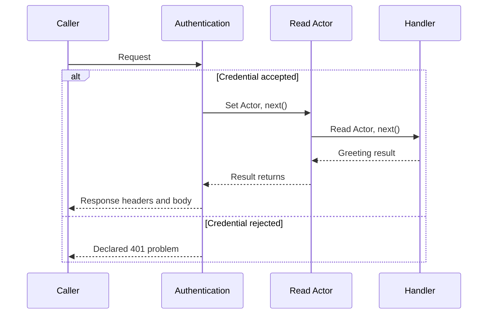

# Provide request values before another step uses them

An authentication step checks a credential and produces an actor for one request. A later step needs that actor.
Middleware declarations make the dependency visible; bound callbacks do the actual checking and populate the value.
Declaring `provides: [Actor]` does not create or authenticate anyone.

These examples use the experimental Utils source checkout. From its root, review `mise.toml`, then run `mise trust`,
`mise install`, and `mise run prepare -- --kind deps`. Save each named file at that root. The examples use workspace exports;
they do not assume a newly published registry version.

The middleware forms a call stack. On success, authentication supplies `Actor`, the reader uses it, and the handler
returns a greeting. A denial returns before either downstream step. The arrows returning upward mean `next()` has
returned a logical result; they do not mean a streaming response body has finished:



After headers return, the caller still owns consuming or cancelling the body. Completion observers report that later
boundary. The diagram omits compilation and individual validation stages; the lane table below locates those stages.

## Follow one greeting through a producer and a consumer

Save `actor-greeting.ts`. The public `demo-token` is a fixed teaching credential, not a real authentication scheme.
Only the example's local comparison accepts it. A deployed host must verify its own credential and authorization rules.
The first request reaches both middleware steps and the handler; the second is rejected before the actor consumer runs.

`await` waits for an operation's result while allowing other ready JavaScript callbacks to run.
`await using runtime` also registers the service for cleanup when the current block ends, including after an error.
That declaration does not open a network listener. Here, `runtime.fetch()` receives a local `Request` directly:

```ts runnable=actor-greeting.ts
import * as endpoint from '@okikio/server/endpoint';
import * as response from '@okikio/http/response';
import * as problem from '@okikio/http/problem';
import * as service from '@okikio/server/service';
import * as middleware from '@okikio/server/middleware';
import * as schema from '@okikio/schema';

// Name the checked request value that later middleware may read.
const Actor = middleware.context<{ name: string }>()({ id: 'actor', description: 'Verified actor for one request.' });
const Unauthorized = problem.define({
	id: 'auth.required',
	type: 'https://problems.example.invalid/auth',
	status: 401,
	title: 'Authentication required',
	description: 'No accepted demo credential.',
});
// Describe which checked value authentication provides. Its implementation must supply that value before Read runs.
const Authentication = middleware.define({
	id: 'authenticate',
	description: 'Check the demo credential.',
	provides: [Actor],
	problems: [Unauthorized],
});
const Read = middleware.define({ id: 'read-actor', description: 'Use the checked actor.', requires: [Actor] });
const Greeting = response.ok(schema.object({ message: schema.string() }), {
	id: 'greeting',
	description: 'Greeting result.',
});
const Greet = endpoint.get({ id: 'greet', path: '/greeting', responses: [Greeting] });

// Collect the declared routes before attaching their behavior.
const Api = service.define({ id: 'greetings', path: '/', endpoints: [Greet], middleware: [Authentication, Read] });

// Bind handlers to the exact definitions above. Matching text IDs alone are insufficient.
const implementation = service.implement(Api, {
	endpoints: [endpoint.handler(Greet, () => response.create(Greeting, { message: 'Hello!' }))],
	middleware: [
		middleware.handler(Authentication, async ({ request, values }, next) => {
			if (request.headers.get('authorization') !== 'Bearer demo-token') return problem.create(Unauthorized);
			values.set(Actor, { name: 'Sam' });
			// next() enters the remaining middleware and handler; awaiting it joins their return path.
			return await next();
		}),
		middleware.handler(Read, async ({ values }, next) => {
			console.log('Actor', values.get(Actor).name);
			// next() enters the remaining middleware and handler; awaiting it joins their return path.
			return await next();
		}),
	],
});

// Compilation checks the bindings; the live runtime owns request resources.
await using runtime = service.create(service.compile(implementation), { host: {} });
for (const headers of [new Headers({ authorization: 'Bearer demo-token' }), new Headers()]) {
	// Exercise a matched request and consume its body.
	const outgoing = await runtime.fetch(new Request('http://localhost/greeting', { headers }));
	console.log(outgoing.status, (await outgoing.json()).title ?? 'Greeting returned');
}
console.log(middleware.validate([Read]).valid, middleware.validate([Authentication, Read]).valid);
```

Run `mise exec -- deno run actor-greeting.ts`. It prints:

```text output
Actor Sam
200 Greeting returned
401 Authentication required
false true
```

The final two booleans check the declarations: `Read` alone has no producer; `Authentication` followed by `Read` has one.
The earlier output proves the callbacks actually ran. `Actor` is an identity-keyed slot, not a global variable. Each
request has its own store. Use the exact key object in `provides`, `requires`, `set` and `get`.

```text
valid credential -> Authentication sets Actor -> Read gets Actor -> greeting result
invalid credential -> declared 401 problem; Read and the greeting do not run
```

`middleware.context<{ name: string }>()(...)` first selects the TypeScript type, then creates the key. The annotation
does not validate a credential at runtime. `next()` runs downstream work and returns its eventual result; returning a
problem without calling `next()` stops this request. Code after `await next()` runs on the return path.

## Choose the right middleware layer

This package declares request lanes, required/provided values and exact bindings for a compiled Service. For a plain
`Request -> Response` application, use [HTTP middleware](../http/README.md). For authorization, use
[permission checks](../../authz/permission/README.md); an available actor is not permission to read every record.

The [middleware guide](../../../docs/server/07-middleware.md) explains lane placement, timing, once-per-request behavior
and declaration inspection. The [public contracts](./mod.ts) list the independently useful planning functions.
