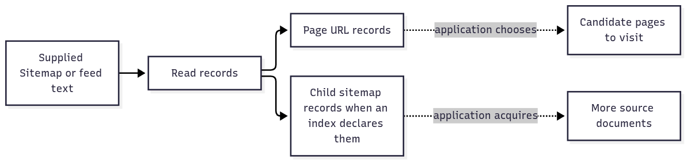

# `@okikio/sitemap`

A website provides a list of pages for discovery, sometimes as Sitemap XML, sometimes as a feed or a plain URL list.
`sitemap` reads those supplied documents into page or child-source records. It saves a collector from writing a
different URL extractor for each supported format; it does not download the listed pages.



[Editable diagram source](diagram.mmd). The first demo contains only one page record. Child records describe other
sources rather than fetching them. Dotted arrows are decisions and I/O your application must provide; this view omits
format errors and streaming limits.

The [full API reference](API.md) includes source formats, streaming options and record metadata.

## Run a complete example

```ts runnable
import * as sitemap from '@okikio/sitemap';
const text =
	'<urlset xmlns="http://www.sitemaps.org/schemas/sitemap/0.9"><url><loc>https://example.com/guide</loc></url></urlset>';
console.log(
	JSON.stringify(sitemap.locations({ url: 'https://example.com/sitemap.xml', contentType: 'application/xml', text })),
);
```

Expected output:

```text output
["https://example.com/guide"]
```

The input is a complete XML document containing the guide URL. `locations()` returns that one address, which the demo
prints as an array. Add another `<url><loc>...</loc></url>` entry to list a second page. A listed URL is a discovery
candidate, not proof that the page exists or should be crawled.

## Decide whether a record is a page or another source

The same parser handles a page list and an index of other sitemap files. Check `kind` before deciding what work to
schedule. The example only prints decisions; it performs no recursive downloads.

```ts runnable=index-decisions.ts
import { parse } from '@okikio/sitemap';

const records = parse({
	url: 'https://example.com/sitemap.xml',
	contentType: 'application/xml',
	text:
		'<sitemapindex xmlns="http://www.sitemaps.org/schemas/sitemap/0.9"><sitemap><loc>https://example.com/pages.xml</loc></sitemap></sitemapindex>',
});
for (const record of records) {
	if (record.kind === 'sitemap') console.log(`Read another source: ${record.loc}`);
	else console.log(`Consider a page: ${record.loc}`);
}
```

```text output
Read another source: https://example.com/pages.xml
```

| Call or value                       | Contract                                                                                        | Meaning                                                                                  |
| ----------------------------------- | ----------------------------------------------------------------------------------------------- | ---------------------------------------------------------------------------------------- |
| Complete input                      | `{ text, url, contentType?, policy? }`                                                          | Supplied source content and metadata; `url` helps identify the source format.            |
| `SitemapRecord`                     | `{ kind: 'url' \| 'sitemap', loc, format, alternates, lastModified? }`, with more page metadata | A page candidate or child source, not a completed download.                              |
| `parse(input)` / `locations(input)` | Readonly record array / readonly URL array                                                      | Complete in-memory parsing. Unsupported or failed XML parsing can return an empty array. |
| `parseStream(input)`                | Byte stream + awaited `onRecord` → `Promise<{ byteLength, capped, format?, problems }>`         | Reports streaming observations and byte capping; owns and releases the stream reader.    |

Under the hood, source metadata and a prefix choose text versus XML. XML parsing uses namespace-aware records to
distinguish Sitemap, RSS and Atom content, then one reducer projects their fields into `SitemapRecord`. Complete-source
parsing removes duplicate records. The streaming path awaits your sink after each record so a slow consumer can apply
backpressure.

One record shape lets discovery code reuse scheduling logic across formats. Use `parseStream()` when diagnostics or
bounded incremental input matter: an empty result from convenience `parse()` alone cannot prove that the source was
valid and empty. Your application owns nested-source limits, fetch policy and admission of discovered pages.

## Build on the example

- Get declared Sitemap addresses from [Robots](../robots/README.md), acquire those sources in your application, then
  apply robots rules to discovered page candidates. The complete local example below uses supplied bytes.
- Pair streamed discovery with a [Context](../context/README.md) signal and an awaited `onRecord` sink. A slow sink can
  make the parser wait rather than forcing your application to retain every record at once.

## The ordinary problem

A generic XML parser can find `loc` elements in a small source. A discovery reader must also distinguish pages from
child sources, interpret RSS/Atom links, handle plain-text lists, respect namespaces and bound streamed bytes. Those
format and lifetime rules are the reusable work this package supplies.

## Use the utility

For a small complete source, use `parse()` or `locations()`:

```ts
import * as sitemap from '@okikio/sitemap';

const records = sitemap.parse({
	url: 'https://example.com/sitemap.xml',
	text: `<?xml version="1.0"?>
    <urlset xmlns="http://www.sitemaps.org/schemas/sitemap/0.9">
      <url><loc>https://example.com/a</loc></url>
      <url><loc>https://example.com/b</loc></url>
    </urlset>`,
});

console.log(records.map((record) => record.loc));
// ['https://example.com/a', 'https://example.com/b']
```

For unknown or large input, use `parseStream()` as in the complete example below. Its `onRecord` callback is awaited, so
a slower consumer applies backpressure instead of forcing the package to retain the complete record set.

## Use with other utilities

Kaiju Crawl discovers Sitemap sources from robots declarations and waits for its candidate sink on each record. This
complete local version streams supplied bytes, applies robots rules and returns only accepted page URLs.

```ts runnable=stream-discovery.ts
import * as robots from '@okikio/robots';
import * as sitemap from '@okikio/sitemap';

const policy = robots.parse('User-agent: *\nDisallow: /private/\nSitemap: https://example.com/sitemap.xml\n');
const text = '<urlset xmlns="http://www.sitemaps.org/schemas/sitemap/0.9">' +
	'<url><loc>https://example.com/guide</loc></url>' +
	'<url><loc>https://example.com/private/report</loc></url></urlset>';
const candidates: string[] = [];
for (const url of robots.getSitemapUrls(policy)) {
	const parsed = await sitemap.parseStream({
		stream: new Response(text).body!,
		url,
		contentType: 'application/xml',
		maxBytes: 20_000,
		onRecord(record) {
			if (record.kind === 'url' && robots.match(policy, { userAgent: 'KaijuBot', url: record.loc })) {
				candidates.push(record.loc);
			}
		},
	});
	if (parsed.capped) throw new Error('The discovery source exceeded its byte budget.');
}
console.log(JSON.stringify(candidates));
```

Expected output:

```text output
["https://example.com/guide"]
```

`parseStream()` returns `Promise<SitemapStreamResult>`. It awaits `onRecord()` before advancing, so an asynchronous sink
can apply backpressure. The final application result is `string[]`; it is deliberately collected here. The parser owns
the stream reader and releases it when parsing finishes or fails. No context is needed for this supplied finite source;
the byte budget is the useful input bound.

For a fetched source, pass the caller's cancellation signal to both `fetch()` and `parseStream()`, reject unwanted HTTP
status, and limit nested source counts. Cancellation cannot undo an already accepted sink write. Robots owns rule
matching, Sitemap owns parsing, and the application owns acquisition and crawl policy.

## Parser and safety model

Production XML parsing uses `@std/xml`. The adapter tracks default namespace scope itself because unprefixed callbacks
do not carry enough namespace state for Sitemap semantics by themselves. Prefixed and unprefixed Sitemap documents
therefore pass through one semantic reducer.

The streaming parser also:

- detects XML versus text from source metadata and a bounded prefix;
- selects XML 1.0 or XML 1.1 from the replayed source prefix;
- rejects DOCTYPE input;
- bounds XML nesting and attribute counts;
- reports deliberate byte-limit truncation as `capped`;
- handles UTF-8 characters split across byte chunks;
- treats Atom `alternate` links as page candidates while excluding feed-control links such as `self` and `next`;
- reports an unexpected Sitemap namespace in standards mode.

Saxes is a **test-only differential oracle**. Production code does not import it. Keep the differential corpus until the
pinned `@std/xml` path continues to prove the same Sitemap semantics.

## Convenience and the manual equivalent

| Convenience             | Manual equivalent                                                                                         | Utility-owned invariant      |
| ----------------------- | --------------------------------------------------------------------------------------------------------- | ---------------------------- |
| `sitemap.parse()`       | detect format, parse, normalize records, de-duplicate                                                     | one complete-source contract |
| `sitemap.parseStream()` | byte accounting + format detection + incremental parser + backpressure + cancellation + problem reporting | bounded streaming discovery  |
| `locations()`           | parse records and project `loc` values                                                                    | simple URL-only use          |

## Source guide

1. `mod.ts` owns format detection, streaming byte policy, and Sitemap semantics.
2. `mod.test.ts` covers XML/feed/text behavior and safety limits.
3. `differential.test.ts` compares production semantics against Saxes on the namespace/chunking corpus.
