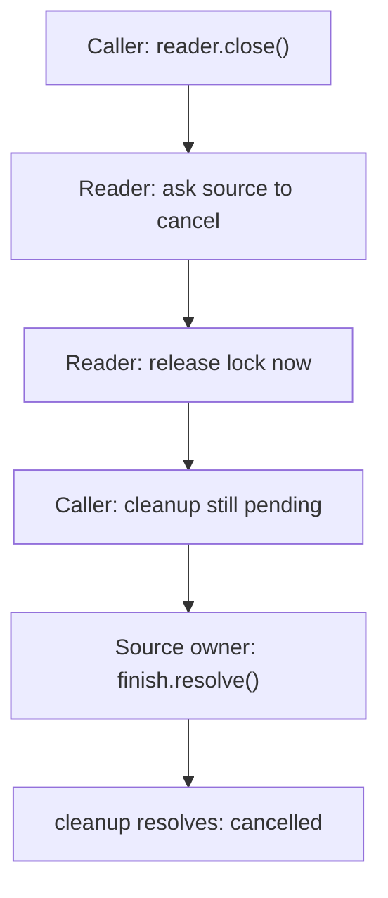
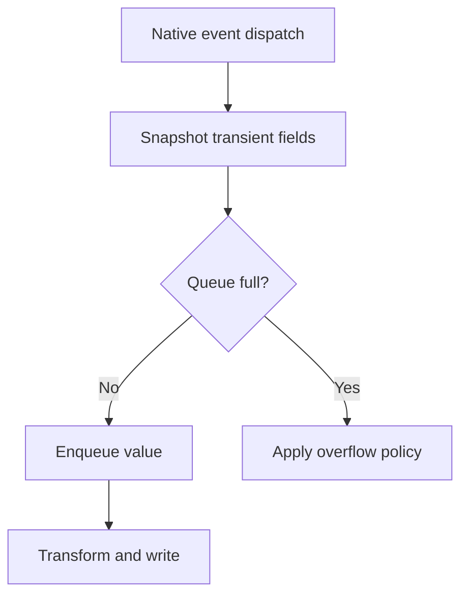

# `@okikio/streams`

A download may contain millions of lines. Reading it all into one array before doing useful work can run out of memory.
`@okikio/streams` lets you consume pieces as they arrive, split byte chunks into complete lines, and group records into
limited batches. You can start saving results before the whole input arrives.

For Deno, Node, and Bun execution, see [run a portable example](../../docs/05-runtime.md#run-a-portable-example-in-your-own-project). Host-specific adapters keep their native runtime requirements.

A **stream** delivers data incrementally. A **batch** is one bounded group. **Materializing** means collecting the
entire result in memory. `collect()` accepts optional limits; omitting them leaves collection unbounded, so supply
limits when the size of the source is unknown.

```text
Values: a, b, c -> batch(maximumItems: 2) -> [a, b] -> [c]

Byte chunks -> carry partial UTF-8 text / line -> complete lines -> consumer
                     enforce maximumLineBytes
```

The first row shows grouping; the second shows framing text that may span chunks. Neither promises that the consumer
stores nothing: collecting every batch or line still retains the full output. Incremental consumption is the useful path
for large inputs.

The [public source contracts](./mod.ts) includes adapter options, cancellation and limit error fields.

A producer supplies values; a consumer asks for and uses them. Network chunks
are arbitrary pieces of bytes, not complete lines, characters or JSON records.
A decoder may need to hold an unfinished character or record until the next
chunk arrives. A limit must bound that unfinished piece too.

**Backpressure** means the consumer's pace controls requests for more data. In a
`for await` loop, awaiting the destination write before asking for the next value
keeps that part of the pipeline paced. Starting detached writes or appending
every value to an array defeats that benefit. A producer can still have its own
native buffers; a stream is not a promise of zero retained memory.

```text
request next -> decode one record -> await destination write -> request next
       producer buffers + unfinished record + current write remain owned
```

If the consumer stops early, close or cancel the reader under its ownership
policy. Cancelling a pending read can finish before the source's cleanup does;
join the separately exposed cleanup when your operation owns that obligation.

## Group records and decode complete lines

Group three records into batches of at most two, then read two complete lines from a local response body. Collecting the
tiny outputs makes their shapes visible; a large destination can consume each yielded value instead.

These examples use the current experimental source checkout, not an assumed registry release. From the `utils`
repository root, review `mise.toml`, run `mise trust`, then `mise install` and `mise run prepare -- --kind deps`. Save the
following module as `example.ts` and run `mise exec -- deno run example.ts`.
[Checkout prerequisites](../../README.md#work-on-the-repository) explain installing Mise.

```ts runnable
import * as streams from '@okikio/streams';
// Limit each batch, not the total source. This tiny source is safe to collect for display.
const batches = streams.batch(['a', 'b', 'c'], { maximumItems: 2 });
console.log(JSON.stringify(await Array.fromAsync(batches)));
// Line framing handles byte chunks, which need not arrive on newline boundaries.
const bytes = new Response(`first
second
`).body!;
console.log(JSON.stringify(await Array.fromAsync(streams.lines(bytes, { maximumLineBytes: 64 }))));
```

Expected output:

```text output
[["a","b"],["c"]]
["first","second"]
```

`batch()` returns an async iterable of readonly item arrays; `lines()` returns an async iterable of strings.
`Array.fromAsync()` reads the whole sequence into an array and returns a Promise for that array. This example
collects only a small, finite input;
its output has two groups and two lines. Streaming adapters release owned readers when iteration completes or stops.

## Read each group and line in the output

The demo first groups three letters into a pair and a final single-letter batch. It then reads a small response body and
returns two text lines without their line-ending characters. Both sequences are collected only so their complete output
can be printed. Try a batch size of `1` to see three groups, or lower `maximumLineBytes` below the length of a line to
see the byte limit reject that line rather than silently truncate it.

- **Import a large CSV:** consume [CSV](../format/csv/README.md) rows incrementally, use batches for database writes,
  and use a [Context](../context/README.md) cancellation signal throughout. The database adapter still owns commit
  behavior.
- **Read records from a converter:** let [Process](../worker/process/README.md) own the child and use `lines()` for its
  byte output. Add [Concurrency](../scheduler/concurrency/README.md) only where independent downstream work can safely
  overlap.

## Save lines in small groups using an ordinary loop

`for await` is the asynchronous version of a normal `for` loop: it waits for the next value before entering the body.
Here a local response supplies lines, and the sink is an ordinary array. Replace the sink with an awaited database write
when integrating the same flow into an importer.

```ts runnable=line-batches.ts
import { batch, lines } from '@okikio/streams';

const response = new Response('Ada\nLin\nGrace\n');
if (response.body === null) throw new Error('Missing response body.');
const saved: string[][] = [];
for await (const group of batch(lines(response.body, { maximumLineBytes: 64 }), { maximumItems: 2 })) {
	saved.push([...group]);
}
console.log(JSON.stringify(saved));
```

```text output
[["Ada","Lin"],["Grace"]]
```

| Call                                   | Contract                                                       | Retained data and ownership                                                                                                 |
| -------------------------------------- | -------------------------------------------------------------- | --------------------------------------------------------------------------------------------------------------------------- |
| `lines(bytes, options?)`               | `ReadableStream<Uint8Array>` → async iterable of strings       | Frames one line from byte chunks; enforce `maximumLineBytes` for unknown input.                                             |
| `batch(values, options)`               | Iterable or async iterable → async iterable of readonly arrays | Retains the current bounded group; requires an item or byte bound. Object byte accounting uses your `size(value)` function. |
| `collect(values, options?)`            | Iterable or async iterable → `Promise<readonly Value[]>`       | Retains all accepted values. Without limits it is unbounded; exceeded bounds throw `StreamLimitError`.                      |
| `iterable(stream, { preventCancel? })` | Web stream → async iterable                                    | Releases its reader; early exit also cancels the source unless `preventCancel` is true.                                     |

One level deeper: `lines()` carries byte pieces until it finds a newline, enforcing the byte bound before joining and
decoding them. That preserves multibyte characters split across chunks. `batch()` counts items and bytes, then yields a
frozen group before beginning the next group. The consumer controls when iteration resumes.

This design lets ordinary loops share correct framing and bounds without a background pipeline runtime. Bounds govern
the adapter's buffer, not every downstream sink: `saved` deliberately collects all results above. For a large source,
write each group to its destination and avoid retaining it. Cancellation is cooperative; pass its signal to the source
operation too, because a signal cannot make arbitrary blocked I/O finish by itself.

## Import chunked logs and stop after one batch

Save as `log-import.ts` and run `mise exec -- deno run log-import.ts` after the setup above. The
producer intentionally splits a UTF-8 character and a JSON record across chunks. The consumer saves one bounded batch,
then stops; this demonstrates early cancellation rather than pretending the complete log was accepted.

```ts runnable=log-import.ts
import * as streams from '@okikio/streams';
import * as json from '@okikio/streams/json';
const bytes = new TextEncoder().encode('{"name":"Zoë"}\n{"name":"Ada"}\n{"name":"Lin"}\n');
let offset = 0;
let cancelled = false;
const source = new ReadableStream<Uint8Array>({
	pull(controller) {
		if (offset === bytes.length) {
			controller.close();
			return;
		}
		const end = Math.min(offset + 3, bytes.length);
		controller.enqueue(bytes.slice(offset, end));
		offset = end;
	},
	cancel() {
		cancelled = true;
	},
}, { highWaterMark: 0 });
const saved: string[] = [];
/** Validate each parsed value before retaining names in this finite, in-memory demonstration. */
async function saveBatch(records: readonly unknown[]): Promise<void> {
	for (const value of records) {
		if (typeof value !== 'object' || value === null || !('name' in value) || typeof value.name !== 'string') {
			throw new Error('Log record needs a name.');
		}
		saved.push(value.name);
	}
}

// Pull only the next bounded batch; saving it finishes before asking for another.
for await (
	const group of streams.batch(
		json.lines(source, {
			maximumBytes: 256,
			maximumLineBytes: 64,
			maximumItems: 3,
		}),
		{ maximumItems: 2 },
	)
) {
	await saveBatch(group);
	break;
}
console.log(saved.join(','));
console.log('Reader released:', !source.locked, 'Cancellation requested:', cancelled);
```

```text output
Zoë,Ada
Reader released: true Cancellation requested: true
```

`json.lines()` bounds original bytes, each line, and the number of records. JSON syntax alone does not check your
application record, so `saveBatch()` validates `name` before saving it. `batch()` holds at most two records; the sink
must not retain all records in a real large import. The local array makes this small output visible. `break` closes the
iterator chain and requests source cancellation. It is not successful end of input (EOF): later malformed lines were never checked.

Remove `break` to read all three records. Lower `maximumLineBytes` below the first line's byte size to see a bound
failure. Previously saved batches remain partial work if a later record fails. Use a staging table and a separate
publication step when the destination requires all-or-nothing visibility. An arbitrary producer may finish cancellation
later; the reader cleanup example below explains how to retain and join that eventual outcome.

## Release a reader promptly and join source cleanup separately

`@okikio/streams/reader` exposes the same reader owner used by bytes, lines, and format parsers. Its synchronous Dispose
stack releases the abort subscription and reader lock even if one release fails. Source cancellation has a separate
promise because a source or tee sibling can keep cancellation pending. `close()` always returns the same `cleanup`
promise; that promise resolves to an outcome and never rejects.

```ts runnable=reader-cleanup.ts
import { open } from '@okikio/streams/reader';
// Simulate a producer whose cancellation cannot finish until its own work is released.
const finish = Promise.withResolvers<void>();
const source = new ReadableStream<number>({ cancel: () => finish.promise });
const reader = open(source);

// close() releases our reader lock now, while retaining the producer's pending cleanup.
const cleanup = reader.close();
console.log(source.locked);

// The source owner finishes later. Only then can the cleanup outcome say cancelled.
finish.resolve();
console.log((await cleanup).status);
```

```text output
false
cancelled
```

The first print happens while source cancellation is still pending. The source is unlocked because the reader
has released its ownership, not because all producer work has stopped:



Read downward as the order in this example: the caller can print `false` at the pending step, before the source
owner permits cleanup to finish.

Choose `preventCancel: true` when the source remains borrowed; cleanup then reports `released`. At EOF it reports
`completed`. A late cancellation or local release failure reports `{ status: 'failed', error }`. When both fail, `error`
is a `SuppressedError` retaining the local release failure and the source cancellation failure. The outcome lets the
enclosing owner decide when to join the source without keeping its reader lock held.

## Connect an iterable to a Web Stream destination

`readable()` adapts iterable values to a Web `ReadableStream`; `pipe()` sends them to a `WritableStream` and lets native
stream pressure control progress. Use these when a destination already accepts Web Streams.

## Observe cancellation and source cleanup

`iterable()`, `lines()` and `bytes()` share one reader owner from `@okikio/streams/reader`. A signal that is already
aborted prevents reader acquisition. Aborting a pending read interrupts that read and releases its lock immediately.
Early iteration exit also releases the lock before returning, even when a tee sibling keeps source cancellation pending.

The source's cancellation hook can finish later or fail. Pass `onCleanup(completion)` to retain its outcome, or use
`reader.open()` directly and retain its `cleanup` Promise. The Promise always resolves to `completed`, `cancelled`,
`released`, or `{ status: 'failed', error }`; it never rejects. `close(reason)` starts cancellation and releases the
lock synchronously, then returns that same Promise. Await it when the source owner needs to join cleanup. When
`preventCancel` is true, the adapter releases its reader without cancelling the borrowed source.

`collect()` and `batch()` also check cancellation before creating or advancing an iterator. During a pending read, abort
stops observation promptly and requests `return()` once. Arbitrary producer Promises still belong to their producer;
`onCleanup` retains the eventual return outcome. Pass the same signal to the producer's I/O when that work must stop
too.

## Read JSON Lines without trusting its record shape

A log export can contain several JSON values separated by newlines. The JSON submodule owns byte limits and framing;
Schema owns what one application record means. A syntax-valid JSON value can still fail that application schema.

```ts runnable=json-lines.ts
import { lines } from '@okikio/streams/json';
import * as schema from '@okikio/schema';

const EntrySchema = schema.object({ name: schema.string() });
const source = new Response('{"name":"Ada"}\n{"name":"Grace"}\n').body!;
const names: string[] = [];
for await (const value of lines(source, { maximumBytes: 1024, maximumLineBytes: 100, maximumItems: 10 })) {
	const entry = await schema.parse(EntrySchema, value);
	names.push(entry.name);
}
console.log(names.join(', '));
```

```text output
Ada, Grace
```

A blank line or malformed JSON rejects. Exceeding any budget rejects too. A consumer that stops early cancels the
source; already yielded records remain partial work. Only successful EOF proves the whole document was read. The final
names array is intentionally retained application data and needs its own bound for large sources.

## Keep the next stage incremental too

An uploaded document needs a byte budget; a log stream needs line framing; a network reader must release its lock even
when a consumer stops early.

Use Bytes to read data into memory with a size limit. Use JSON to read or write separate JSON messages in a stream.
Use Reader when you need to know whether closing the source succeeded. Use Format when the input is CSV or a sitemap.

A bounded input read does not bound data retained later. Prompt reader-lock release and completion of underlying source
cancellation are separate events.

## Choose an entry point

Use the table to find a focused import for the job you need. Contract links open the exact public source, including its
options and types.

| Import                   | Use it to                                                                | Exact contract          |
| ------------------------ | ------------------------------------------------------------------------ | ----------------------- |
| `@okikio/streams`        | Use the package entry shown in the complete examples above.              | [Contract](./mod.ts)    |
| `@okikio/streams/types`  | Import public types for this capability; this entry does not start work. | [Contract](./types.ts)  |
| `@okikio/streams/bytes`  | Materialize binary input under a byte limit.                             | [Contract](./bytes.ts)  |
| `@okikio/streams/json`   | Read bounded JSON or frame JSON Lines input.                             | [Contract](./json.ts)   |
| `@okikio/streams/reader` | Own one reader, release its lock promptly, and inspect delayed cleanup.  | [Contract](./reader.ts) |
| `@okikio/streams/text` | Decode UTF-8 byte chunks or encode text with explicit byte limits. | [Contract](./text.ts) |
| `@okikio/streams/frame` | Split bytes by a delimiter or fixed width before interpreting each record. | [Contract](./frame.ts) |
| `@okikio/streams/events` | Observe native events or adapt push notifications to a bounded Web Stream. | [Contract](./events.ts) |

## Decode, frame and validate incrementally

`@okikio/streams/text` provides native UTF-8 `decode` and `encode` iterators. Decoding requires explicit fatal/BOM
policy plus total/chunk byte limits. Encoding requires total output bytes and incoming UTF-16 chunk limits, and carries
at most one high surrogate across strings. Both use the existing reader owner; early return releases its lock while
`onCleanup` observes eventual cancellation.

`@okikio/streams/frame` provides `split(source, delimiter, options)` and `fixed(source, size, options)`. Required
options independently bound total input, incoming chunks and frames. Choose `incomplete: 'emit' | 'reject'` for
unterminated/short EOF. Split excludes delimiters and does not add an empty frame at empty EOF; consecutive delimiters
produce empty frames. Every output frame owns its bytes. Delimiter matching retains at most frame bound plus delimiter
bytes and uses prefix fallback for repeated prefixes. A provider's pre-existing chunk allocation remains outside reader
ownership.

For example, an export might separate names with `|` instead of newlines. Framing finds each complete byte record;
a TextDecoder then gives that record its text meaning. This source ends with a delimiter, so no incomplete record
remains at EOF. The explicit `reject` policy would reject an unfinished final record.

```ts runnable=delimited-names.ts
import { split } from '@okikio/streams/frame';

const source = new Response('Ada|Grace|').body!;
const delimiter = new TextEncoder().encode('|');
const decoder = new TextDecoder('utf-8', { fatal: true });
for await (const record of split(source, delimiter, {
	maximumBytes: 64,
	maximumChunkBytes: 64,
	maximumFrameBytes: 16,
	incomplete: 'reject',
})) {
	console.log(decoder.decode(record));
}
```

```text output
Ada
Grace
```

The total byte limit bounds accepted input, the chunk limit rejects oversized deliveries, and the frame limit bounds
one unfinished name. They are separate because a tiny complete record does not prove a source or chunk is small.
Choose the limits from your file or protocol contract; these small values only describe this demonstration.

`bytes.rechunk` delegates fixed framing. `json.decode(schema, source, options)` parses JSONL and validates once per
record. It yields value/schema/syntax records with one-based record numbers and original zero-based UTF-8 byte offsets.
Choose `errors: 'throw'` for fail-fast `JsonRecordError`, or `yield` for bounded per-record schema evidence.
Total/chunk/line/record/issue/path bounds are explicit. Earlier outputs remain partial work if later input fails.
Foreign validator work is not interrupted by the returned-issue cap.

Native TextDecoder/TextEncoder own UTF conversion. STD's delimiter/fixed/capped transforms remain alternatives to
revisit; the capped and fixed contracts reviewed were unstable and do not replace this API's explicit
reader-cleanup/result contract automatically. No new STD runtime dependency was selected for framing.

## Measure framing and bounded consumption

The focused benchmarks measure text, byte frames and validated JSON at the program’s explicit chunk scales. The
benchmark compares against native TextDecoderStream or explicit framing references. Chunking, materialization and
validation differ between cases; no network throughput is implied.

From the repository root, run the package's tests and untimed benchmark checks before collecting timings:

```sh
deno task --cwd=packages/streams test
deno task --cwd=packages/streams bench:check
deno task --cwd=packages/streams bench
```

These commands use package-owned fixtures and development dependencies. The
[benchmark protocol](../../docs/benchmarks/01-running.md#choose-a-comparison-that-answers-the-question) explains fair
comparisons, raw report collection and the limits of local measurements.

## Flush a partial live batch when its deadline arrives

A live source may pause after one record. Waiting for three records could then delay a write indefinitely. This
complete example holds the next record back, advances a deterministic clock by 50 milliseconds and receives `[1]`
while the source is still open. The second record arrives afterward and flushes at EOF. A production operation supplies
its Context clock; the test clock makes the timing visible without sleeping in real time.

```ts runnable=timed.ts
import * as context from '@okikio/context';
import * as streams from '@okikio/streams';
const clock = new context.TestClock();
const nextRecord = Promise.withResolvers<void>();
let closed = false;
/** Keep the source open after record 1 until this example permits record 2. */
async function* records() {
	try {
		yield 1;
		await nextRecord.promise;
		yield 2;
	} finally {
		closed = true;
	}
}
const batches = streams.batch(records(), { maximumItems: 3, maximumDelay: 50, clock });
try {
	const first = batches.next();
	// Give the iterator time to accept record 1 and register its deadline.
	// Bound this check so a broken setup fails rather than waiting forever.
	for (let turn = 0; turn < 100 && clock.pending().length === 0; turn++) await Promise.resolve();
	if (clock.pending().length !== 1) throw new Error('Expected one batch deadline.');
	clock.advance({ milliseconds: 50 });
	console.log(JSON.stringify((await first).value), 'source closed:', closed);
	nextRecord.resolve();
	console.log(JSON.stringify(await Array.fromAsync(batches)), 'source closed:', closed);
} finally {
	// Release the producer before joining it, including when an assertion fails.
	nextRecord.resolve();
	await batches.return?.(undefined);
}
```

```text output
[1] source closed: false
[[2]] source closed: true
```

## Own timed flush and cleanup

For a live source, pass `maximumDelay` in milliseconds and a caller-owned `clock` with cancellable
`sleep(milliseconds, signal)` to `batch`. Context clocks fit this structural contract. The deadline starts with the
first item in a nonempty batch; empty batches are never emitted. Count and byte limits still apply. Only one source read
remains outstanding across a deadline flush, and consumer suspension does not start another read. A byte-boundary flush
can retain one incoming item outside the emitted batch, so the total retained estimate can reach two batch limits.
Estimates describe caller policy, not VM heap usage.

Early return or abort clears owned clock waits and requests source return once. Use `onCleanup` to await the producer's
actual cleanup outcome; an uncooperative producer may remain pending. Abort preserves the exact supplied reason. Clock
failures and size-estimator defects reject iteration. This adapter does not tee the source, buffer observer
notifications or promise a deadline while the consumer itself is suspended.

## Pipe native events and EventBus values

`@okikio/streams/events` keeps native event delivery available and adds Observable and Web Stream composition. Observe
original events synchronously when you need `preventDefault()`, `currentTarget` or `composedPath()`. A stream runs
later, after native dispatch has finished; snapshot dispatch-only fields before an asynchronous stage.

```ts runnable=native-events.ts
import * as events from '@okikio/streams/events';

const target = new EventTarget();
const source = events.observe<CustomEvent<number>>(target, 'value', { once: true });
const values = events.readable(source, { maximumItems: 2, overflow: 'error' });
const received: number[] = [];
const piping = values.pipeThrough(
	new TransformStream<CustomEvent<number>, number>({
		transform(event, controller) {
			controller.enqueue(event.detail);
		},
	}),
).pipeTo(
	new WritableStream<number>({
		write(value) {
			received.push(value);
		},
	}),
);
target.dispatchEvent(new CustomEvent('value', { detail: 7 }));
await piping;
console.log(JSON.stringify(received));
```

```text output
[7]
```

`observe()` is cold: each subscription owns its own listener, while the target is borrowed. Native listeners continue to
work. Capture, passive and once retain native meaning. Signal abort completes observation, while unsubscribing removes
only that subscription's listener. A supplied event generic asserts the caller's knowledge of the event name; it does
not validate host events.

The native event source pushes during dispatch. The pipe consumes later, so the queue needs a policy for the case
where events arrive faster than writes complete. A native event listener cannot make `dispatchEvent()` await a slow
consumer. For `currentTarget` or `composedPath()`, copy the needed fields in a synchronous subscription before sending
that snapshot downstream; their dispatch-time values may no longer exist when a pipe receives the Event.



| `overflow` | What happens to an incoming value when the queue is full | Use when |
| --- | --- | --- |
| `error` | Fail the stream and unsubscribe. | Missing a value must be visible. |
| `drop-newest` | Keep queued values; discard the new value. | Earlier accepted values matter most. |
| `drop-oldest` | Remove the oldest queued value; retain the new value. | Recent state matters more than old updates. |

These policies bound retained values, not their byte size. They cannot slow the native producer or recover a value
that was deliberately dropped.

`readable()` subscribes immediately and also accepts `EventBus.events` and piped Observables. A push producer cannot
wait for downstream demand. Choose `overflow: 'error'` for visible loss refusal, `'drop-newest'` to retain the oldest
queued values, or `'drop-oldest'` to retain recent values. The bound counts queued values, not their byte size or native
producer allocations. At most `maximumItems` values are queued, plus one handed to an outstanding read. Cancellation,
abort, source failure and completion release the subscription. Completion drains retained values; abort discards them
and errors with the exact reason. Source errors terminate this stream; ObservableError values emitted by upstream
operators remain values.

## Read further

The [Streams guide](https://github.com/okikio/utils/blob/main/docs/streams.md) explains the model, manual alternatives,
and composition.
