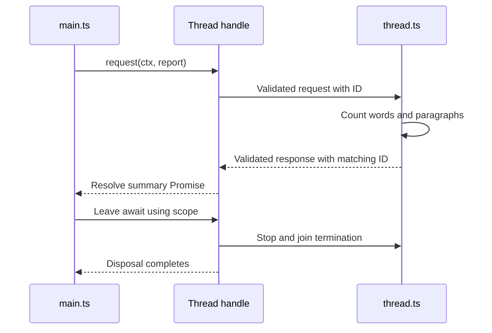

# Worker

Run an operation in another JavaScript thread or operating-system process, send it checked input, and receive its
answer. Use this when CPU-heavy work should leave the main thread, or when a native program needs its own lifetime.
A **thread** runs another JavaScript module; a **process** runs a separate program with input/output streams. Both
need an owner that stops accepting calls, requests shutdown, and waits for cleanup.

For Deno, Node, and Bun execution, see
[run a portable example](../../docs/05-runtime.md#run-a-portable-example-in-your-own-project). Host-specific adapters
keep their native runtime requirements.

There are two lifetimes in a reusable Worker: the thread stays open across calls, while each request can stop
independently. That is why `open(ctx, ...)` and `thread.request(ctx, input)` both take a Context. The first owns the
thread; the second bounds this request. They may use the same Context for a short program. An HTTP server would normally
keep the thread under its server lifetime and pass a different request Context for each caller.

## Summarize a report in a separate Worker module

An ordinary function is sufficient for a small string. Choose a Worker when expensive analysis should run in a separate
JavaScript environment. The parent owns the handle; the companion owns the analysis. The returned value is still an
ordinary Promise result, not a queue item or durable workflow.

From the repository root run `mise run prepare -- --kind deps`, save `main.ts` and `thread.ts` below together, then run
`mise exec -- deno run --allow-read main.ts`. The pinned Deno 2.9.7 host supplies Web Workers; read permission permits
loading the companion module and its imports. The data is local and no network service is used. Plain Node needs an
explicit Runtime Worker factory rather than assuming a browser-style global constructor.

```ts runnable=main.ts
import * as context from '@okikio/context';
import * as worker from '@okikio/worker/thread';
import * as schema from '@okikio/schema';
await using ctx = context.create({ id: 'thread-owner' });
// The session owns the thread. Scope exit waits for its cleanup; the module runs in that thread.
await using thread = worker.open(ctx, {
	module: new URL('./thread.ts', import.meta.url),
	protocol: worker.protocol({
		request: schema.object({ title: schema.string(), text: schema.string() }),
		response: schema.object({
			title: schema.string(),
			words: schema.number({ integer: true, minimum: 0 }),
			paragraphs: schema.number({ integer: true, minimum: 0 }),
			characters: schema.number({ integer: true, minimum: 0 }),
		}),
	}),
});
// Only checked data crosses the boundary. The caller's context carries cancellation for this request.
const summary = await thread.request(ctx, {
	title: 'Family photo notes',
	text: 'Ada keeps the family photo.\n\nLin records its date.',
});
console.log(`${summary.title}: ${summary.words} words in ${summary.paragraphs} paragraphs`);
console.log(`${summary.characters} characters`);
```

Expected output:

```text output
Family photo notes: 9 words in 2 paragraphs
50 characters
```

Worker module, saved as `thread.ts`:

```ts support=thread.ts
import * as worker from '@okikio/worker/thread';
import * as schema from '@okikio/schema';
worker.serve({
	protocol: worker.protocol({
		request: schema.object({ title: schema.string(), text: schema.string() }),
		response: schema.object({
			title: schema.string(),
			words: schema.number({ integer: true, minimum: 0 }),
			paragraphs: schema.number({ integer: true, minimum: 0 }),
			characters: schema.number({ integer: true, minimum: 0 }),
		}),
	}),
	run(request) {
		const text = request.text.trim();
		return {
			title: request.title,
			words: text.match(/\S+/gu)?.length ?? 0,
			paragraphs: text.length === 0 ? 0 : text.split(/\n\s*\n/u).length,
			characters: request.text.length,
		};
	},
});
```

The report has nine whitespace-separated words and two blank-line-separated paragraphs. The parent sends
`{ title, text }`; the Worker validates it, calculates the summary, and replies with the matching request ID.
`await using thread` joins shutdown when the parent block ends. The count is a display rule, not language-aware
segmentation or a benchmark.

Follow one summary request through those owners. Progress messages can arrive before the result; they do not settle the
request. Closing the parent scope joins shutdown before the handle is considered closed.



If the call fails, catch its rejection at the caller. Forward cancellation through its Context. An interrupted call may
have performed external work before losing its reply, so reconcile an upload or charge before repeating it. A returned
summary means request cleanup has joined; an observation message alone does not. The
[thread guide](./thread/README.md#replace-an-interrupted-report-worker-without-silently-resending-it) extends this exact
report into a controlled generation replacement and an explicitly chosen resubmission.

## Select a transport and read its exact contracts

| Import                           | Responsibility                                                                    |
| -------------------------------- | --------------------------------------------------------------------------------- |
| `@okikio/worker/supervisor`      | Replace one confirmed-terminated generation without replaying uncertain requests. |
| `@okikio/worker/protocol`        | Shared input, output, progress, request and response contracts.                   |
| `@okikio/worker/thread`          | Host-independent worker-thread clients and servers.                               |
| `@okikio/worker/process`         | Host-independent subprocess clients, framing and servers.                         |
| `@okikio/worker/process/channel` | Framed byte-channel contracts.                                                    |

The root exports `protocol`, `thread` and `process` namespaces. Select native adapters explicitly from Runtime:
`@okikio/runtime/node/worker`, `/node/process`, `/deno/worker`, `/deno/process`, `/bun/worker` or `/browser/worker`. No
Worker import launches a host.

All five protocol payload types flow through clients, handlers and adapters. Directional codecs encode application
values and decode wire values. Remote cancellation settles after validation, execution, result encoding and registered
cleanup have joined. A noncooperative host is retired and its actual termination is joined before Pool releases its
capacity. Progress subscriber exceptions cannot change the result of the work being observed.

Read the [Thread](./thread/README.md) and [Process](./process/README.md) guides. Thread placement is an execution
choice; durable resumption requires Workflow and a persistent Storage adapter. Arbitrary JavaScript stacks cannot
migrate between hosts.

The shared receipt owner uses Dispose to release request correlation before disposing its Context. Every release is
attempted and its asynchronous cleanup is joined before a terminal result, cancellation, or fault is sent. A cleanup
failure takes the fault path; the bounded fault projection preserves nested `SuppressedError.error`,
`SuppressedError.suppressed`, and `AggregateError.errors`, including exact undefined markers. Failure diagnostics remain
bounded data and cannot execute getters on the original error.

Thread stop and process stop publish their completion promise before notifying synchronous lifecycle observers or
cancelling request signals. Reentrant stop and repeated disposal therefore join the same shutdown. Process-group grace
and force periods measure elapsed monotonic time, so a wall-clock adjustment cannot silently shorten or prolong them.

## Choose a thread or a subprocess for the job

CPU-heavy analysis fits a thread; an external encoder fits a subprocess. Both need requests, cancellation, bounded
transport, and joined cleanup.

Declare the protocol first, choose Thread or Process, then select a Runtime adapter for the actual host. Activity adds a
checked job and Workflow adds saved scheduling.

A validated contract alone starts nothing. Host termination and registered cleanup must finish before reuse; durable
recovery requires an explicit store and repeat-safe effects.

## Choose an entry point

Use the table to find a focused import for the job you need. Contract links open the exact public source, including its
options and types.

| Import                                 | Use it to                                                                | Exact contract                         |
| -------------------------------------- | ------------------------------------------------------------------------ | -------------------------------------- |
| `@okikio/worker/process`               | Own a subprocess, bounded output, cancellation, and termination.         | [Contract](./process/mod.ts)           |
| `@okikio/worker/process/types`         | Import public types for this capability; this entry does not start work. | [Contract](./process/types.ts)         |
| `@okikio/worker/process/channel`       | Frame validated calls over a byte channel.                               | [Contract](./process/channel/mod.ts)   |
| `@okikio/worker/process/channel/types` | Import public types for this capability; this entry does not start work. | [Contract](./process/channel/types.ts) |
| `@okikio/worker/thread`                | Use correlated calls over a supplied Worker host.                        | [Contract](./thread/mod.ts)            |
| `@okikio/worker/thread/types`          | Import public types for this capability; this entry does not start work. | [Contract](./thread/types.ts)          |
| `@okikio/worker`                       | Import the protocol, thread and process namespaces.                      | [Contract](./mod.ts)                   |
| `@okikio/worker/protocol`              | Declare validated requests, responses, progress, and cleanup receipts.   | [Contract](./protocol.ts)              |

## Negotiate a version and bound admission

Set `compatibility: { contract: 'image.resize', version: 1, features: ['notice'], required: ['notice'] }` on both
protocol definitions. The peers exchange their contract, exact version and supported/required features before encoding
the first request. Missing required features or a different version closes the session. This is compatibility checking,
not peer authentication. Omitting compatibility explicitly retains the legacy unnegotiated protocol.

Thread and process-channel options accept `maximumRequests` (default 1000), including requests awaiting negotiation or
validation and requests awaiting remote cleanup. Excess requests reject immediately; they do not form a waiter queue. An
optional `budget` requires `maximumMessageBytes`, `maximumInFlightBytes` and `maximumNodes`; `maximumDepth` defaults
to 128. Raw input is charged before encoding, replaced by the encoded envelope and retained until the terminal cleanup
receipt. Incoming decoding and queued process writes also reserve capacity. Process `maximumFrameBytes` remains the
separate limit on actual JSON frame bytes.

Logical costs count UTF-8 keys/strings, eight bytes per number/date/signed-64-bit BigInt, one byte per boolean and each
full binary backing store once within a message. Aliased views and transferred buffers retain their measured cost after
detachment. Larger BigInts, accessors, functions, symbols and unsupported host objects reject; use a narrower wire
codec. Native collection iteration avoids caller overrides. These costs do not measure JavaScript object overhead or the
native `postMessage` queue. A borrowed asynchronous validator can continue its own allocations after cancellation; the
transport cannot impose a VM heap quota on it. Native termination and cleanup receipts retain their existing authority.

## Measure joined request receipts

The focused benchmarks measure 1–256 local successful/fault receipts with released correlations. The benchmark compares
against explicit successful finally cleanup. This excludes transport, serialization and native Worker startup; root host
scenarios measure those.

Thread protocol tests are split by the caller's concern: [handle](./thread/mod.test.ts),
[server](./thread/server.test.ts), [intermediate messages](./thread/protocol.test.ts),
[admission](./thread/admission.test.ts), [cleanup receipts](./thread/cleanup.test.ts) and
[payload validation](./thread/payload.test.ts). Their shared fixture contains explicit protocol doubles; native runtime
and process suites establish actual host behavior separately. Each scenario owns its live resources.

From the repository root, run the package's tests and untimed benchmark checks before collecting timings:

```sh
mise run test -- --project worker
mise run bench -- --project worker --check
mise run bench -- --project worker
```

These commands use package-owned fixtures and development dependencies. The
[benchmark protocol](../../docs/benchmarks/01-running.md#choose-a-comparison-that-answers-the-question) explains fair
comparisons, raw report collection and the limits of local measurements.

The [native process-group integration test](../../tests/worker-groups.test.ts) also checks the explicit system-kill
host. It belongs to the root suite because it combines the Runtime adapter with real POSIX process-group control.

## Own restart policy without replay

`@okikio/worker/supervisor` exports `create(ctx, factory, { maximumRestarts,
maximumRequests, backoff })`. The factory
receives a zero-based generation and cancellation signal and transfers one started generation with `request`, `stop` and
an authoritative `closed` receipt. Thread handles now expose that receipt: it settles after native termination and local
correlation release, separately from cooperative shutdown messages and Observable lifecycle notifications.

Await `ready` before the first call. `request` sends once to the current ready generation; startup, backoff and full
capacity reject `UnavailableError`. There is no waiting queue. A lost generation rejects outstanding calls with
`UncertainRequestError`; an external side effect may already have committed. Reconcile with application-owned stable
operation IDs before deciding whether to resend. Late old-generation replies cannot complete calls in a replacement.

Restarts use the context clock and a fixed cancellable millisecond delay, up to the explicit replacement-attempt budget.
Startup failures count as attempts. Failed factory calls must retain no live worker. Stop waits for in-progress startup,
then stops any late acquired generation. An uncooperative factory or worker cleanup can therefore keep stop pending;
cancellation alone is not proof of release. A failed native termination ends supervision without acquiring a
replacement. `closed` reports stopped/exhausted/failed plus exact final reason.

`events` uses the existing `@okikio/observables` EventBus for small immutable status projections with no retained
history or internal queue. Read `status` for the current phase. Events cannot complete requests, cancel work or prove
termination. Successful requests remove their loss listeners rather than accumulating callbacks on a long-lived terminal
promise. Use Pool separately for worker leasing; this owner supervises one generation at a time.

## Pipe bounded bytes over a dedicated MessagePort

`@okikio/worker/stream` provides a versioned byte-stream family separate from request/reply and notices.
`@okikio/worker/stream/types` exposes its resource and policy contracts. A caller transfers one dedicated MessagePort to
the producer's runtime, then opens the other endpoint. Both calls explicitly transfer ownership of their port to this
protocol; the enclosing Worker remains caller-owned.

This complete local example uses the same native MessageChannel protocol as the browser Worker tests. Replace the local
producer with a module Worker that receives the transferred port when the source belongs in another thread.

```ts runnable=port-bytes.ts
import * as context from '@okikio/context';
import * as stream from '@okikio/worker/stream';

await using ctx = context.create({ id: 'byte-owner' });
const { port1, port2 } = new MessageChannel();
const policy = { maximumChunkBytes: 64, maximumChunks: 2, maximumBytes: 64 };
let released = false;
await using producer = stream.serve(ctx, port1, async function* (owner) {
	owner.defer(() => {
		released = true;
	});
	yield new TextEncoder().encode('hello ');
	yield new TextEncoder().encode('world');
}, policy);
await using receiver = stream.open(ctx, port2, { ...policy, id: 'words', timeout: 1000 });
const words: string[] = [];
await receiver.readable.pipeThrough(new TextDecoderStream()).pipeTo(
	new WritableStream<string>({
		write(value) {
			words.push(value);
		},
	}),
);
console.log(words.join(''));
console.log((await receiver.closed).status, released);
```

```text output
hello world
complete true
```

Revision one negotiates exact family/version/ID and the minimum of both peers' limits. One downstream read grants one
sequenced chunk; there is no prefetch or pending chunk queue. A final read is needed to discover EOF. Empty chunks count
toward `maximumChunks`. Chunks and their full backing stores must fit `maximumChunkBytes`; shared buffers are rejected.
The sender copies into an exact-sized owned buffer before transfer, so it never detaches the source's buffer. Limits
count payload bytes and frames, not native queue overhead or VM heap. An untrusted peer can allocate or flood its native
transport before validation; this is not a sandbox quota or peer authentication.

The lazy source receives an owned child Context for cooperative cancellation and deferred cleanup. Terminal frames
follow iterator return and child cleanup. `closed` owns that evidence independently of `events` and the native
`target`'s `state` CustomEvents. Both projections use the same small immutable values and retain no history. Use
`@okikio/streams/events` to observe native state events or pipe EventBus values with an explicit overflow policy.

Calling `receiver.cancel()` or aborting its Context errors the readable immediately. Native reader/pipe cancellation
closes its own stream under Web Stream rules. Both paths send one cancellation frame and wait for a terminal receipt.
`timeout` is a positive millisecond budget on `ctx.clock` for each handshake, requested chunk or cancellation receipt.
It does not time out an idle consumer between reads. An absent peer or hung source yields receiver status `unconfirmed`;
inspect it after `pipeTo()` cancellation rather than treating local cancellation as proof of remote release. The
producer's `stop()`/`closed` continue to await actual source cleanup. The Worker owner can terminate a noncooperative
host and await its termination separately. There is no automatic request replay, process-channel integration,
multiplexing, reconnection or application authorization. Remote fault details remain local to the producer; the receiver
gets a typed protocol error.
