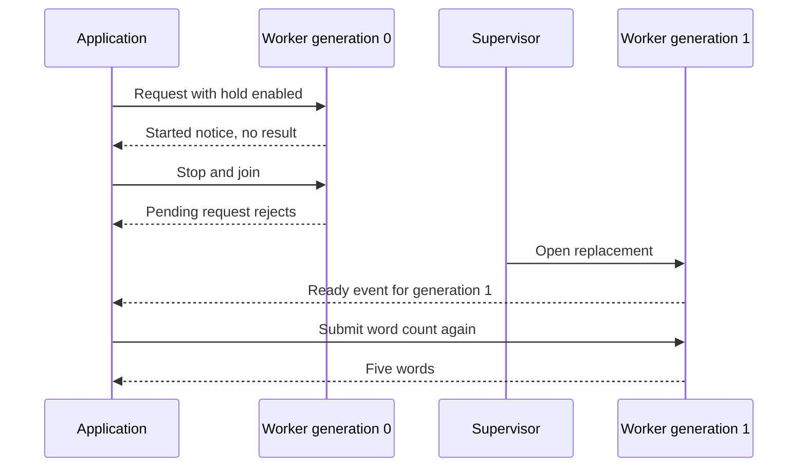

# `@okikio/worker/thread`

A report viewer needs to count words without making its controls wait for a large calculation. A standard Worker
runs another module in a separate execution environment. `@okikio/worker/thread` lets the parent call
that module with validated requests, receive the matching result, and own shutdown without writing its own message
protocol.

A **protocol** describes the request and response shapes. **Correlation** matches each response to its request. A Worker
can provide CPU parallelism when the host supports it; message transfer and setup still have costs, so the small text
demo teaches the communication boundary rather than demonstrating a speedup.

This package wraps a Web Worker, not the background service process described in the
[workflow guide](../../../docs/workflows/01-basics.md). A `workflow.serve()` worker can run in a container without
creating a Web Worker. Choose this package when you specifically need the separate JavaScript execution environment and
message boundary.

```text
Parent module                         Worker module
open(thread.ts) --------------------> serve(protocol)
request: title + report text + ID --> validate -> count words and paragraphs
matching summary + same ID <--------- validate response -> settle this request
await using ends -------------------> cooperative stop / bounded termination
```

Read across each row as a message crossing the boundary, then down as the lifecycle. The Worker owns its local
execution; the parent owns the handle and shutdown. This diagram omits progress notices and reverse calls, which have
separate meanings from a terminal response.

## Summarize a report in a separate module

A document screen can send report text to an analysis module and receive a small summary for display. Save the parent
and Worker modules below together. This fixture is deliberately short so its counts are inspectable. The same handler
can analyze a larger text; choose a Worker when isolating that CPU work is worth module startup and message-copy costs.

Use the supported Deno host in this checkout. From the repository root, run `mise run prepare -- --kind deps`, save the two
files together as `main.ts` and `thread.ts`, then run:

```sh
mise exec -- deno run --allow-read main.ts
```

The pinned Deno 2.9.7 host supplies Web Worker modules and `--allow-read` permits the companion module and its imports.
No network is used. Plain Node does not supply the same global Worker constructor; a Node consumer must explicitly
supply the [Node Worker adapter](../../runtime/node/worker.ts) through `create`, and test that host separately.
Do not run this command under an arbitrary Node version and assume Deno's host contract exists there.

```ts runnable=main.ts
import * as context from '@okikio/context';
import * as worker from '@okikio/worker/thread';
import * as schema from '@okikio/schema';
await using ctx = context.create({ id: 'thread-owner' });
// The session owns the thread. Scope exit waits for its cleanup; the module runs in that thread.
await using thread = worker.open(ctx, {
	module: new URL('./thread.ts', import.meta.url),
	protocol: worker.protocol({
		request: schema.object({ title: schema.string(), text: schema.string() }),
		response: schema.object({
			title: schema.string(),
			words: schema.number({ integer: true, minimum: 0 }),
			paragraphs: schema.number({ integer: true, minimum: 0 }),
			characters: schema.number({ integer: true, minimum: 0 }),
		}),
	}),
});
// Only checked data crosses the boundary. The caller's context carries cancellation for this request.
const summary = await thread.request(ctx, {
	title: 'Family photo notes',
	text: 'Ada keeps the family photo.\n\nLin records its date.',
});
console.log(`${summary.title}: ${summary.words} words in ${summary.paragraphs} paragraphs`);
console.log(`${summary.characters} characters`);
```

Expected output:

```text output
Family photo notes: 9 words in 2 paragraphs
50 characters
```

Worker module, saved as `thread.ts`:

```ts support=thread.ts
import * as worker from '@okikio/worker/thread';
import * as schema from '@okikio/schema';
worker.serve({
	protocol: worker.protocol({
		request: schema.object({ title: schema.string(), text: schema.string() }),
		response: schema.object({
			title: schema.string(),
			words: schema.number({ integer: true, minimum: 0 }),
			paragraphs: schema.number({ integer: true, minimum: 0 }),
			characters: schema.number({ integer: true, minimum: 0 }),
		}),
	}),
	run(request) {
		const text = request.text.trim();
		return {
			title: request.title,
			words: text.match(/\S+/gu)?.length ?? 0,
			paragraphs: text.length === 0 ? 0 : text.split(/\n\s*\n/u).length,
			characters: request.text.length,
		};
	},
});
```

## Follow the request across the two modules

The first paragraph has five words and the second has four. The handler counts whitespace-separated chunks as words,
blank-line-separated blocks as paragraphs, and JavaScript string code units as characters. Those are explicit display
rules, not language-aware word segmentation. An empty report returns zero words and paragraphs. Both modules validate
the request and summary shapes, and the parent uses the inferred fields directly to render the result.

The benefit is a separate analysis module with a checked request/result boundary. The utility supplies validation,
request IDs, matching Promise settlement, and owned shutdown around standard Worker messaging. A plain function call is
sufficient when the report is small and isolation is unnecessary. This fixture makes no speedup claim. A host must
supply the standard Worker contract or an appropriate factory.

The ordinary call is `await thread.request(ctx, input)`. With these schemas it takes `{ title, text }` and resolves to
`{ title, words, paragraphs, characters }`; there is no additional result container. The Context supplies cancellation,
identity, and a serializable clock/deadline snapshot. `await using thread` owns shutdown when the block ends. It is the
Worker handle, not the summary object, that needs disposal.

| Contract                                              | Why it exists                                                                          |
| ----------------------------------------------------- | -------------------------------------------------------------------------------------- |
| `WorkerProtocol<Request, Response>`                   | Request and response schemas shared in meaning by the parent and Worker.               |
| `WorkerHandle.request(ctx, input): Promise<Response>` | Ordinary async call; it validates both sides and matches the response to this request. |
| `run(request, ctx, control)`                          | The Worker-side function returning your response value or Promise.                     |
| `control.checkpoint(): Promise<void>`                 | An explicit place for cooperative pause to wait for resume.                            |
| Request envelope                                      | `{ type: 'request', id, context: snapshot, request: validatedInput }`.                 |
| Result envelope                                       | `{ type: 'result', id, response: validatedOutput }`.                                   |

The parent validates input, assigns a request ID, and remembers its pending Promise before sending a message. The Worker
reconstructs a local Context, validates input, calls `run()`, validates the output, and sends a result with the same ID.
The parent resolves that one Promise. Cancellation uses a control message and local AbortController in the receiving
realm; an AbortSignal is not sent as a transferable object. The [public source contracts](./mod.ts) includes the
failure, notice, and reverse-call envelopes when you need them.

## Keep results attached to the report that requested them

While the first parent's handle is open, it can send several reports using the same protocol. The utility assigns each
call a request ID; each Promise receives the matching summary. `Promise.all()` returns the summaries in input order, so
a screen can keep its report list in that order even if a later request returns first.

This extension continues the parent module above with its existing `thread` and `ctx`:

```ts
const reports = [
	{ title: 'Photo notes', text: 'Ada keeps the family photo.' },
	{ title: 'Date notes', text: 'Lin records its date.' },
];
const summaries = await Promise.all(reports.map((report) => thread.request(ctx, report)));
console.log(summaries.map((summary) => `${summary.title}: ${summary.words} words`).join('\n'));
// Photo notes: 5 words
// Date notes: 4 words
```

One Worker still runs its JavaScript on one execution thread. Multiple outstanding requests exercise correlation; they
do not create additional CPU threads or guarantee that two synchronous analyses run in parallel.

- **Analyze uploaded files:** combine a [Context](../../context/README.md) for cancellation with this protocol for the
  analysis request. Transferable buffers can move across the boundary when ownership is deliberately transferred;
  ordinary resource handles and AbortSignals do not become transferable merely by being in a request.
- **Reuse several analysis threads:** let [Pool](../../pool/README.md) own Worker handles and
  [Concurrency](../../scheduler/concurrency/README.md) limit admitted analysis calls. Add
  [Queue](../../scheduler/queue/README.md) for pending logical work; the Worker itself supplies neither durable attempts
  nor cross-machine placement.

## Extend the protocol without losing ownership

Save the second module beside the first. Start with request/result, then add notices for progress and reverse calls for
host-owned policy. A notice is not completion. Transfer lists move ownership of transferable data; they do not move
arbitrary resources. Pause is cooperative and requires handler checkpoints. Parent admission can stop waiting for
validation before sending a request. Remote validators, encoders, handlers, and cleanup are joined before a release
receipt is sent. The parent owns Worker shutdown; the examples use local time and disposal providers without changing globals.

## Completion includes cleanup

A result, declared failure, fault or cancellation receipt means the remote request's validation, handler and owned
cleanup have settled. The parent retains its pending request until that receipt arrives. An Activity provider keeps its
Pool lease during this entire period, so cancelling one attempt cannot make its host available while disposal is still
running.

`cancelMs` bounds cooperative cancellation, defaulting to `shutdownMs`. If the remote request does not finish, the
parent retires the host. An asynchronous runtime adapter's `terminate()` must resolve only when the thread has stopped.
Cooperative cancellation rejects with `ContextCancelledError`; retirement rejects with `WorkerStoppedError` and retains
the cancellation cause.

Native `@okikio/schema` validators can be used directly in a protocol. For application values that differ from message
values, supply an explicit `@okikio/schema/codec` codec. Sending calls its encoder; receiving calls its decoder. Use
`codec.identity(externalSchema)` only when the external schema accepts its own output without changing its
representation. All five payload types remain inferred: request, response, notice, reverse request and reverse response.

## Choose adjacent capabilities

Runtime supplies the real host adapter. Activity can place checked jobs here; Workflow and Storage add saved scheduling
separately.

The [package choice map](../README.md#choose-an-entry-point) lists the other public entries and when to use them.

## Replace an interrupted report Worker without silently resending it

The report request now includes `hold`, a deliberate interruption point. Generation 0 announces that it received the
report and waits for cancellation instead of replying. The parent then stops that generation, waits for generation 1,
and explicitly chooses to request the same analysis again. This analysis has no external write, so that choice is safe.
A charge or upload would first require reconciliation with its business-operation ID.

Save `supervised.ts` and `supervised-thread.ts` together. Run
`mise exec -- deno run --allow-read supervised.ts` from the prepared repository. The readiness event is only a demo
coordination point; `closed` and joined `stop` remain termination authority.

```ts runnable=supervised.ts
import * as context from '@okikio/context';
import * as thread from '@okikio/worker/thread';
import * as supervisor from '@okikio/worker/supervisor';
import * as schema from '@okikio/schema';
const Request = schema.object({ title: schema.string(), text: schema.string(), hold: schema.boolean() });
const Response = schema.object({ title: schema.string(), words: schema.number({ integer: true }) });

// Separate evidence that the old request started from evidence that a replacement is ready.
await using owner = context.create({ id: 'supervised-report' });
const entered = Promise.withResolvers<void>();
const replacement = Promise.withResolvers<void>();
let current: thread.WorkerHandle<schema.Output<typeof Request>, schema.Output<typeof Response>> | undefined;

// Each restart calls this factory to open a new native Worker with the same checked protocol.
await using lifecycle = supervisor.create(owner, () => {
	current = thread.open(owner, {
		module: new URL('./supervised-thread.ts', import.meta.url),
		protocol: thread.protocol({ request: Request, response: Response, notice: schema.string() }),
		notice: () => {
			entered.resolve();
		},
		shutdownMs: 100,
	});
	return current;
}, { maximumRestarts: 1, maximumRequests: 1, backoff: 0 });

using listener = lifecycle.events.subscribe((event) => {
	if (event.status === 'ready' && event.generation === 1) replacement.resolve();
});
await lifecycle.ready;

// Hold the first request so the example can interrupt it before a reply exists.
const failed = lifecycle.request(owner, { title: 'Photo notes', text: 'Ada keeps the family photo.', hold: true })
	.then(() => {
		throw new Error('Interrupted report unexpectedly completed.');
	}, () => 'Report interrupted');
await entered.promise;
await current!.stop('controlled generation loss');
console.log(await failed);
await replacement.promise;
console.log('Ready generation:', lifecycle.status.generation);

// Counting words is safe to repeat. The application explicitly submits it to the new generation.
const summary = await lifecycle.request(owner, {
	title: 'Photo notes',
	text: 'Ada keeps the family photo.',
	hold: false,
});
console.log(`${summary.title}: ${summary.words} words`);
await lifecycle.stop('example complete');
console.log((await lifecycle.closed).status);
```

```text output
Report interrupted
Ready generation: 1
Photo notes: 5 words
stopped
```

```ts support=supervised-thread.ts
import * as thread from '@okikio/worker/thread';
import * as schema from '@okikio/schema';

const server = thread.serve({
	protocol: thread.protocol({
		request: schema.object({ title: schema.string(), text: schema.string(), hold: schema.boolean() }),
		response: schema.object({ title: schema.string(), words: schema.number({ integer: true }) }),
		notice: schema.string(),
	}),
	/** Hold only the test request until cancellation; ordinary requests return a word count. */
	async run(report, ctx, control) {
		if (report.hold) {
			await control.notify('report received');
			// Cooperate with the old generation's shutdown instead of leaving an unfinished callback.
			await new Promise<never>((_, reject) => {
				if (ctx.signal.aborted) reject(ctx.signal.reason);
				else ctx.signal.addEventListener('abort', () => reject(ctx.signal.reason), { once: true });
			});
		}
		return { title: report.title, words: report.text.match(/\S+/gu)?.length ?? 0 };
	},
});
await server.closed;
```



The generation number distinguishes successive Workers behind one supervisor. It is not a count of completed requests.
Replacing the Worker restores a place to send new work; it does not recover the answer to the interrupted call.

The second request is an application decision after replacement, not automatic replay by the supervisor. Pending calls
fail when their generation is lost; they are not transferred into generation 1. A lost transport can report
`UncertainRequestError` because the remote effect may have committed. This controlled cooperative stop can instead
surface its transport cancellation directly; either way, the caller receives a rejection. The example validates one
local replacement and shutdown, not process-loss persistence, deployment availability or stress capacity.

Activity providers built on this transport can select one thread inside a pool.
The provider owns host identity and retirement; this transport still owns
request correlation and native stop. See [Physical hosts](../../../docs/workflows/19-hosts.md).

## Read further

The [numbered guide](https://github.com/okikio/utils/blob/main/docs/worker.md) explains the model, manual alternatives,
and composition.
