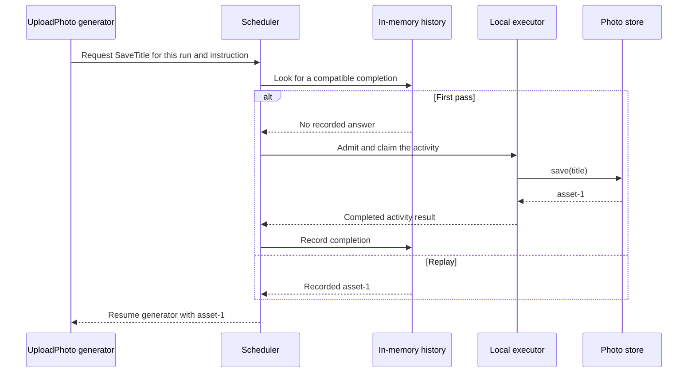

# `@okikio/workflow`

A photo upload saves a title and adds the photo to an album. If a caller repeats the same upload after losing the
reply, it wants the original photo ID. Calling the two functions again can create a second title and album entry.
A workflow names those steps so the runner can record their results and reuse them for the same run.

For Deno, Node, and Bun execution, see
[run a portable example](../../docs/05-runtime.md#run-a-portable-example-in-your-own-project). Host-specific adapters
keep their native runtime requirements.

This package separates the sequence from the code that performs each job. An [activity](../activity/README.md) describes
one job; the workflow requests those jobs in order. A scheduler consults recorded results and sends new work to an
executor. An executor is the host that runs the supplied job implementation.

The tutorial below keeps the photo and its recorded results in memory. Run it first if you want to see what replay
does without setting up a server. If accepted work must survive a process restart, follow the
[durable workflow guide](../../docs/workflows/01-basics.md). That path uses `client` and `serve` with the
[PostgreSQL adapter](../storage/workflow/postgres/README.md) and supplies its own business storage and write receipts.

## Save a photo and reuse its completed steps

Save a photo title, then add its returned ID to an album. Running the same logical upload again should return that ID
without adding a second title or album entry. The two arrays at the end let you inspect whether either write repeated.

Save this first program as `ordinary-upload.ts` and run `mise exec -- deno run ordinary-upload.ts`. It uses only
ordinary JavaScript and needs no package setup. Before recording anything, consider those calls. Each call to `save`
appends a title. Repeating the function therefore appends twice, even though its input is unchanged:

```ts runnable=ordinary-upload.ts
const titles: string[] = [];
const album: string[] = [];
/** Simulate a write without deduplication, so repeated calls expose the problem replay must address. */
async function save(title: string): Promise<string> {
	titles.push(title.toUpperCase());
	return `asset-${titles.length}`;
}
/** This ordinary function repeats both writes on every call, even when the title is unchanged. */
async function upload(title: string): Promise<string> {
	const id = await save(title);
	album.push(id);
	return id;
}
console.log(await upload('summer trip'), await upload('summer trip'));
console.log(titles.length, album.length);
```

```text output
asset-1 asset-2
2 2
```

The next example exposes the local pieces so you can see who runs work and who remembers answers. You do not need
to reproduce this wiring for every application. For one checked call use `activity.call()`. For pause and cancellation
in one process use Task. For accepted work that must survive process loss, use the
[complete stored workflow](../../docs/workflows/01-basics.md), which selects a persistent store and owns the worker loop.
The memory history below demonstrates replay in one process; it cannot recover after that process exits.

## Record the same two writes

Keep those two writes, but ask the scheduler for each result instead of calling it directly. In a workflow generator,
`yield* ctx.trigger(SaveTitle, input)` means “request this named job, then continue with its result.” JavaScript pauses
this generator at the instruction. The scheduler either supplies a compatible recorded answer or runs the job. `await`
still belongs inside the ordinary activity implementation that actually writes the data.

These objects divide responsibility for running and remembering the two photo writes:

| Owner                                | Role in this upload                                                                     |
| ------------------------------------ | --------------------------------------------------------------------------------------- |
| Activity definition / implementation | Describe checked save/album calls / supply their ordinary async functions.              |
| Resource collection                  | Acquire the photo store and own its cleanup; activities borrow it.                      |
| Engine and local provider            | Select and execute implementations in this process. Declaring an engine starts nothing. |
| Dispatch and executor                | Retain pending jobs / take those jobs and run the provider.                             |
| History and scheduler                | Retain completed instructions / decide whether a request reuses or runs work.           |
| Context                              | Supply cancellation and local cleanup lifetime. It does not persist an execution.       |

From the repository root, run `mise run prepare -- --kind deps` once. Save the next block as `recorded-upload.ts` and
run `mise exec -- deno run recorded-upload.ts`. These workspace imports need no published package or network service.

```ts runnable=recorded-upload.ts
import * as activity from '@okikio/activity';
import * as engine from '@okikio/activity/engine';
import * as local from '@okikio/activity/local';
import * as context from '@okikio/context';
import * as resource from '@okikio/capability/resource';
import * as dispatch from '@okikio/workflow/dispatch';
import * as history from '@okikio/workflow/history';
import * as workflow from '@okikio/workflow';
import * as schema from '@okikio/schema';

// Schemas and engine identity describe calls; they do not start the executor.
const TextSchema = schema.string();
const Local = engine.define({ id: 'local' });

// Activities borrow this contract. The collection below owns its live implementation.
const Store = resource.define<{
	/** Append a title and return the new application asset ID. */
	save(title: string): Promise<string>;
	/** Append that asset ID to this example's album and return it. */
	addToAlbum(id: string): Promise<string>;
}>({ id: 'photo.store', description: 'Save titles and append photo IDs to an album.' });

// These arrays are the entire business store; a restart loses them.
const titles: string[] = [];
const album: string[] = [];
const store = resource.implement(Store, {
	create: () => ({
		/** Simulate the title write so the final array reveals any repeat. */
		async save(title) {
			titles.push(title);
			return `asset-${titles.length}`;
		},
		/** Keep the album write separate so replay must remember both instructions. */
		async addToAlbum(id) {
			album.push(id);
			return id;
		},
	}),
});

// Declare each checked business operation before supplying its implementation.
const SaveTitle = activity.define({
	id: 'photo.save-title',
	version: '1',
	input: schema.string({ minLength: 1 }),
	result: TextSchema,
	placement: engine.require(Local),
	resources: [Store],
});
const AddToAlbum = activity.define({
	id: 'photo.add-to-album',
	version: '1',
	input: TextSchema,
	result: TextSchema,
	placement: engine.require(Local),
	resources: [Store],
});

const saveTitle = activity.implement(SaveTitle, {
	async run(ctx) {
		const photos = await ctx.get(Store);
		return await photos.save(ctx.input.toUpperCase());
	},
});
const addToAlbum = activity.implement(AddToAlbum, {
	async run(ctx) {
		const photos = await ctx.get(Store);
		return await photos.addToAlbum(ctx.input);
	},
});

// The generator requests jobs. It does not perform the array writes itself.
const UploadPhoto = workflow.define({
	id: 'photo.upload',
	version: '1',
	input: TextSchema,
	result: TextSchema,
	activities: [SaveTitle, AddToAlbum],
});
const uploadPhoto = workflow.implement(UploadPhoto, function* (ctx) {
	const id = yield* ctx.trigger(SaveTitle, ctx.input);
	return yield* ctx.trigger(AddToAlbum, id);
});

// Lifetime owners close in reverse order; activities borrow the resource collection.
await using parent = context.create({ id: 'photo-parent' });
await using stores = resource.create(resource.implementations(store), { ctx: parent, host: {} });

// Dispatch retains requests; history retains their recorded answers in this process.
await using jobs = dispatch.memory();
await using records = history.memory();
await using scheduler = workflow.scheduler({
	activityDispatch: jobs,
	history: records,
});

// This executor takes pending jobs and runs the local provider.
await using executor = await workflow.executor({
	dispatch: jobs,
	engine: Local,
	hostId: 'photo-host',
	capacity: 1,
	provider: local.create({ engine: Local, implementations: [saveTitle, addToAlbum], resources: stores }),
});

// Both passes use the same run identity and history, so the second reuses completed instructions.
for (const pass of ['first run', 'replay']) {
	await using run = await workflow.context({
		definition: UploadPhoto,
		runId: 'photo-upload-1',
		input: 'summer trip',
		ctx: parent,
	});
	console.log(pass, await workflow.run({ ctx: run, implementation: uploadPhoto, scheduler }));
}
console.log('Saved titles:', titles.join(','));
console.log('Album entries:', album.join(','));
```

Expected output:

```text output
first run asset-1
replay asset-1
Saved titles: SUMMER TRIP
Album entries: asset-1
```

The first activity checks and saves the title, returning `asset-1`. The second appends that ID to the album. The final
two lines inspect the actual arrays used by the supplied store: one saved title and one album entry after two passes.
The scheduler records returned values; the activity implementations perform the writes.

Read this diagram as one call to save the title. The album call follows the same path. History owns the reusable answer;
the executor owns the live activity call. A history hit skips the executor and therefore skips the write.



The loop then repeats the same run identity, input and program while the same stores remain alive. The replay returns
the recorded instruction results, so neither write runs a second time. Change the title and give it a new `runId` to
start a different logical run. Reusing a run's identity with changed instruction data is a conflict, not a request to
silently replace its recorded work.

The example uses real activity implementations through `local.create()`. It does not simulate a remote computer, save
records to disk or prove that a remote write happens exactly once. The collection supplies the same lazy store to both
activities. The arrays are deliberately not idempotent: calling their methods again appends another entry. The demo
shows replay of accepted completions, not recovery from a crash between a write and recording its result. A production
store needs stable write keys or another duplicate-write policy for that gap.

## Wall instants and local scheduling

The durable worker uses monotonic host time for polling intervals, registration-renewal cadence, recovery spacing, and
scan-age readiness. The first recovery scan is immediate even at process startup. Its `checkedAt` diagnostic uses the
selected Temporal implementation and canonical UTC millisecond text. Persisted deadlines and lease expiry remain the
store's authority, and workflow execution keeps the Context clock chosen by its owner. A wall-clock correction can
change a reported instant without changing an already-running local grace or scan interval.

## Execution and wake-ups

The [execution guide](https://github.com/okikio/utils/blob/main/docs/workflows/13-execution.md) explains the common
activity and workflow operations across local and durable hosts. It also covers saved parallel branches, relative
timers, race cancellation, notification ownership, and crash tests. A PostgreSQL worker listens before scanning and
keeps a bounded fallback scan. `serve({ pollIntervalMs })` sets the maximum idle interval; its default is 1000 ms.
`postgres.open({ database, namespace, notifications: false })` selects polling for transaction-pooled connections. The
worker owns its notification session. The application owns its query pool and closes it after worker drain.

Draining stops new claims and joins claims already awaiting a storage reply, then waits for their admitted work and
cleanup. `worker.state().pendingClaims` distinguishes that acquisition wait from active code. A drain timeout leaves
`closed` pending; it does not release borrowed resources while an attempt can still use them. After repeated scan
failures exhaust the retry budget, the worker starts the same drain automatically. `closed`, `drain()` and asynchronous
disposal reject on a terminal scan or release failure. All release steps are attempted, and an `AggregateError` retains
multiple failures. A successful `closed` means admission, work and cleanup have joined and registration was released.

## Preserve authored types through storage and replay

Definitions retain their literal ID, version and declared activity, child, resource, failure and effect unions.
`ctx.trigger()` accepts the exact activities and children declared by its workflow. Selecting a subset of a catalog
narrows the resulting declarations as well.

Caller input, validated execution input and encoded storage data have distinct types. A codec can, for example, accept a
date string, provide a `Date` to the implementation, and save an ISO string. Admission decodes and then encodes before
storage; replay decodes the saved representation; result observation decodes through the declared result contract. A
transforming schema without an encoder rejects before a durable value is written.

Local history uses the same result codecs for individual instructions and for nested parallel, race, map and retry
results. Composite history stores explicit completion envelopes so `undefined`, a success value and a declared failure
remain distinct. Saved history from an older representation requires an explicit migration or a new workflow version.

Instrumentation is borrowed explicitly through `client({ instrument, ... })` and `serve({ instrument, ... })`. The
worker propagates that instrument to local activity and resource contexts. Omitting it keeps the portable runtime
independent of OpenTelemetry or LogTape; the optional telemetry adapter provides those integrations.

## Move from local replay to saved execution

A photo pipeline and a report pipeline can reuse recorded step completions. A local history demonstrates replay; a saved
execution needs a persistent store and a running executor.

Use a regular function until work needs recorded instructions or recovery. Activity owns individual checked calls;
Scheduler and Storage own dispatch and saved state.

Replay does not make arbitrary remote writes exactly-once. Preserve deterministic instruction order and define
transactions, receipts, or receiver idempotency where writes can repeat.

The [connected consumer guide](../../docs/workflows/14-consumers.md) shows `ctx.trigger()` for activities and children,
background acceptance through effects, event-only `wait()`, `sleep()`, standard progress, and durable `defer()` cleanup.
It links the complete service, process, thread, policy, and recovery tests.

The library's saved-work schemas use `@okikio/schema` and implement Standard Schema. Native validators provide
`parse(value)`. Explicit codecs describe a different application and saved representation without guessing how to
reverse a transformation.

## Choose an entry point

Use the table to find a focused import for the job you need. Contract links open the exact public source, including its
options and types.

| Import                       | Use it to                                                                | Exact contract                |
| ---------------------------- | ------------------------------------------------------------------------ | ----------------------------- |
| `@okikio/workflow`           | Use the package entry shown in the complete examples above.              | [Contract](./mod.ts)          |
| `@okikio/workflow/dispatch`  | Admit activity jobs, register executors, and own attempt leases.         | [Contract](./dispatch.ts)     |
| `@okikio/workflow/history`   | Record instructions and reuse their completions during replay.           | [Contract](./history.ts)      |
| `@okikio/workflow/types`     | Import public types for this capability; this entry does not start work. | [Contract](./types.ts)        |
| `@okikio/workflow/execution` | Use the saved execution contracts shared by clients and stores.          | [Contract](./execution.ts)    |
| `@okikio/workflow/testing`   | Record and archive bounded completed workflow fixtures.                  | [Contract](./testing.ts)      |
| `@okikio/workflow/replay`    | Check saved completions against the current exact workflow definition.   | [Contract](./replay/check.ts) |

## Record a bounded fixture and check a code change

Use `/testing` to run a trusted implementation with explicit command services and retain its completed instruction
history. Use `/replay` to check that fixture through the same production scheduler, with no command services available:

```ts runnable
import * as context from '@okikio/context';
import * as schema from '@okikio/schema';
import * as workflow from '@okikio/workflow';
import * as testing from '@okikio/workflow/testing';
import * as replay from '@okikio/workflow/replay';
import { temporal as Temporal } from '@okikio/duration/temporal';

const Greeting = workflow.define({
	id: 'example.greeting',
	version: '1',
	input: schema.string(),
	result: schema.string(),
});
const implementation = workflow.implement(Greeting, function* (ctx) {
	yield* workflow.sleep('PT1S');
	return ctx.input;
});
await using parent = context.create({ id: 'fixture-owner' });
const limits = { maximumEntries: 1000, maximumBytes: 1_000_000 };
const recorded = await testing.run(implementation, {
	...limits,
	ctx: parent,
	input: 'hello',
	runId: 'compatibility-fixture',
	scheduler: {
		async command() {
			return workflow.success(Temporal.Instant.from('2026-01-01T00:00:00Z'));
		},
	},
});
const archive = await testing.encode(recorded.fixture, limits);
const fixture = await testing.decode(archive, limits);
const checked = await replay.check(implementation, fixture, { ...limits, ctx: parent });
console.log(JSON.stringify([checked.value, checked.matched, checked.opaqueControls]));
```

```text output
["hello",1,[]]
```

The recording owner bounds retained entry count and encoded metadata/completion bytes before publication. The final
fixture has its own complete byte check, including input and contract identity. Input uses an explicit undefined marker
when a workflow accepts no JSON value; its archive never silently substitutes null or drops that input. Individual
application codecs and command callbacks remain trusted code; this does not bound their private allocations. A failed or
suspended recording is not exported as a complete fixture. The SHA-256 archive detects accidental corruption; it does
not authenticate a sender. Decode does not schedule work or import definitions. Supply the trusted exact definition
explicitly when checking; a different ID/version rejects before execution.

The checker rejects a missing step before dispatch, reports a changed instruction's exact path and fingerprints, and
rejects extra retained steps. Saved payloads pass through current instruction codecs. Generator and schema code still
runs and must obey the normal rule that external work goes through yielded instructions. As with native memory history,
a completed control result is atomic: nested programs beneath it are not reinterpreted. `opaqueControls` names those
coverage boundaries. This check cannot prove every internal branch remains compatible; use the durable replay and
recovery suites for that claim. Cleanup failures retain their production error boundary.

These fixtures describe process-local instruction history. PostgreSQL's existing inspector remains the owner of
paginated lifecycle events, attempts, waits, host leases, pauses and continuation chains. Importing a diagnostic fixture
does not create a durable run, grant a claim, restore a continuation reservation or authorize external effects.

## Measure dispatch admission and completion

The focused benchmarks measure 1,000 deterministic jobs through add/claim/complete. The benchmark compares against
native Map bookkeeping without placement, validation or leases. This local component benchmark is not process-death
recovery; composed recovery stays at root.

From the repository root, run the package's tests and untimed benchmark checks before collecting timings:

```sh
mise run test -- --project workflow
mise run bench -- --project workflow --check
mise run bench -- --project workflow
```

These commands use package-owned fixtures and development dependencies. The
[benchmark protocol](../../docs/benchmarks/01-running.md#choose-a-comparison-that-answers-the-question) explains fair
comparisons, raw report collection and the limits of local measurements.

The package separates [declarations](./mod.test.ts), [deterministic composition](./composition.test.ts) and
[cleanup](./cleanup.test.ts). Their [local runner fixture](./fixtures/program.ts) owns a fresh Context and Scheduler per
run and borrows any supplied history. Durable dispatch and native host recovery have separate integration suites; the
local fixture does not establish those capabilities.

## Wait for time or an addressed event

Use `yield* workflow.sleep({ seconds: 5 })` for a relative timer. Use `yield* workflow.sleep({ until })` for an absolute
UTC deadline. Both return a `Temporal.Instant`. Use `yield* workflow.wait(Approved, { key: 'approval', until })` for a
saved event with a deadline. It returns received data or a timeout. Keep `defer()` for cleanup. See the
[execution guide](https://github.com/okikio/utils/blob/main/docs/workflows/13-execution.md) for composition and
recovery.

## Return activity work to one pooled host

`placement.host(executor, hostReference)` selects a particular thread or child process inside a registered provider. It
survives saved-job and nested-workflow serialization, while the referenced native host remains live. Retirement or
replacement makes the old reference lost; retries cannot choose a sibling. See
[Physical hosts](../../docs/workflows/19-hosts.md) for the complete setup and
[Resource sessions](../../docs/workflows/18-sessions.md) for resource ownership.

## Read further

The [Workflow guide](https://github.com/okikio/utils/blob/main/docs/workflows/README.md) explains the model, manual
alternatives, and composition.


See [event waits](https://github.com/okikio/utils/blob/main/docs/workflows/11-events.md) for `wait(Event, { key })` and
`client.send()`. See [saved progress](https://github.com/okikio/utils/blob/main/docs/workflows/12-progress.md) for
progress effects and `client.watch()`.

For bounded host sharing and inherited required locations, read [Placement](../../docs/workflows/17-placement.md). It
connects registration, ancestor capacity, durable claims, replacement fences, and cooperative host turns.
