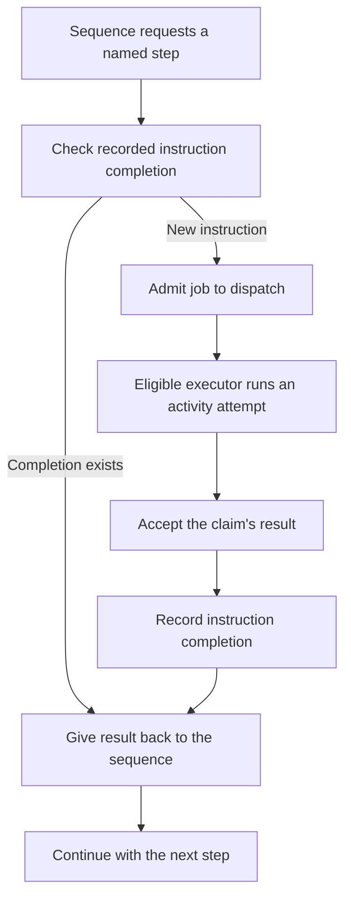

# `@okikio/workflow`

A workflow is a named sequence of jobs whose instruction results can be recorded and reused. Suppose preparing a photo
means reading its dimensions, creating a preview, and saving the preview's location. If the last step fails, starting
the whole sequence again can repeat work you already finished.

This package separates the sequence from the code that performs each job. An [activity](../activity/README.md) describes
one job; the workflow requests those jobs in order. A scheduler consults recorded results and sends new work to an
executor. An executor is the host that runs the supplied job implementation.

## See the sequence and the record of completed work

Read this diagram from top to bottom. A recorded completion can provide the step's result without another provider call.
A step without a completion needs the configured dispatch and executor.



This is the successful path. It omits retry timing, cancellation and stale-claim rejection, which the later sections
explain. Reusing a result does not rewind the JavaScript process. Durable recovery needs authoritative storage and host
services: the memory stores in the demo below disappear when their process exits.

Use a regular function for a simple sequence that can start over safely. Use [task](../task/README.md) for an owned
local operation. Use a workflow when named instruction results, independently executed jobs or controlled replay are
part of the application's requirements.

For shared terms such as `await` and `await using`, see
[the short glossary](../../docs/learn.md#read-the-small-amount-of-code-you-need).

## Run a complete example

The explicit polyfill imports let this example run when the host lacks Temporal or disposal globals. An existing native
implementation is preserved.

```ts runnable
import '@okikio/duration/polyfill';
import '@okikio/dispose/polyfill';
import * as activity from '@okikio/activity';
import * as engine from '@okikio/activity/engine';
import * as local from '@okikio/activity/local';
import * as context from '@okikio/context';
import * as resource from '@okikio/resource';
import * as dispatch from '@okikio/workflow/dispatch';
import * as history from '@okikio/workflow/history';
import * as workflow from '@okikio/workflow';
import { z } from 'zod';

const TextSchema = z.string();
const Local = engine.define({ id: 'local' });
const Trim = activity.define({
	id: 'photo.trim-label',
	version: '1',
	input: TextSchema,
	result: TextSchema,
	placement: engine.require(Local),
});
const Upper = activity.define({
	id: 'photo.upper-label',
	version: '1',
	input: TextSchema,
	result: TextSchema,
	placement: engine.require(Local),
});
let calls = 0;
const TrimLive = activity.implement(Trim, {
	run: (ctx) => {
		calls++;
		return ctx.input.trim();
	},
});
const UpperLive = activity.implement(Upper, {
	run: (ctx) => {
		calls++;
		return ctx.input.toUpperCase();
	},
});
const PrepareLabel = workflow.define({
	id: 'photo.prepare-label',
	version: '1',
	input: TextSchema,
	result: TextSchema,
	activities: [Trim, Upper],
});
const PrepareLabelLive = workflow.implement(PrepareLabel, function* (ctx) {
	const trimmed = yield* activity.request(Trim, ctx.input);
	return yield* activity.request(Upper, trimmed);
});

await using parent = context.create({ id: 'photo-parent' });
await using stores = resource.create(resource.implementations(), { ctx: parent, host: {} });
await using jobs = dispatch.memory();
await using records = history.memory();
await using scheduler = workflow.scheduler({
	activityDispatch: jobs,
	history: records,
});
await using executor = await workflow.executor({
	dispatch: jobs,
	engine: Local,
	hostId: 'photo-host',
	capacity: 1,
	provider: local.create({ engine: Local, implementations: [TrimLive, UpperLive], resources: stores }),
});
for (const pass of ['first run', 'replay']) {
	await using run = await workflow.context({
		definition: PrepareLabel,
		runId: 'photo-label-1',
		input: ' summer trip ',
		ctx: parent,
	});
	console.log(pass, await workflow.run({ ctx: run, implementation: PrepareLabelLive, scheduler }));
}
console.log('implementation calls:', calls);
```

Expected output:

```text output
first run SUMMER TRIP
replay SUMMER TRIP
implementation calls: 2
```

The input has spaces around `summer trip`. The first activity removes the surrounding spaces; the second changes the
letters to uppercase. `yield* activity.request(...)` asks the scheduler for that step's result before the program
continues. The functions that change the text live in the activity implementations, not in the scheduler.

The loop then repeats the same run identity, input and program while the same stores remain alive. The replay returns
the recorded instruction results, so there are two implementation calls across both passes, rather than four. Change the
title and give it a new `runId` to start a different logical run. Reusing a run's identity with changed instruction data
is a conflict, not a request to silently replace its recorded work.

The example uses real activity implementations through `local.create()`. It does not simulate a remote computer, save
records to disk or prove that a remote write happens exactly once. Its empty resource collection is enough because these
two activities only transform text.

## Apply the same shape to a larger job

| Scenario                  | Named activity steps                                                          | What the application must supply                                         |
| ------------------------- | ----------------------------------------------------------------------------- | ------------------------------------------------------------------------ |
| Prepare a photo           | Inspect dimensions, create preview, save preview location                     | Image tools, storage resources and a duplicate-write policy.             |
| Import customer records   | Validate a batch, store accepted records, publish import result               | Input limits, authoritative storage and stable commit identities.        |
| Send work to another host | Request a job, let an eligible executor claim it, receive its accepted result | Shared authoritative dispatch/history and that host's activity provider. |

For resource use, start with
[the activity save-title demo](../activity/README.md#save-a-photo-title-with-a-supplied-store). For a simpler local
import, start with [the bounded CSV composition](../../docs/composition.md#import-rows-with-bounded-work). Adding
workflow is useful when replay and dispatch solve a real problem; it is not necessary just to run two functions.

## Build on the example

Run the complete local dispatch example first, then select Worker or process activity providers without changing the
workflow definition. Share authoritative dispatch and history adapters before spreading execution across computers.
Placement selects an eligible engine and host; claims fence attempts. Replay records instruction outcomes, not live
stack frames, sockets or threads. External effects still need stable idempotency keys and an accepting sink. The
in-memory example survives replica replacement only while its owning process retains the stores.

[Choose related utilities by outcome](../../docs/outcomes.md). The sections below explain the remaining contracts and
variations. Examples that introduce application-owned clients or schemas are composition sketches; supply those
dependencies before running them.

`@okikio/workflow` interprets deterministic generator programs. A workflow program yields serializable instructions. The
Scheduler gives each instruction a stable path, records or replays its completion through `History`, and admits external
activity work through `ActivityDispatch`.

Use `@okikio/task` for finite work that is local to one process. Use this package when the work needs replayable
instruction identity, declared external activities, or an explicit stored handoff between scheduling and execution.

## Understand the local host

The first example runs two activities through the process-local reference stores. `workflow.run()` resolves to the
validated workflow result: here `Promise<string>` containing `SUMMER TRIP`. The generator yields a declared request; it
does not call the provider directly. The executor produces the activity result and the scheduler resumes the generator.

`await using` closes the run, executor, scheduler and stores in reverse declaration order. Cancellation remains
cooperative and the owners join cleanup. Both `memory()` stores disappear when their process exits. Read the
[workflow recovery scenario](../../docs/scenarios.md) for failure, replacement and replay qualification; a deployed
durable scheduler is an application responsibility.

The generator never holds a queue, Worker, process, database connection, or provider callback. It only creates an
`activity.request()` instruction. The Scheduler copies the serializable item to dispatch. The executor claims the item,
owns the live provider call, and conditionally stores the terminal result.

## What the package provides today

| Capability                            | Current behavior                                                                                               | Limit                                                         |
| ------------------------------------- | -------------------------------------------------------------------------------------------------------------- | ------------------------------------------------------------- |
| Workflow definitions and instructions | Immutable definitions, JSON-safe descriptions, stable fingerprints, replayable paths                           | Definitions and schemas stay in the importing program         |
| Scheduler                             | Interprets activity and workflow-control instructions, requirements, effects, cleanup, cancellation, and retry | It is not an activation or timer service                      |
| `history.memory()`                    | Bounds local instruction history, coalesces local scheduling, replays recorded completions                     | Process-local only                                            |
| `dispatch.memory()`                   | Stores logical items, placement, fenced executor generations, claims, retry timing, cancellation, and results  | Process-local only                                            |
| `workflow.executor()`                 | Independently claims matching work through `ActivityDispatch` with bounded capacity                            | A remote or process host needs a shared authoritative adapter |
| Compute metadata                      | Optional `id`, open `kind`, optional `parent`, and attributes                                                  | Describes topology; it does not enforce one                   |

The interfaces are ready for a durable adapter, but this package does **not** provide SQLite, Postgres, OPFS, Deno KV,
activation claims, durable timers, external signal storage, an outbox, or a reconciler. An in-memory implementation that
has the same methods is still not durable.

## Owners and handoffs

```text
workflow program
    | yields a serializable instruction
    v
Scheduler ---- History
    | admits one logical activity item
    v
ActivityDispatch <---- Executor ----> provider resources
    |                         |
    | stores claim/result      `-- runs one fenced attempt
    v
replayed workflow completion
```

The Scheduler owns deterministic instruction identity and workflow-control semantics. `History` owns whether an existing
instruction completion can be replayed or new work can advance. `ActivityDispatch` owns the logical item, placement,
claim, retry, cancellation, and terminal result. An executor owns provider resources, local capacity, claim renewal, and
attempt delivery.

This separation matters when an executor changes host. Replaying the same workflow instruction adds the same logical
dispatch key. A late completion from an old executor generation is fenced, and a new claim can create the next attempt
without producing a second logical item.

```text
logical item
   |
   +-- attempt 1, host generation 4 -> host lost
   `-- attempt 2, host generation 5 -> terminal result
```

`scheduler.register()` is only a local convenience. It creates an executor against the Scheduler's configured dispatch
owner. It does not use a separate placement path.

## Workflow programs

`workflow.define()` declares input, result, direct requirements, activities, effects, child workflows, and expected
failures. `workflow.implement()` binds one exact definition to a generator program. `workflow.context()` validates one
run input and creates a local cancellation/checkpoint lifetime.

| Operation                                  | Meaning                                                        |
| ------------------------------------------ | -------------------------------------------------------------- |
| `activity()` or `activity.request()`       | Request one declared external activity                         |
| `sleep()`                                  | Ask the command host to interpret a timer instruction          |
| `wait()`                                   | Ask the command host to interpret one declared external signal |
| `child()`                                  | Request a declared child workflow                              |
| `effect()`                                 | Announce one declared workflow effect                          |
| `defer()`                                  | Register serializable cleanup before the program advances      |
| `continue()`                               | End this run and validate the next input                       |
| `parallel()`, `map()`, `race()`, `retry()` | Scheduler-owned deterministic control operations               |

Every yielded instruction is a cooperative checkpoint. Context snapshots contain serializable identity and timing only.
Do not put an `AbortSignal`, browser handle, process, Worker, provider client, or resource collection in workflow input
or history.

## History and durable values

`workflow.describe()` returns JSON-safe instruction data. `workflow.identify()` adds a stable SHA-256 fingerprint. A
`History` implementation must record that identity before it starts external work, return a stored completion on replay,
and reject a different fingerprint at the same deterministic path.

History and activity results retain JSON-safe data. `undefined` has an explicit marker so storage does not erase the
difference between an absent JavaScript value and a stored value. Expected failures are reduced to stable definition ID,
data, and message; the replayed definition reconstructs the occurrence. Live schemas, functions, errors, and provider
objects do not cross the storage seam.

`history.memory()` is useful for local replay tests. A durable implementation needs storage-authoritative ownership and
an atomic or recoverable protocol for identity, completion, and concurrent claims. It must record committed outcomes,
not merely attempted work.

## Placement and compute

An activity declares ordered engine choices. An executor advertises one exact engine, supported activities, capacity,
optional affinity, protocol version, and optional compute metadata. Dispatch matches activity version and affinity
before it grants a claim.

Compute metadata is topology-neutral. A flat host can omit it. A deployment that models a process and child threads can
use `parent`; another deployment can use different open `kind` names or no hierarchy at all. The contract carries facts
for placement and diagnostics without imposing a cluster/pod/container taxonomy.

## Requirements, effects, cleanup, and cancellation

Workflow definitions keep direct requirements. Activity definitions keep their own direct requirements. The Scheduler
applies an activity's active direct requirements before placement; target-bearing permissions remain declarations until
activity code checks a concrete target.

Workflow effects must be declared by the workflow definition. The Scheduler gives an occurrence a deterministic default
key and waits for the configured effect owner to accept it. Durable delivery still needs a concrete outbox or equivalent
owner.

`workflow.defer()` records cleanup before the generator moves forward. Required cleanup runs after a failure and during
cancellation. Cancellation asks work to stop cooperatively; it does not make an uncooperative provider safe to abandon
without fencing or lease recovery.

## Building a durable host

A concrete host can implement `History` and `ActivityDispatch`, but must add:

1. Persisted and fenced workflow-run or activation ownership.
2. Instruction identity before external dispatch and terminal completion through the same authority.
3. Atomic activity claims using storage-authoritative lease time.
4. Reconciliation for expired registrations and claims that rejects late results.
5. Timer and signal storage, wake-ups, and an outbox or equivalent idempotent effect commitment.

Do not persist definitions, schemas, callbacks, live errors, or provider resources. Import the exact definitions in the
host, then resolve stored identity through the replayed workflow contract.

## Source guide

1. `mod.ts` owns definitions, instructions, identity, and the Scheduler.
2. `types.ts` defines public contracts and storage documents.
3. `history.ts` and `dispatch.ts` provide bounded process-local references.
4. `jobs.ts` owns executor admission, provider snapshots, and lease delivery.
5. `*.test.ts` demonstrates replay, stale-generation fencing, cancellation, virtual-clock retry, and accessor-safe
   durable snapshots.
